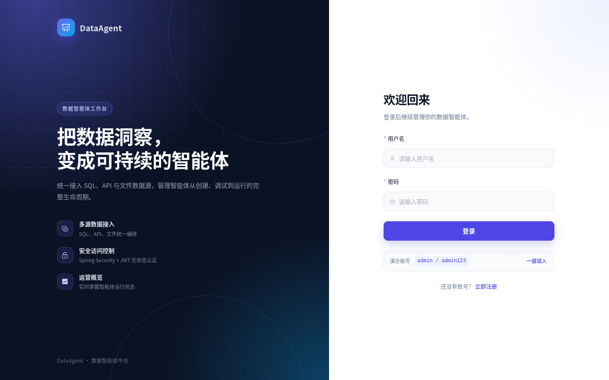
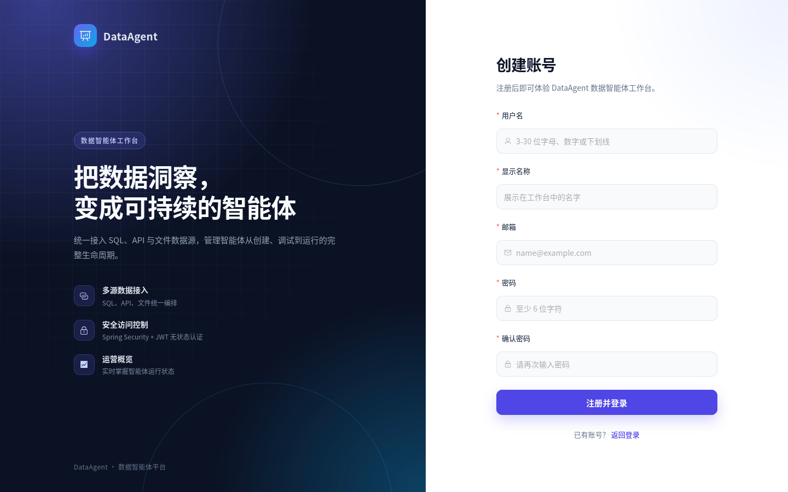
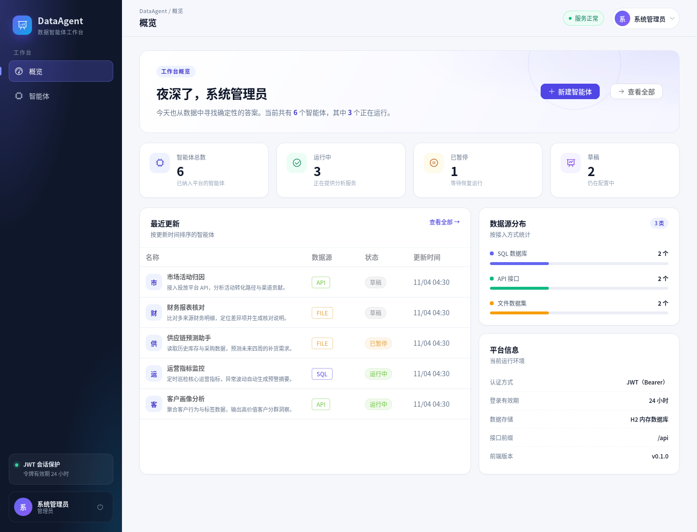
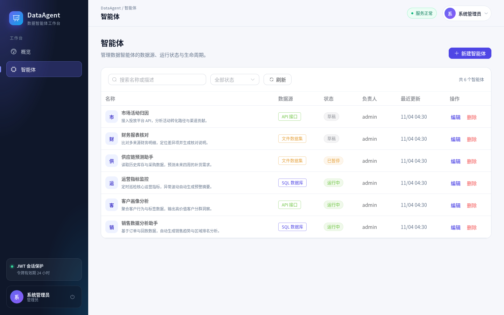
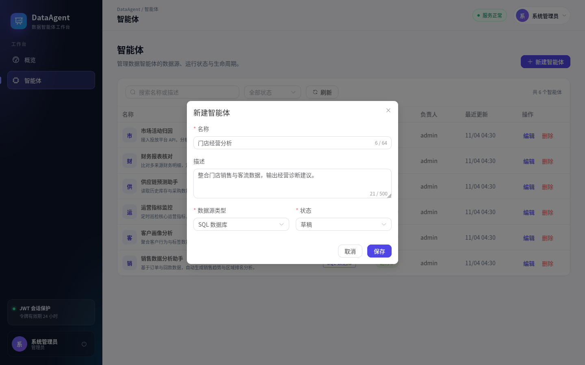
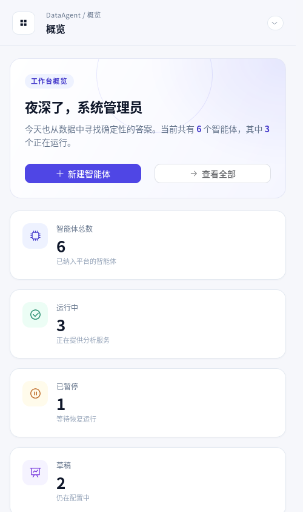

# DataAgent

DataAgent 是一个前后端分离的**数据智能体工作台**示例项目：前端提供登录注册、运营概览与智能体管理界面，后端提供基于 Spring Security + JWT 的无状态认证、智能体管理 API，以及基于 **AgentScope Java 2.0.x Harness** 的智能体运行时。

项目开箱即用：后端使用 H2 内存数据库并自动初始化演示数据，前端通过 Vite 代理访问后端，无需额外配置数据库即可本地运行。未配置大模型密钥时，管理功能不受影响，智能体对话接口会返回明确的“模型未就绪”提示。

## 功能特性

- **账号体系**：登录、注册、获取当前用户；JWT（Bearer）无状态认证，令牌默认 24 小时有效
- **角色权限**：`ADMIN` 可创建、编辑、删除智能体；`USER` 仅可查看
- **运营概览**：智能体总数、运行状态、数据源分布与最近更新
- **智能体管理**：列表、关键词搜索、状态筛选、新建、编辑、删除
- **Agent Harness**：基于 AgentScope Java 2.0.4 `HarnessAgent` 的对话运行时，支持多轮会话、会话恢复与平台只读查询工具
- **安全基线**：BCrypt 密码散列、统一 401/403 JSON 响应、参数校验、CORS 白名单；Harness 关闭 Shell、文件、Web 与子智能体能力
- **界面体验**：Vue 3 + Element Plus 中文界面，响应式布局，支持移动端

## 技术栈

| 端 | 技术 |
| --- | --- |
| 前端 | Vue 3.5、TypeScript、Vite 6、Element Plus 2、Pinia、Vue Router 4、Axios |
| 后端 | Java 17、Spring Boot 3.5.x、Spring Security、Spring Data JPA、JJWT、H2、AgentScope Java 2.0.4 Harness、Maven |

## 目录结构

```text
.
├── backend/                  # Spring Boot 后端
│   ├── pom.xml
│   └── src/
│       ├── main/java/com/huansi/dataagent/
│       │   ├── auth/         # 登录、注册、当前用户
│       │   ├── agent/        # 智能体领域与 CRUD API
│       │   ├── dashboard/    # 概览统计
│       │   ├── harness/      # AgentScope Harness 运行时、平台工具与对话 API
│       │   ├── security/     # JWT 生成/校验、认证过滤器
│       │   ├── config/       # Security、CORS、演示数据初始化
│       │   ├── user/         # 用户与角色
│       │   └── common/       # 统一响应与异常处理
│       ├── main/resources/application.yml
│       └── test/             # 认证、智能体 API 与 Harness 测试
├── frontend/                 # Vue 3 前端
│   ├── src/
│   │   ├── api/              # Axios 请求封装
│   │   ├── components/       # 登录/注册通用外壳
│   │   ├── layouts/          # 工作台布局
│   │   ├── router/           # 路由与登录守卫
│   │   ├── stores/           # Pinia 认证状态
│   │   ├── views/            # 登录、注册、概览、智能体
│   │   └── utils/
│   └── vite.config.ts        # 开发代理 /api -> localhost:8080
├── docs/screenshots/         # 界面截图
├── README.md
└── LICENSE
```

## 快速开始

### 环境要求

- JDK 17+
- Maven 3.9+
- Node.js 20.19+（推荐 22 LTS）与 npm 10+
- 可选：`DASHSCOPE_API_KEY`（启用 AgentScope Harness 对话时需要）

### 1. 启动后端

```bash
cd backend
mvn spring-boot:run
```

后端启动在 <http://localhost:8080>。H2 控制台：<http://localhost:8080/h2-console>（JDBC URL `jdbc:h2:mem:dataagent`，用户名 `sa`，密码为空）。

### 2. 启动前端

```bash
cd frontend
npm install
npm run dev
```

浏览器访问 <http://localhost:5173>。开发服务器已将 `/api` 代理到 `http://localhost:8080`，前端无需配置后端地址。

### 3. 使用演示账号登录

| 用户名 | 密码 | 角色 | 权限 |
| --- | --- | --- | --- |
| `admin` | `admin123` | 管理员 | 查看 + 新建/编辑/删除智能体 |
| `analyst` | `analyst123` | 普通用户 | 仅查看 |

也可以在登录页点击“一键填入”，或注册新账号（新账号默认角色为 `USER`）。

## 界面预览

| 登录 | 注册 |
| --- | --- |
|  |  |

| 概览 | 智能体管理 |
| --- | --- |
|  |  |

| 新建智能体 | 移动端概览 |
| --- | --- |
|  |  |

## Agent Harness

后端 `backend/src/main/java/com/huansi/dataagent/harness/` 基于 AgentScope Java 2.0.4 Harness 实现智能体运行时：

- 使用 `io.agentscope:agentscope-harness` 的 `HarnessAgent`，每次请求构建实例、结束后关闭；同一 `userId + sessionId` 通过 `InMemoryAgentStateStore` 恢复多轮上下文
- 为智能体注册两个只读平台工具：`list_data_agents`（按状态查询智能体）与 `get_platform_summary`（概览统计）
- 系统提示词由智能体名称、描述、数据源类型与状态生成
- 安全限制：`disableFilesystemTools()`、`disableShellTool()`、`disableWebTools()`、`disableSubagents()`，避免模型访问服务器文件/命令/外网或派生子智能体
- 默认模型为 `dashscope:qwen-plus`，由 AgentScope DashScope 扩展读取 `DASHSCOPE_API_KEY`；未配置密钥时对话接口返回 503，管理功能不受影响
- 会话状态保存在进程内，重启后清空；生产环境可替换为 Redis/数据库等分布式 `AgentStateStore`

启动带 Harness 的后端：

```bash
cd backend
export DASHSCOPE_API_KEY="sk-your-key"
mvn spring-boot:run
```

调用对话接口（普通用户也可调用）：

```bash
TOKEN=$(curl -s -X POST http://localhost:8080/api/auth/login \
  -H "Content-Type: application/json" \
  -d '{"username":"analyst","password":"analyst123"}' \
  | python3 -c "import sys, json; print(json.load(sys.stdin)['data']['token'])")

curl -s -X POST http://localhost:8080/api/agents/1/chat \
  -H "Authorization: Bearer $TOKEN" \
  -H "Content-Type: application/json" \
  -d '{"message":"平台上有哪些智能体？","sessionId":"demo-1"}'
```

## 配置说明

后端配置位于 `backend/src/main/resources/application.yml`，支持通过环境变量覆盖：

| 环境变量 | 默认值 | 说明 |
| --- | --- | --- |
| `SERVER_PORT` | `8080` | 后端端口 |
| `JWT_SECRET` | 开发环境默认密钥 | JWT 签名密钥，**至少 32 个字符**，生产环境必须覆盖 |
| `JWT_EXPIRATION` | `24h` | 令牌有效期，支持 `30m`、`24h` 等 Duration 格式 |
| `CORS_ALLOWED_ORIGINS` | `http://localhost:5173,http://127.0.0.1:5173` | 允许的前端来源，逗号分隔 |
| `DASHSCOPE_API_KEY` | 无 | AgentScope DashScope 模型密钥；启用对话接口时必填 |
| `AGENTSCOPE_MODEL` | `dashscope:qwen-plus` | Harness 模型标识，需存在对应的 AgentScope 模型扩展 |
| `AGENTSCOPE_WORKSPACE` | `data/harness-workspace` | Harness 工作目录（已加入 `.gitignore`） |
| `AGENTSCOPE_MAX_ITERS` | `6` | 单轮对话最大推理步数 |
| `AGENTSCOPE_TIMEOUT` | `90s` | 单次对话超时，支持 `30s`、`2m` 等 Duration 格式 |

示例：

```bash
JWT_SECRET="please-replace-with-a-random-64-char-secret-key-2026" \
CORS_ALLOWED_ORIGINS="https://dataagent.example.com" \
mvn spring-boot:run
```

> **部署提示**：前端与后端同域部署时，浏览器对 POST 请求仍会携带 `Origin` 头，请将 `CORS_ALLOWED_ORIGINS` 设置为实际访问域名（例如 `https://dataagent.example.com`）。

> **安全提示**：`JWT_SECRET`、`DASHSCOPE_API_KEY` 与演示账号仅用于本地体验。部署到生产环境前，请替换随机密钥、关闭或移除 H2 控制台，并改用 MySQL/PostgreSQL 等持久化数据库；Harness 默认关闭 Shell、文件、Web 与子智能体能力，请勿在未做隔离的情况下开启。

## API 一览

所有业务接口以 `/api` 为前缀，除登录、注册外均需在请求头携带 `Authorization: Bearer <token>`。

| 方法 | 路径 | 权限 | 说明 |
| --- | --- | --- | --- |
| `POST` | `/api/auth/login` | 公开 | 登录并返回 JWT |
| `POST` | `/api/auth/register` | 公开 | 注册并返回 JWT |
| `GET` | `/api/auth/me` | 已登录 | 当前用户信息 |
| `GET` | `/api/dashboard/summary` | 已登录 | 概览统计 |
| `GET` | `/api/agents` | 已登录 | 智能体列表，支持 `keyword`、`status` 参数 |
| `POST` | `/api/agents` | 管理员 | 创建智能体 |
| `PUT` | `/api/agents/{id}` | 管理员 | 更新智能体 |
| `DELETE` | `/api/agents/{id}` | 管理员 | 删除智能体 |
| `POST` | `/api/agents/{id}/chat` | 已登录 | 运行 AgentScope Harness，与智能体对话 |

统一响应结构：

```json
{
  "success": true,
  "message": "登录成功",
  "data": {
    "token": "eyJhbGciOiJIUzI1NiJ9...",
    "tokenType": "Bearer",
    "expiresIn": 86400,
    "user": {
      "id": 1,
      "username": "admin",
      "displayName": "系统管理员",
      "email": "admin@dataagent.local",
      "role": "ADMIN"
    }
  }
}
```

登录示例：

```bash
curl -X POST http://localhost:8080/api/auth/login \
  -H "Content-Type: application/json" \
  -d '{"username":"admin","password":"admin123"}'
```

## 构建与测试

### 后端

```bash
cd backend
mvn test        # 认证、智能体 API 与 AgentScope Harness 测试
mvn package     # 构建可执行 jar：target/dataagent-backend-0.1.0-SNAPSHOT.jar
java -jar target/dataagent-backend-0.1.0-SNAPSHOT.jar
```

Harness 测试使用确定性的 Stub Model 验证 `HarnessAgent` 的构建、调用与会话参数，不依赖外部大模型服务；真实模型调用需要设置 `DASHSCOPE_API_KEY`。

### 前端

```bash
cd frontend
npm run typecheck   # vue-tsc 类型检查
npm run build       # 类型检查并构建到 dist/
npm run preview     # 本地预览构建产物
```

前端构建产物为纯静态文件，部署时需将 `/api` 反向代理到后端服务。

## 许可证

[MIT](LICENSE)
