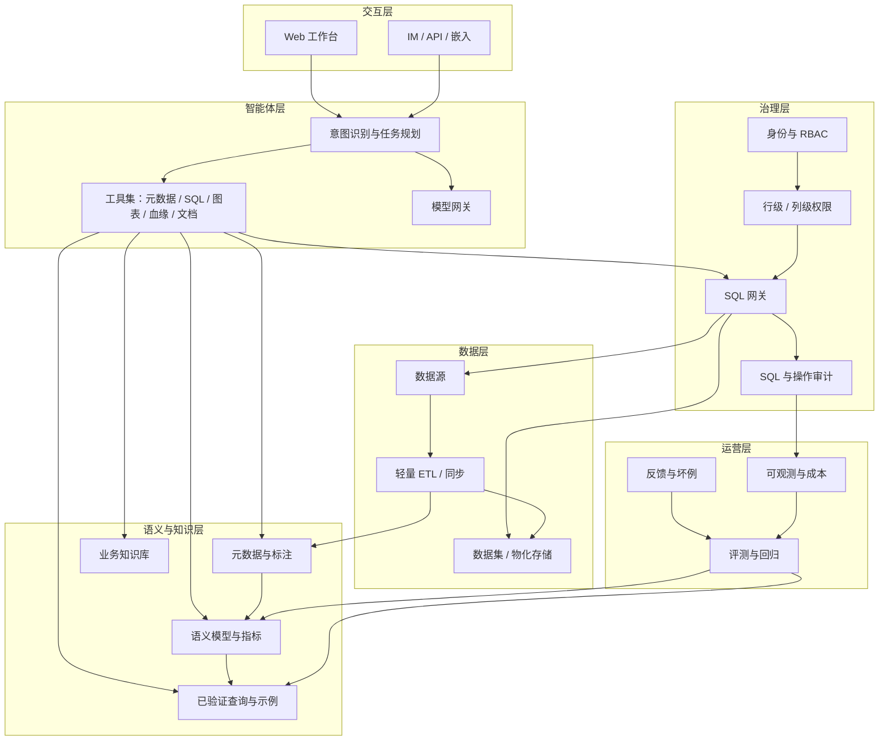

# 01 行业全景：DataAgent 主流功能与中小企业取舍

> 文档版本：v1.1（2026-11-04）  
> 适用对象：产品、研发、数据管理与业务负责人  
> 说明：本文基于公开产品资料与行业实践整理，重点回答“业内主流 DataAgent 到底包含哪些能力、哪些适合中小企业、哪些应当后置”。

## 1. 结论先行

1. **DataAgent 不是“给 BI 加一个聊天框”**。主流产品正在从“自然语言生成 SQL”升级为“以企业语义和元数据为上下文、能规划并调用多种工具的复合智能体”。
2. **决定可用性的不是模型，而是上下文工程**：表/字段注释、指标口径、同义词、示例 SQL、已验证查询、数据血缘与权限策略，共同决定回答是否准确、可解释、可审计。
3. **业内正在收敛为六层能力**：数据接入与准备、元数据与知识、语义与指标、智能分析、治理与安全、运营与评估。缺少任何一层，系统都难以从 Demo 走向生产。
4. **中小企业不应照搬大平台**。大而全的数据中台、复杂调度、实时湖仓、多智能体协同，对多数中小企业是过度建设；应保留“轻接入、强语义、可审计、能闭环”的最小组合。
5. **推荐定位**：面向中小企业的“轻量 DataAgent 工作台”——以现有业务数据库和 Excel 为主要数据源，以元数据/标注/语义层为可信基础，以会话式分析为入口，以 SQL 审计和细粒度权限为安全底线，以反馈评估驱动持续变准。

## 2. 概念演进与边界

| 形态 | 核心交互 | 主要能力 | 典型局限 |
| --- | --- | --- | --- |
| 传统 BI | 拖拽报表、看板 | 固定指标、可视化、订阅 | 需求排期长，业务无法自助追问 |
| ChatBI / 智能问数 | 自然语言问答 | NL2SQL、图表推荐、多轮追问 | 依赖表和字段质量，复杂口径易失真 |
| NL2SQL 工具 | 输入问题输出 SQL | Schema 理解、SQL 生成与纠错 | 只解决“生成”，不解决权限、审计、运营闭环 |
| DataAgent | 对话 + 任务 | 意图理解、规划、工具调用、执行、解释、沉淀 | 需要知识库、权限、评估与工程化支撑 |
| 通用 Copilot | 辅助人操作 | 代码补全、文档问答、报表生成 | 缺少企业数据语义与治理约束 |

本书所说的 DataAgent，指**面向企业结构化数据的分析型智能体**：用户用自然语言提出数据问题，系统结合元数据、语义、权限与历史知识进行规划，调用查询/图表/血缘/文档等工具，给出可解释、可追溯、受管控的答案，并能从反馈中持续优化。

与“数据开发 Agent”（自动建表、写 ETL、发布调度）相比，本书聚焦**数据分析与数据治理闭环**；数据开发 Agent 仅作为后续演进方向，不纳入首期范围。

## 3. 业内主流功能清单

按“数据 → 知识 → 分析 → 治理 → 运营”的链路，主流产品的能力可归纳为六层。下表同时给出中小企业的优先级建议（P0 首期必备、P1 二期、P2 后续）。

### 3.1 数据接入与准备

| 能力 | 说明 | 中小企业优先级 |
| --- | --- | --- |
| 多源连接 | MySQL、PostgreSQL、SQL Server、Oracle、ClickHouse、Doris、Excel/CSV、API | P0：MySQL/PostgreSQL/Excel；其余 P2 |
| 连接管理 | 连接测试、只读账号、SSL、超时、连接池、凭据加密 | P0 |
| Schema 探查 | 自动读取库表、字段、类型、主外键、注释、行数、样例数据 | P0 |
| 数据同步 | 全量/增量同步、字段映射、过滤、去重、类型转换 | P0：手动全量；P1：定时/增量 |
| 轻量 ETL | SQL 转换、简单 Join、派生字段、物化数据集、任务依赖 | P1 |
| 调度与运维 | Cron、重试、超时、失败告警、运行历史 | P1 |
| 数据质量 | 非空、唯一、范围、枚举、新鲜度、行数波动、质量报告 | P1 |
| 数据标注 | 表/字段业务名、描述、同义词、枚举含义、敏感级别、负责人 | P0 |
| 数据血缘 | 表级/字段级上下游、影响分析、覆盖率 | P1 |

**行业观察**：阿里云 DataWorks Data Agent 将数据集成、开发、运维、治理、分析封装为“专家套件”，并原生使用平台的元数据、血缘、调度与语义资产；腾讯云 WeData 把数据集成、开发、质量、数据地图、血缘与安全作为一站式 DataOps 能力。大厂的优势来自“平台资产打通”，中小企业则应反过来：**先有轻量资产，再做智能分析**，避免先建重型平台。

### 3.2 元数据与知识

| 能力 | 说明 | 中小企业优先级 |
| --- | --- | --- |
| 技术元数据 | 数据源、库、表、字段、类型、主外键、索引、行数、更新时间 | P0 |
| 业务元数据 | 业务名称、业务描述、所属域、标签、负责人、认证状态 | P0 |
| 数据字典 | 字段取值、枚举映射、单位、精度、示例值 | P0 |
| 业务术语表 | 术语定义、同义词、关联字段/指标、口径负责人 | P1 |
| 知识库 | 业务规则、指标口径文档、常见问答、制度文件 | P2 |
| 检索与推荐 | 按关键词/同义词检索表、字段、指标；推荐相关资产 | P0 |
| 资产评分 | 完整度、认证、新鲜度、使用热度、质量分 | P1 |
| 上下文注入 | 将命中的表、字段、指标、示例、规则注入模型上下文 | P0 |

**行业观察**：Databricks Genie 的 knowledge store 明确包含表/字段描述、同义词、Join 关系、SQL 表达式与提示匹配设置；Wren AI 把“Schema linking、值画像、歧义检测、生成轨迹、重试修复、评估”作为可靠性的六个支柱。这说明**元数据不是展示页，而是模型上下文的一部分**。

### 3.3 语义与指标

| 能力 | 说明 | 中小企业优先级 |
| --- | --- | --- |
| 语义模型 | 数据集、事实/维度、粒度、默认时间字段、Join 关系 | P0 |
| 维度 | 时间、地区、产品、客户、渠道等分析维度及层级 | P0 |
| 度量 | 求和、计数、去重计数、均值、比率等原子度量 | P0 |
| 指标 | 原子/派生/复合指标、计算公式、单位、格式、口径负责人 | P0 |
| 指标治理 | 指标唯一性、版本、审批、废弃、影响分析 | P1 |
| 已验证查询 | 高频问题的标准 SQL、参数、预期结果、维护人 | P1 |
| 语义编译 | 将“指标 + 维度 + 过滤”编译为受控 SQL | P0 |
| 同义词与业务口径 | “销售额/营收/GMV”等词映射到唯一指标 | P0 |

**行业观察**：数势科技明确把“NL2Semantics”与“NL2SQL”区分开：先理解指标语义和业务口径，再调用可信数据资产，以降低复杂多表场景的失真；Snowflake Cortex Analyst 通过 semantic views、verified queries 与 evaluations 提升可信度。**对中小企业，语义层不必做全，但核心指标必须先统一**。

### 3.4 智能分析

| 能力 | 说明 | 中小企业优先级 |
| --- | --- | --- |
| 意图识别 | 区分闲聊、元数据问答、数据查询、解释、追问、越权请求 | P0 |
| 澄清追问 | 缺时间范围、指标歧义、维度不明时主动提问 | P0 |
| 任务规划 | 将复杂问题拆成查询、对比、归因、图表等子任务 | P1 |
| NL2SQL / NL2Semantics | 生成受控 SQL 或基于语义编译查询 | P0 |
| SQL 自纠 | 语法/字段错误时最多重试 1–2 次，并解释失败原因 | P0 |
| 多轮会话 | 继承筛选、时间、维度；支持“再按区域拆开”等追问 | P0 |
| 图表推荐 | KPI、折线、柱状、饼图、明细表自动匹配 | P0 |
| 结果解读 | 结论 + 关键数字 + 口径 + 局限，而非只给一张表 | P0 |
| 归因/洞察 | 维度归因、因子归因、时间序列归因、相关性 | P2 |
| 报告生成 | 将分析结果组织为日报/周报/专题报告 | P2 |
| 预测/What-if | 趋势预测、情景模拟 | P2 |
| 多模态输入 | 语音、Excel、图片 | P2 |

**行业观察**：数势 SwiftAgent 强调“问数、归因、洞察、报告”的连续链路；阿里云 DataWorks ChatBI 提供从洞察、归因到行动建议的分析结果；Databricks Genie 的 Agent mode 会拆解复杂问题、执行多次查询并返回结构化报告。**首期不应追求“全自动分析师”，而应先做到“单问题答得准、可解释、可追问”**。

### 3.5 治理与安全

| 能力 | 说明 | 中小企业优先级 |
| --- | --- | --- |
| 身份认证 | 本地账号、JWT/会话、SSO/OIDC、LDAP | P0：本地账号；P2：SSO |
| 角色权限 | 平台管理员、数据管理员、分析师、只读用户 | P0 |
| 资源权限 | 数据源、数据集、表、字段、指标、智能体的授权 | P0 |
| 行级权限 | 按租户、区域、部门、负责人等自动过滤 | P1 |
| 列级权限 | 可见、脱敏、隐藏；脱敏规则可配置 | P0：L3/L4 默认策略；P1：自定义策略 |
| SQL 网关 | 只读校验、表白名单、自动加行级条件、行数/超时限制 | P0 |
| SQL 审计 | 全量记录 SQL、执行人、结果、耗时、风险级别 | P0 |
| 操作审计 | 登录、元数据变更、权限变更、导出、同步等留痕 | P1 |
| 敏感数据保护 | 敏感字段识别、脱敏、导出审批、数据不出域 | P0：识别/默认脱敏；P1：导出审批 |
| 访问审批 | 敏感数据集临时授权、到期回收 | P1 |
| 成本管控 | Token/查询配额、按用户/租户核算、限流 | P1 |
| 提示注入防护 | 数据/文档中的指令不进入系统提示；工具调用白名单 | P0 |

**行业观察**：阿里云 DataWorks Data Agent 明确“权限随调用者收敛、高危操作前置拦截、全程审计、数据不出域”；Snowflake、Databricks 均把语义层与权限体系统一在平台治理之下。**权限不是查询之后的过滤，而必须进入 SQL 生成与执行链路**。

### 3.6 运营、评估与交付

| 能力 | 说明 | 中小企业优先级 |
| --- | --- | --- |
| 用户反馈 | 点赞/点踩、原因分类、纠正 SQL、期望答案 | P0 |
| 坏例闭环 | 收集 → 归因 → 修复（元数据/语义/提示/模型/数据）→ 回归 → 关闭 | P1 |
| 评测集 | 领域问题集、标准 SQL/结果、难度、维护人 | P1 |
| 回归评测 | Schema/语义/提示/模型变更后自动跑分 | P1 |
| 质量指标 | 执行成功率、结果匹配率、人工采纳率、澄清率、P95 时延、单次成本 | P1 |
| 可观测性 | 会话轨迹、工具调用、Token、错误码、慢查询 | P1 |
| 分享与导出 | 只读分享、CSV/Excel/图片导出、权限校验 | P1 |
| 定时问数 | 将保存的问题按 Cron 定时执行，留存结果并通知 | P0 |
| 多平台推送 | 邮件、Webhook、IM、第三方平台 | P1：邮件/Webhook；P2：IM/第三方 |
| 定时报告 | 将结果组织为日报/周报并订阅 | P2 |
| 嵌入与 API | 将问数能力嵌入业务系统 | P2 |
| IM 集成 | 飞书/钉钉/企业微信中提问与接收结果 | P2 |

**行业观察**：阿里云 Data Agent 支持钉钉/飞书/企业微信，并与云端共享同一 Agent、权限与记忆；Databricks Genie 用 benchmarks 做评测，Wren AI 把 golden NL-SQL eval 作为开发流程的一部分。**没有评测与坏例闭环的 DataAgent，无法长期保持准确率**。

## 4. 代表性产品扫描

下表只提取与本书相关的“可借鉴能力”，不代表产品完整功能；公开资料会随版本变化。

| 产品/平台 | 定位 | 可借鉴能力 | 对本书的启示 |
| --- | --- | --- | --- |
| 阿里云 DataWorks Data Agent | 平台原生企业级数据智能体 | 八层架构、知识引擎、专家套件、自主规划、高危拦截、全程审计、IM 集成 | 语义/元数据/血缘/权限必须原生打通；高危操作要有人工确认 |
| 数势科技 SwiftAgent | 企业经营分析 Data Agent | NL2Semantics、指标语义层、归因洞察、报告生成、多模态输入 | 先统一指标口径，再谈自然语言；分析链路要覆盖“问数→归因→报告” |
| 观远数据（BI + 问数/洞察 Agent） | AI+BI 一站式分析平台 | BI、问数 Agent、洞察 Agent、DataFlow、指标中心、移动分析 | 中小企业更需要“开箱即用的分析体验”，而不是自建全套数据平台 |
| 北极九章 DataGPT | 对话式数据洞察 | 自然语言分析、语义理解、私有化部署 | 私有化与数据安全是中小企业（尤其制造/金融）的重要采购因素 |
| 网易数帆有数 ChatBI | 对话式 BI | 自然语言问数、指标口径、报表集成 | ChatBI 必须与既有报表/指标体系统一，避免“第二套口径” |
| 火山引擎 DataWind ChatBI | 智能数据洞察 | 智能问数、可视化、移动端 | 交互体验与图表自动匹配直接影响采纳率 |
| 腾讯云 WeData | 数据开发治理平台 | 数据集成、开发、质量、数据地图、血缘、安全 | 数据闭环的底座能力可参考，但中小企业应做“轻量版” |
| Databricks Genie Agents | Lakehouse 上的自然语言分析 | Knowledge store、Instructions、Example SQL、Trusted assets、Benchmarks、Agent mode | 上下文资产与评测是可靠性的核心；可信资产可绕过模型不确定性 |
| Snowflake Cortex Analyst | 结构化数据问答 | Semantic views、Verified queries、Evaluations、Cortex Agents | 语义视图 + 已验证查询是降低幻觉的有效组合 |
| Microsoft Fabric / Power BI Copilot | BI 中的 Copilot | 语义模型、自然语言问答、报表生成 | 语义模型质量决定 Copilot 效果；与 BI 资产复用 |
| ThoughtSpot Spotter | 搜索式/智能分析 | 语义层、Spotter AI 分析师、可视化与代码 Agent | 搜索式交互降低学习成本；语义层是跨表分析基础 |
| Wren AI（开源） | 开放语义层 + GenBI | MDL 语义模型、上下文检索、dry-plan、重试修复、Golden NL-SQL eval | 开源方案可作为语义层与评测机制的参考实现 |

## 5. 共性架构：六层 + 三个闭环

三个闭环：

1. **数据闭环**：接入 → 同步/ETL → 元数据 → 标注 → 语义/指标 → 血缘 → 分析消费 → 反馈 → 反哺元数据与语义。
2. **回答闭环**：问题 → 意图/澄清 → 检索上下文 → 生成/编译查询 → 权限校验 → 执行 → 图表/解读 → 展示 SQL 与口径 → 反馈。
3. **治理闭环**：身份/权限 → SQL 网关 → 审计 → 风险识别 → 审批/告警 → 策略优化 → 回归验证。

## 6. 关键趋势

1. **从 NL2SQL 到 NL2Semantics**：优先用指标、维度、语义模型约束生成空间，纯 SQL 生成作为探索兜底。
2. **复合 AI（Compound AI）**：不是单个大模型包打天下，而是检索、规划、SQL 编译、执行、校验、修复多组件协同。
3. **上下文资产化**：表/字段描述、同义词、示例 SQL、业务规则、已验证查询成为可版本化、可评测的资产。
4. **Agent 化的工作流**：从“一问一答”走向“拆解任务、调用工具、执行多步、输出报告”，但关键操作保留人工确认。
5. **治理前置**：权限、脱敏、审计、成本控制进入生成与执行链路，而不是事后补。
6. **评测常态化**：用领域评测集和线上反馈持续度量准确率、采纳率与成本。

## 7. 常见反模式

| 反模式 | 表现 | 后果 |
| --- | --- | --- |
| 只接模型，不做语义 | 把 Schema 直接塞进 Prompt，让模型自由写 SQL | 口径不一致、复杂问题失真、无法解释 |
| 一开始就做大平台 | 先建湖仓、调度、多租户、多智能体 | 周期长、成本高、业务迟迟用不上 |
| 没有权威口径 | 同一指标多个算法，谁都能改 | 同一个问题不同答案，失去信任 |
| 权限事后过滤 | 先查全量数据，再在应用层裁剪 | 数据已出库，存在泄露与越权风险 |
| 没有审计 | 只记录聊天，不记录 SQL 与结果 | 无法追责、无法复盘、无法满足合规 |
| 没有评测 | 靠 Demo 和感觉判断效果 | 模型/数据一变就退化，无法定位 |
| 过度 Agent 化 | 所有问题都多步规划、多次调用 | 慢、贵、不可控，简单问题复杂化 |
| 数据质量缺位 | 空值、重复、口径漂移无人管 | “AI 答错”本质是数据错 |

## 8. 对中小企业的取舍

### 8.1 典型约束

- 人员：通常 1–3 名兼职数据管理员，没有独立 AI 团队。
- 数据：1–5 个业务系统（ERP/CRM/进销存/财务），大量 Excel；表规模多在 10–500 张。
- 预算：希望按年付费或一次性轻量部署，无法承担重型平台与长期实施。
- 安全：不希望业务数据出企业边界，至少要求私有化/专有云与细粒度权限。
- 目标：快速让业务自己查到数，减少取数排队，而不是建设完整数据中台。

### 8.2 能力取舍（MoSCoW）

| 优先级 | 能力 | 理由 |
| --- | --- | --- |
| Must（首期） | 数据源连接、Schema 自动导入、表/字段标注、核心指标语义、单智能体会话、NL2SQL/语义查询、图表、SQL 审计、RBAC、列脱敏、反馈、定时问数任务 | 没有这些就无法“问得准、看得懂、管得住、跑得稳” |
| Should（二期） | 轻量 ETL、调度、质量规则、表/字段血缘、行级权限、已验证查询、评测集、坏例闭环、访问审批 | 形成数据与治理闭环，支撑规模化 |
| Could（三期） | 更多数据源、多平台推送、定时报告、分享/嵌入、IM、归因、预测、多租户、SSO | 提升覆盖与体验，但不阻塞首期价值 |
| Won't（本期不做） | 自研大模型、完整湖仓、实时流计算、复杂 DAG 调度、主数据管理、ML 训练平台、原生移动 App | 投入大、与中小企业核心痛点弱相关 |

### 8.3 四条设计原则

1. **轻**：模块化单体优先，默认不要求建仓；能虚拟查询就不物化，能配置就不写代码。
2. **准**：语义层 + 已验证查询 + 元数据上下文优先，纯 NL2SQL 只作探索兜底。
3. **安**：默认拒绝、最小权限、只读连接、SQL 网关、全量审计、敏感字段脱敏。
4. **闭环**：每个功能都要能回答“它如何让下一次回答更准/更安全/更快”，否则不做。

## 9. 对本书的输入

- 第 02 章将上述能力转化为**可验收的功能需求与非功能需求**，并明确首期边界。
- 第 03 章给出**轻量十模块架构**与关键流程，重点解决语义、权限、审计、反馈四个难点。
- 第 04 章给出**三期实施路径**，每期都能独立上线并形成最小闭环。

## 10. 参考资料

以下资料用于本文的能力归纳，产品能力以官方最新说明为准：

- [阿里云 DataWorks Data Agent 简介](https://help.aliyun.com/zh/dataworks/user-guide/new-data-agent)
- [数势科技 SwiftAgent 产品页](https://www.digitforce.com/product/sa/)
- [观远数据官网](https://www.guandata.com/)
- [网易有数 ChatBI 手册](https://youdata.163.com/index/manual/p/chatbi.html)
- [火山引擎 DataWind ChatBI](https://www.volcengine.com/product/datawind-chatbi)
- [腾讯云 WeData 产品页](https://cloud.tencent.com/product/wedata)
- [Databricks Genie Agents concepts](https://learn.microsoft.com/en-us/azure/databricks/genie-agents/concepts)
- [Snowflake Cortex Analyst](https://docs.snowflake.com/en/user-guide/snowflake-cortex/cortex-analyst)
- [ThoughtSpot BI Agents](https://www.thoughtspot.com/product/agents)
- [Wren AI 架构文档](https://docs.getwren.ai/oss/reference/architecture)
- [北极九章 DataGPT 产品介绍](https://datarc.cn/articles/arctic-data-releases-datagpt/)
