# 03 功能设计：轻量 DataAgent 的模块、数据与流程

> 文档版本：v1.1（2026-11-04）  
> 上游文档：[02 需求分析](02-requirements-analysis.md)  
> 下游文档：[04 分期实施方案](04-phased-delivery.md)  
> 说明：本文是功能与技术设计，不包含代码改动；示例 SQL/JSON 仅用于说明契约。

## 1. 设计原则与关键决策

### 1.1 五条原则

1. **语义优先，SQL 兜底**：核心问题走“指标 + 维度 + 过滤器”的语义编译；探索性问题才允许生成自由 SQL。
2. **权限进入执行链路**：不是查完再裁剪，而是在 SQL 生成后、执行前完成表/列/行级校验与改写。
3. **一切可追溯**：每次问答必须能还原“谁、在什么上下文、用了哪个指标、执行了什么 SQL、看到了什么结果”。
4. **轻量可运维**：模块化单体、一个元数据库、一个查询网关、一个调度器；不引入不必要的中间件。
5. **闭环可度量**：功能必须进入“数据闭环 / 回答闭环 / 治理闭环”之一，并有指标验证。

### 1.2 关键设计决策

| 编号 | 决策 | 理由 | 代价/缓解 |
| --- | --- | --- | --- |
| D1 | 模块化单体，而非微服务 | 中小企业团队小、流量低；单体部署简单、事务一致 | 模块边界要清晰；查询/Agent 可独立线程池，未来可拆分 |
| D2 | 语义层优先，纯 NL2SQL 仅作探索 | 降低口径漂移与幻觉，答案可解释 | 前期需要指标建模；用模板与自动建议降低工作量 |
| D3 | 所有查询走统一 SQL 网关 | 权限、限流、审计、脱敏只做一次 | 网关是单点；做无状态多实例与熔断 |
| D4 | 元数据/语义/血缘与业务库分离 | 不侵入业务系统；支持跨源 | 需要同步与新鲜度管理 |
| D5 | 默认虚拟查询，按需物化 | 避免强制建仓；首期成本低 | 大表/复杂 Join 慢；用物化数据集与缓存解决 |
| D6 | 审计“失败即拒绝” | 不能出现查了但没记录 | 审计库需高可用；用本地落盘缓冲兜底 |
| D7 | 行列权限在网关改写，不依赖数据库 RLS | 跨 MySQL/PostgreSQL 一致；策略可运营 | SQL 解析要覆盖方言；复杂 SQL 需限制 |
| D8 | 单智能体 + 工具，不做多智能体自治 | 可控、便宜、易调试 | 复杂任务分步引导；后续再引入规划器 |

## 2. 总体架构

### 2.1 逻辑架构

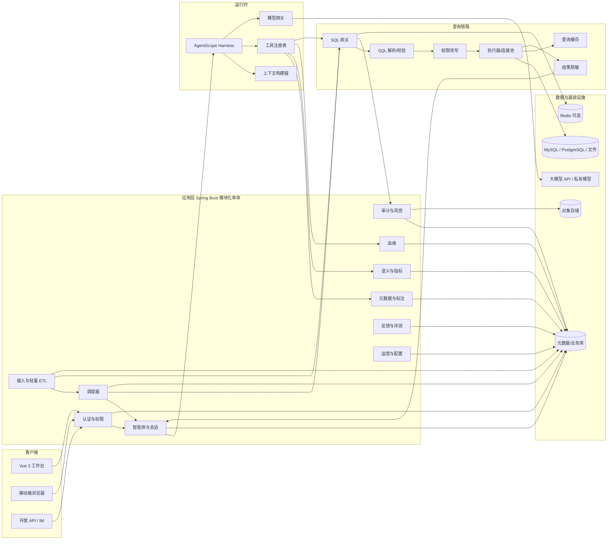

**关键点**：

- **应用层是模块化单体**：同一进程、同一数据库，模块间通过接口与领域事件解耦。
- **Agent 运行时与查询网关分离**：模型只负责理解、规划与组织答案；取数必须经过网关。
- **元数据库是唯一事实源**：数据源、元数据、语义、权限、审计、评测都在这里；业务数据仍在原系统。
- **对象存储可选**：导出文件、审计归档、大结果集；首期可用本地磁盘。

### 2.2 部署架构

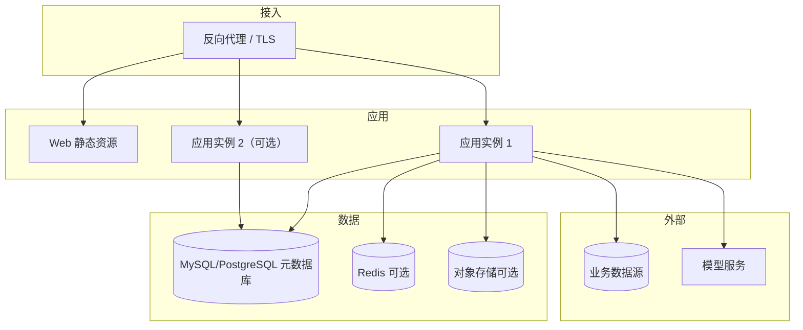

部署形态：

| 形态 | 适用 | 隔离方式 | 说明 |
| --- | --- | --- | --- |
| 单租户私有化 | 制造、金融、政企等对数据边界敏感的中小企业 | 独立部署、独立数据库 | 默认推荐；可离线/内网 |
| 专有云单租户 | 有云资源但要求隔离 | 独立 VPC/数据库 | 运维由客户或服务商托管 |
| SaaS 多租户（后续） | 小微企业、标准化场景 | `tenant_id` + 行级隔离；可选独立 schema | 需要配额、计费、跨租户防护 |

首期只做**单租户私有化**，多租户留到三期；但所有表预留 `tenant_id`，避免后期迁移。

### 2.3 模块清单

| 模块 | 职责 | 首期 | 关键依赖 |
| --- | --- | --- | --- |
| 认证与权限 | 登录、JWT、角色、资源授权、行/列策略 | ✅ | 用户、审计 |
| 数据接入 | 数据源、连接、Schema 导入、同步 | ✅ | 元数据、ETL |
| 轻量 ETL | SQL 转换、物化、调度、质量 | 二期 | 数据接入、血缘 |
| 元数据与标注 | 技术/业务元数据、标注、术语、检索 | ✅ | 数据接入 |
| 语义与指标 | 语义模型、维度、度量、指标、编译、验证查询 | ✅ | 元数据 |
| 血缘 | 表/字段血缘、图谱、影响分析 | 二期 | ETL、元数据 |
| 智能体与会话 | 会话、意图、规划、工具、答案 | ✅ | 语义、查询网关 |
| 定时任务 | 问数任务保存、Cron 调度、执行、结果快照、通知 | ✅（一期仅站内） | 会话、查询网关、权限、审计 |
| 查询网关 | 解析、校验、权限改写、执行、脱敏、缓存 | ✅ | 权限、审计 |
| 审计与风控 | SQL/操作审计、风险规则、告警 | ✅ | 查询网关 |
| 反馈与评测 | 反馈、坏例、评测集、回归 | 首期反馈 / 二期评测 | 会话、语义 |
| 运营与配置 | 看板、告警、模型、配额、系统配置 | 二期 | 全部 |

> 其中“认证与权限”“运营与配置”是支撑模块；核心功能模块为 10 个：数据接入、轻量 ETL、元数据与标注、语义与指标、数据血缘、智能体与会话、查询网关、审计与风控、反馈与评测、定时任务。

### 2.4 功能自闭环矩阵

每个核心模块都必须有“输入 → 处理 → 输出 → 反馈/下一环”，避免做成孤立功能页：

| 模块 | 输入 | 核心处理 | 输出 | 反馈/下一环 |
| --- | --- | --- | --- | --- |
| 数据接入 | 连接信息、源表 | 测试、探查、同步 | 数据集、表/字段元数据 | 生成标注任务；同步结果进入质量检查 |
| 轻量 ETL | 源表、转换配置 | 转换、物化、质量规则 | 目标数据集、质量结果 | 血缘解析；质量问题进入标注/修复 |
| 元数据与标注 | 技术元数据、业务知识 | 标注、审核、认证、检索 | 业务语义、上下文资产 | 进入语义建模与问答检索；坏例反哺标注 |
| 语义与指标 | 标注、指标口径 | 建模、编译、版本管理 | 受控指标查询、语义 SQL | 查询结果进入审计；口径问题进入指标治理 |
| 数据血缘 | ETL/SQL、配置、查询日志 | 解析、建图、影响分析 | 血缘图、影响清单 | 驱动 Schema 变更修复与回归评测 |
| 智能体与会话 | 问题、上下文、权限 | 意图、澄清、规划、工具调用 | 答案、图表、SQL、引用 | 反馈进入坏例；会话沉淀为已验证查询 |
| 查询网关 | SQL/结构化查询 | 校验、权限改写、执行、脱敏 | 结果集、审计记录 | 审计进入风控；失败进入错误分析 |
| 定时任务 | 保存的问题/查询语义/Cron | 调度、权限重校验、执行、快照 | 运行结果、通知、审计 | 失败告警/连续失败暂停；结果可推送（后续） |
| 权限与审计 | 身份、资源、策略 | 授权、改写、审计、风险识别 | 允许/拒绝、审计事件 | 风险驱动策略优化；审批到期回收 |
| 反馈与评测 | 点赞/点踩、评测集 | 归因、修复、回归 | 坏例状态、评测报告 | 发布门禁；修复进入元数据/语义/提示 |

> 这张表也是验收检查表：任一模块如果只有“输出”没有“反馈/下一环”，就说明闭环没有设计完整。

## 3. “轻量”的具体落地

| 维度 | 轻量做法 | 何时升级 |
| --- | --- | --- |
| 计算 | 不建湖仓；虚拟查询 + 按需物化到元数据库同实例 | 单表 > 5000 万行或复杂 Join 频繁超时 |
| 调度 | Spring Scheduler + 数据库租约；问数任务与 ETL 分队列，单机起步 | 多机、跨系统依赖、SLA 要求高时引入 Quartz 集群/专业调度 |
| 存储 | 一个 MySQL/PostgreSQL；可选 Redis | 会话/限流压力大时加 Redis |
| 消息 | 领域事件 + 本地事务表；不引入 Kafka | 多实例、异步任务量大时 |
| 搜索 | 数据库全文索引 + 关键词 + 同义词匹配 | 资产 > 1 万、语义检索效果不足时引入向量库 |
| 部署 | 2–3 个容器：web、app、db | 高可用时 app 多实例 + 负载均衡 |
| 多租户 | 单租户 + `tenant_id` 预留 | SaaS 化时启用行级隔离 |
| Agent | 单智能体 + 固定工具集 | 复杂任务需要多 Agent 时再拆分 |

## 4. 模块设计

### 4.1 数据接入与同步（DS）

#### 4.1.1 对象与状态

- **数据源（Datasource）**：一个数据库连接或文件集合。
- **数据集（Dataset）**：面向业务分析的一组表/视图，可来自一个数据源，也可跨源物化。
- **表（TableMeta）/字段（ColumnMeta）**：从数据源导入的技术元数据。

数据源状态：

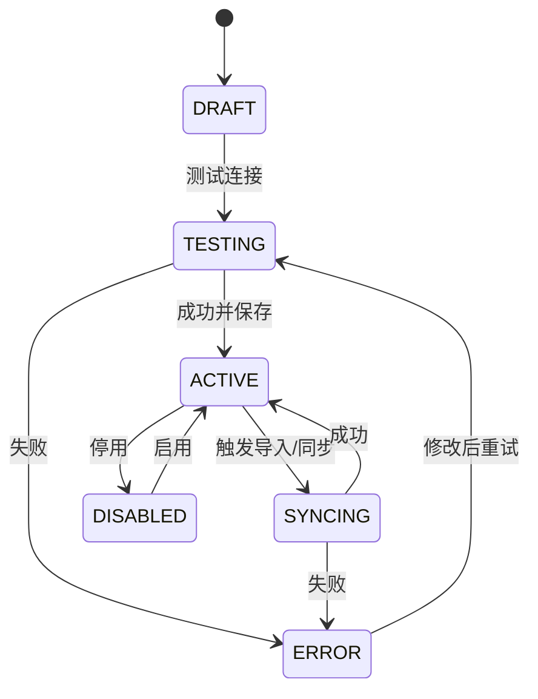

#### 4.1.2 接入流程

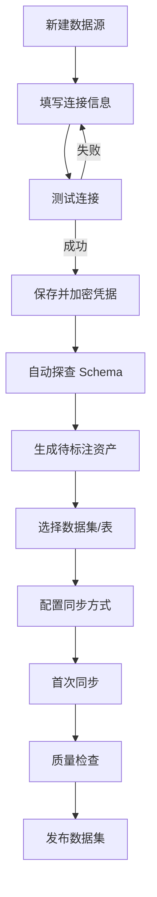

#### 4.1.3 关键规则

1. **只读优先**：连接测试时执行 `SELECT 1`，并检查账号是否具备写权限；检测到写权限时给出高风险警告，默认拒绝保存。管理员确需使用受限写账号时，必须在系统设置中显式开启并二次确认，网关仍强制只读、全量审计。
2. **凭据安全**：使用 AES-256-GCM 加密，主密钥来自环境变量/KMS；日志、接口响应、错误信息均不返回密码；支持轮换。
3. **Schema 探查**：
   - 读取 `information_schema` 或 JDBC metadata；
   - 获取表/字段、类型、主外键、注释、索引、行数（估算）；
   - 样例数据每表最多 100 行，L3/L4 字段默认脱敏；
   - 生成 `table_meta`、`column_meta`，与上次快照 diff。
4. **同步模式**：
   - 全量：分批读取（默认 5,000 行/批），写入 staging 表后原子切换；
   - 增量：时间戳/自增 ID 水位，幂等 upsert；
   - 手动/定时：Cron 最小 5 分钟；
   - 失败重试 3 次，指数退避；记录 `sync_run`。
5. **多源与跨源**：首期一个数据集只绑定一个数据源；跨源分析通过物化数据集在二期实现。
6. **文件数据源**：CSV/XLSX 上传后解析表头、推断类型、预览、确认后入库；单文件默认 ≤ 100MB、≤ 50 万行。

#### 4.1.4 页面

- 数据源列表：状态、类型、负责人、最近同步、表数量、操作。
- 新建/编辑抽屉：类型、主机、端口、库、账号、密码、SSL、超时、测试连接。
- Schema 导入结果：新增/变更/删除表，支持勾选。
- 数据集详情：表清单、字段、样例、标注状态、质量、血缘入口。

### 4.2 轻量 ETL 与数据质量（ETL）

#### 4.2.1 任务模型

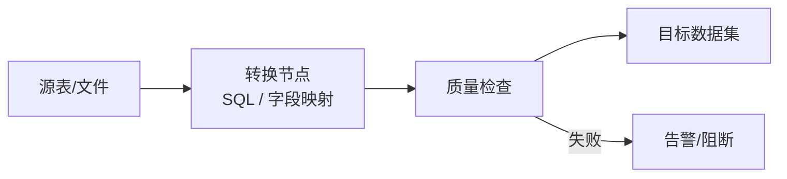

- **任务类型**：`SYNC`（同步）、`TRANSFORM`（SQL 转换）、`QUALITY`（质量检查）。
- **DAG**：ETL 首个版本只支持线性/单依赖；节点失败阻断下游；支持手动重跑与从失败节点恢复。
- **执行**：独立线程池（默认 2 并发）；预览限制 100 行/10 秒；正式运行超时 30 分钟；结果写入目标数据集。
- **版本**：任务配置版本化；发布前必须预览成功；回滚到上一版本。
- **写入隔离**：ETL 使用受控写入连接/内部存储，不经过面向用户的只读查询网关；写入任务仅数据管理员可创建/发布，运行与变更进入操作审计。
- **SQL 转换模板**：

```sql
-- 设计示例：订单宽表
SELECT
  o.order_id,
  o.customer_id,
  o.order_time,
  o.region,
  o.amount,
  c.customer_level,
  p.category
FROM ods_order o
LEFT JOIN dim_customer c ON o.customer_id = c.customer_id
LEFT JOIN dim_product p ON o.product_id = p.product_id
WHERE o.order_time >= :start_time
```

> 说明：这只是设计示例，不是本次交付的代码；实际由配置生成并受 SQL 网关校验。

#### 4.2.2 质量规则

| 类型 | 参数 | 失败动作 |
| --- | --- | --- |
| 非空 | 字段 | 告警/阻断 |
| 唯一 | 字段组合 | 告警/阻断 |
| 范围 | 字段、min/max | 告警 |
| 枚举 | 字段、允许值 | 告警 |
| 行数波动 | 表、阈值% | 告警 |
| 新鲜度 | 时间字段、最大延迟 | 告警/阻断 |

质量结果写入 `data_quality_result`，并在数据集卡片、问答答案中展示“质量/新鲜度”提示。认证数据集必须通过阻断级规则。

#### 4.2.3 页面

- 任务列表：状态、最近运行、耗时、负责人。
- 编辑器：源/目标、字段映射、SQL、质量规则、调度、告警。
- 运行历史：日志、输入/输出行数、失败原因、重跑。

### 4.3 元数据与标注（META）

> 本方案的“数据标注”指表/字段的业务语义标注（业务名、描述、同义词、枚举、敏感级别），不含机器学习训练集标注。

#### 4.3.1 元数据模型

| 对象 | 关键字段 | 说明 |
| --- | --- | --- |
| TableMeta | 数据源、schema、表名、类型、行数、注释、负责人、更新时间 | 技术元数据 |
| ColumnMeta | 表、字段名、类型、长度、可空、默认值、主键、注释、样例 | 技术元数据 |
| TableAnnotation | 业务名、描述、主题域、标签、敏感级别、认证状态 | 业务元数据 |
| ColumnAnnotation | 业务名、描述、同义词、枚举映射、单位、敏感级别 | 业务元数据 |
| GlossaryTerm | 术语、定义、同义词、关联资产、负责人 | 业务术语 |
| AnnotationTask | 对象、指派人、状态、截止时间、审核意见 | 标注工作流 |

#### 4.3.2 标注工作流

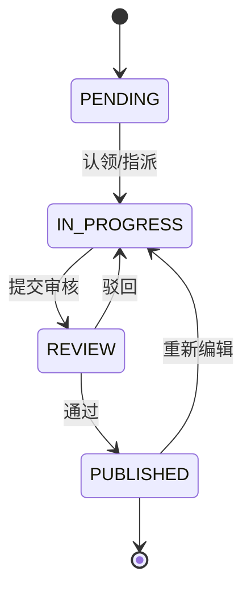

规则：

- 表/字段标注发布后进入检索与问答上下文；未发布标注不参与推荐。
- 首期（Phase 1）可先支持直接编辑发布；审核流与认证在二期启用。
- 敏感级别变更需要数据管理员确认；L3/L4 变更触发权限影响检查。
- 认证状态：`UNCERTIFIED` / `CERTIFIED` / `DEPRECATED`；认证需要完整度 ≥ 80%、质量通过、负责人确认。
- 标注质量分：完整度（30%）、准确度（人工抽检，30%）、新鲜度（20%）、使用热度（20%）。

#### 4.3.3 上下文构建

问答前，上下文构建器按以下顺序组装，严格控制 Token：

1. 用户问题中命中的表/字段/指标（关键词 + 同义词）；
2. 相关表的业务标注、字段注释、枚举、样例值；
3. 相关指标的公式、维度、时间字段；
4. Top 3–5 条已验证查询/示例 SQL；
5. 用户权限范围内的数据集清单摘要；
6. 业务规则/术语（如命中）。

Token 预算：系统提示 ≤ 2k，业务上下文 ≤ 6k，历史对话 ≤ 4k，工具结果 ≤ 4k；超出时按相关度截断，并记录“上下文截断”标记。

#### 4.3.4 标注工作台

- 左侧：数据集/表树，支持按“待标注、缺描述、L3/L4、低质量分”筛选。
- 中间：字段表格，列展示字段名、类型、业务名、描述、同义词、敏感级别、状态；支持批量填充、复制上一行、键盘上下切换。
- 右侧：字段详情与样例值（脱敏）、枚举映射、引用该字段的指标/智能体、变更历史。
- 底部：保存草稿、提交审核、发布；展示完整度评分与缺失项。
- 批量操作：按前缀/后缀匹配字段、套用模板、导入 CSV 词表；所有批量变更可撤销。


### 4.4 语义层与指标（SEM）

#### 4.4.1 语义模型结构

| 对象 | 关键字段 | 示例 |
| --- | --- | --- |
| SemanticModel | 名称、数据集、粒度、默认时间字段、状态、版本 | `sales_model` |
| Dimension | 名称、字段/表达式、类型、层级、同义词 | `region`、`order_month` |
| Measure | 名称、聚合方式、字段/表达式 | `sum(amount)` |
| Metric | 名称、类型、公式、单位、格式、维度、时间字段、负责人、版本 | `sales_amount` |
| Join | 左/右数据集、类型、条件、基数 | `order.customer_id = customer.id` |
| VerifiedQuery | 问题、参数、SQL、预期列、维护人、状态 | “上月华东销售额” |

指标类型：

- **原子指标**：直接聚合，如 `SUM(order.amount)`；
- **派生指标**：原子指标 + 过滤/维度，如“华东销售额”；
- **复合指标**：多个指标的运算，如“客单价 = 销售额 / 订单数”；
- **比率指标**：分子/分母，需处理分母为 0 与空值。

#### 4.4.2 语义编译

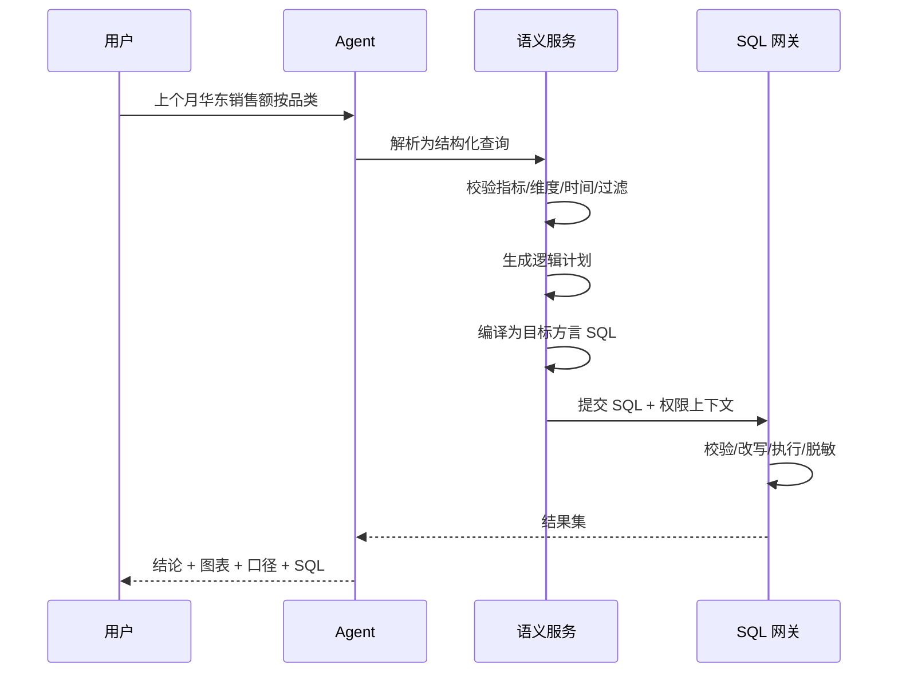

结构化查询示例（设计契约）：

```json
{
  "dataset": "sales_model",
  "metrics": ["sales_amount"],
  "dimensions": ["category"],
  "filters": [
    {"field": "region", "op": "=", "value": "华东"}
  ],
  "time": {
    "field": "order_date",
    "range": "last_month",
    "timezone": "Asia/Shanghai"
  },
  "order_by": [{"field": "sales_amount", "direction": "desc"}],
  "limit": 100
}
```

编译规则：

- 只允许已定义的指标/维度/过滤器；未知字段直接拒绝并给出候选。
- 时间范围统一转换为半开区间 `[start, end)`；周一开始；时区默认 `Asia/Shanghai`。
- Join 必须来自语义模型定义；多对多关系需显式声明，否则拒绝自动 Join。
- 比率指标先算分子/分母再相除，避免“先聚合再相除”的误差。
- 生成的 SQL 带 `/* trace_id */` 注释，便于审计关联。
- 相同语义查询生成稳定 SQL，便于缓存与回归。

#### 4.4.3 已验证查询

- 匹配优先级：精确问题/参数 → 同义问题 → 文本相似度 ≥ 阈值（资产规模大时可加向量）→ 语义编译 → 自由 SQL。
- 已验证查询必须绑定数据集、参数、预期列与维护人；执行前重新做权限校验。
- 失效条件：Schema 变更、指标版本变更、连续失败 3 次；失效后自动降级并通知维护人。
- 使用次数与最近验证时间进入资产评分。
- 指标版本变更后，历史消息保留原口径快照并标记“口径已更新”；新查询强制使用当前认证版本。

#### 4.4.4 指标建模页

- 数据集列表 → 语义模型画布：事实表、维度表、Join 关系、粒度、默认时间字段。
- 指标编辑器：名称、类型、公式、聚合、单位、格式、可用维度、时间字段、负责人、同义词。
- 右侧实时预览：选择维度/时间/过滤，展示生成的 SQL 与样例结果。
- 校验：同名冲突、循环引用、除零、Join 基数、未授权字段；错误定位到具体配置项。
- 版本与发布：保存草稿、提交审核、发布、对比版本、查看影响资产（报表/智能体/已验证查询）。


### 4.5 数据血缘（LIN）

#### 4.5.1 图模型

- **节点**：数据源、表、字段、ETL 任务、数据集、指标、智能体、报表。
- **边**：`READS`、`WRITES`、`DERIVES`、`USES`。
- **属性**：置信度（`PARSED` / `DECLARED` / `INFERRED`）、创建时间、来源、版本。

#### 4.5.2 采集方式

1. **SQL 解析**：解析 ETL/同步 SQL 的 `SELECT`/`INSERT`/`CREATE TABLE AS`，提取源表/目标表与字段映射。
2. **配置声明**：字段映射、数据集绑定、指标引用。
3. **运行时补充**：查询日志中出现但未声明的表关系，标记为 `INFERRED`，需人工确认。
4. **手工补充**：无法解析的存储过程/脚本，由数据管理员声明。

#### 4.5.3 影响分析

- 从变更节点向下游 BFS，默认深度 5，返回受影响的数据集、指标、智能体、报表、负责人。
- 变更类型：字段删除/类型变更/重命名/口径变更/任务下线。
- 影响等级：`HIGH`（认证指标/对外报表）、`MEDIUM`（内部数据集）、`LOW`（草稿）。
- 支持导出影响清单、通知负责人、创建修复任务。

#### 4.5.4 页面

- 图谱画布：节点按类型着色，支持上下游切换、路径高亮、深度滑块、节点详情。
- 影响分析：左侧变更对象，右侧影响清单与负责人。
- 覆盖率：按数据集统计“有上游/有下游/字段级覆盖”。

### 4.6 会话式分析 Agent（CHAT）

#### 4.6.1 会话模型

| 字段 | 说明 |
| --- | --- |
| session_id | 会话 ID |
| agent_id | 绑定的智能体 |
| user_id / tenant_id | 归属 |
| title | 自动生成/可编辑 |
| status | ACTIVE / ARCHIVED / DELETED |
| context_summary | 超过 N 轮后的摘要 |
| last_query_plan | 上次查询计划（指标、维度、过滤、时间） |
| data_version | 数据集/语义版本快照 |
| share_token | 只读分享令牌（可空） |

消息类型：`USER`、`ASSISTANT`、`TOOL`、`SYSTEM`。每条助手消息保存：文本、SQL、结构化结果、图表配置、引用资产、耗时、Token、反馈状态。

#### 4.6.2 问数主流程

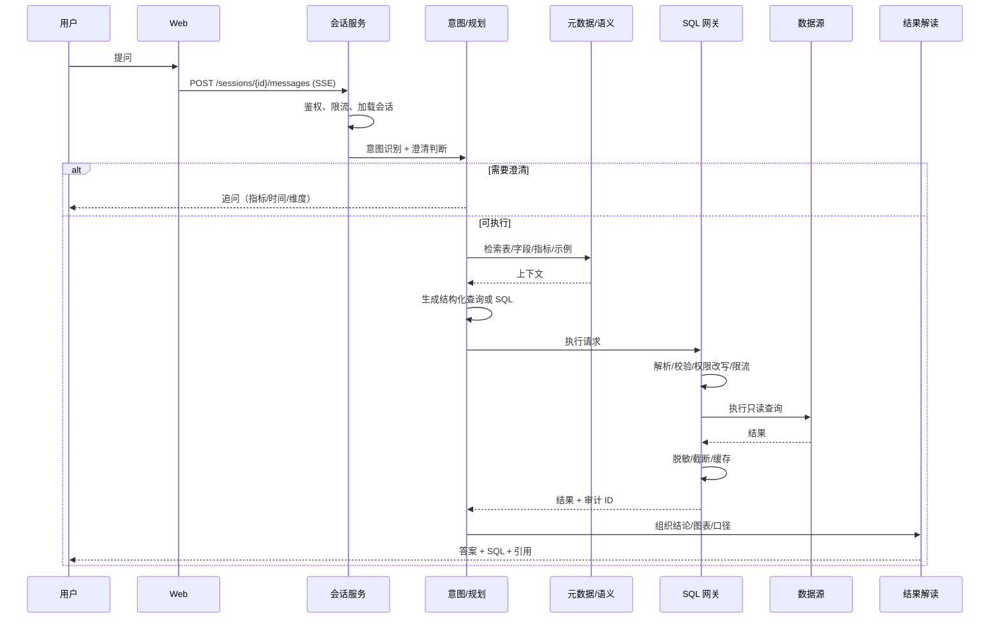

#### 4.6.3 意图与澄清

| 意图 | 示例 | 处理 |
| --- | --- | --- |
| `META` | “有哪些销售相关的表？” | 检索元数据，返回资产卡片 |
| `DATA` | “上月销售额多少？” | 语义编译/查询 |
| `EXPLAIN` | “为什么下降了？” | 先查数，再按维度拆解/解释 |
| `FOLLOWUP` | “按区域拆开” | 继承上下文，修改查询计划 |
| `DEFINITION` | “客单价怎么算？” | 返回指标定义、公式、负责人 |
| `CHITCHAT` | “你好” | 简短回应，引导提问 |
| `UNSAFE` | “删掉订单表” | 拒绝，说明只读边界 |

澄清触发条件：

- 指标歧义（同名/近义指标多个）；
- 时间范围缺失且问题依赖时间；
- 维度缺失但“下降/异常”无法定位；
- 数据源/数据集不唯一；
- 权限不足，需告知申请路径。

澄清最多 2 轮；仍不明确则给出可选问题列表，不猜测执行。

#### 4.6.4 查询生成策略

| 模式 | 触发 | 生成方式 | 权限 | 说明 |
| --- | --- | --- | --- | --- |
| 语义模式（默认） | 命中指标/维度 | LLM 输出结构化查询 → 编译器生成 SQL | 普通用户 | 可解释、可缓存、可回归 |
| 已验证查询 | 命中标准问题 | 参数替换 → 执行 | 普通用户 | 最可信，优先 |
| 探索模式 | 语义模式无法覆盖，用户有权限 | LLM 生成 SQL → 网关校验 | 分析师及以上 | 明确提示“探索结果”，记录风险 |
| 元数据模式 | 问表/字段/口径 | 不发 SQL | 普通用户 | 引用资产 |

#### 4.6.5 SQL 网关校验规则

按顺序执行，任一失败即拒绝：

1. **语法解析**：仅允许单条 `SELECT`/`WITH`；拒绝多语句、用注释切分/隐藏语句、`INTO OUTFILE`。
2. **语句类型**：拒绝 `INSERT/UPDATE/DELETE/DROP/ALTER/TRUNCATE/CREATE/GRANT/CALL` 等。
3. **对象解析**：解析所有表/字段；必须属于当前数据集且在用户授权范围内。
4. **列权限**：`HIDDEN` 列出现即拒绝；`MASKED` 列按策略处理。
5. **行权限**：按用户属性注入 `tenant_id/region/dept_id` 等谓词；与已有条件 `AND`。
6. **危险模式**：拒绝系统库、`information_schema`（白名单除外）、跨库查询、笛卡尔积（无 Join 条件且多表）、`SLEEP/BENCHMARK`、文件函数。
7. **成本与限制**：强制 `LIMIT`（默认 1,000，最大 5,000）；超时 30 秒；扫描行数/分区数超阈值需确认或拒绝。
8. **审计前置**：写入 `sql_audit_log`（状态 `RUNNING`），失败则拒绝执行。
9. **执行**：只读连接、事务只读、连接池隔离、取消机制。
10. **结果处理**：列脱敏、行数截断、大小限制（默认 10MB）、缓存。

#### 4.6.6 结果与答案

答案模板：

```text
结论：<1–3 句，含关键数字与对比>
依据：<表格/图表 + 数据来源 + 时间范围>
口径：<指标定义、过滤条件、维度、单位>
SQL：<可展开，带语法高亮与复制>
数据新鲜度：<最近同步时间>
局限：<样例数据、口径变更、权限范围等>
```

规则：

- 数字必须来自查询结果，模型不得改写/编造；对比基线需明确。
- 图表推荐：
  - 1 行 1 指标 → KPI 卡；
  - 时间序列 → 折线；
  - 类别对比 → 柱状；
  - 占比且类别 ≤ 6 → 饼图；
  - 明细/多列 → 表格；
  - 数据不足 → 只给表格并说明。
- 结果为空：说明可能原因（时间范围、过滤条件、权限），给出放宽建议。
- 敏感字段：展示“已脱敏”标识；导出前再次校验。
- 置信度：高（已验证查询/语义编译）、中（语义编译有歧义）、低（探索 SQL）；低置信度必须提示。

#### 4.6.7 多轮上下文

- 继承：时间范围、过滤条件、维度、排序、数据集。
- 修改：用户明确说“改成上月/加上华南/按品类”时覆盖对应字段。
- 重置：话题切换（意图分类变化 + 实体不重叠）时询问“是否开始新分析”。
- 摘要：超过 10 轮或 Token 超限时，将早期对话压缩为“已确认口径/筛选/结论”，保留最近 3 轮原文。
- 分享：只读链接携带会话快照，接收人看到的结果按接收人权限重新过滤；无权限的字段隐藏。

#### 4.6.8 错误处理

| 错误 | 处理 | 用户提示 |
| --- | --- | --- |
| SQL 语法/字段错误 | 最多自纠 2 次，把错误回传模型 | “第一次生成的 SQL 有字段不匹配，已自动修正/未能修正” |
| 权限不足 | 不执行；给出申请入口 | “你暂无该数据权限，可申请 7 天临时权限” |
| 超时 | 取消查询，返回已得部分/建议缩小范围 | “查询超过 30 秒，建议缩小时间范围或加过滤条件” |
| 数据源不可用 | 熔断，降级到物化数据集/缓存 | “数据源暂时不可用，以下为最近一次同步结果” |
| 模型不可用 | 关闭新问答，保留元数据/历史 | “智能问答暂不可用，你仍可浏览元数据与历史会话” |
| 结果过大 | 截断 + 提示导出/聚合 | “结果超过 1,000 行，已截断；可导出或加聚合” |
| 审计写入失败 | 拒绝执行 | “审计服务异常，查询已阻止” |

#### 4.6.9 前端会话页

- 左栏：会话列表（置顶/历史/搜索）、新建会话、智能体切换。
- 中栏：消息流；用户消息、助手答案、工具执行折叠、SQL 折叠、图表、反馈。
- 右栏：本次引用资产（表/字段/指标）、口径、血缘入口、权限提示。
- 底部：输入框、推荐问题、数据集/指标 @ 选择、探索模式开关（有权限才显示）。
- 移动端：单栏，图表全宽，SQL 折叠。

### 4.7 SQL 审计与风控（AUD）

#### 4.7.1 审计记录字段

| 字段 | 说明 |
| --- | --- |
| audit_id / trace_id | 唯一标识，贯穿问答与 SQL |
| tenant_id / user_id | 租户与用户 |
| session_id / message_id / agent_id | 会话上下文 |
| trigger_source / scheduled_task_id / scheduled_task_run_id | 触发来源（CHAT / SCHEDULED_TASK / API）与定时任务上下文 |
| datasource_id / dataset_id | 数据来源 |
| sql_text / sql_hash / normalized_sql | 原始、哈希、归一化 SQL |
| params_json | 参数（脱敏） |
| decision | ALLOW / DENY / REQUIRE_APPROVAL |
| risk_level / risk_rules | 风险级别与命中规则 |
| row_limit / timeout_ms | 执行限制 |
| started_at / finished_at / duration_ms | 时间 |
| row_count / result_size | 结果规模 |
| status / error_code | SUCCESS / FAILED / DENIED / TIMEOUT |
| result_preview | 脱敏后的前 N 行（可配置关闭） |
| client_ip / user_agent | 客户端 |
| model / prompt_tokens / completion_tokens / cost | 模型与成本 |
| policy_snapshot | 生效的权限策略版本 |

#### 4.7.2 写入与不可篡改

- 查询前写入 `RUNNING` 记录；执行后更新结果；拒绝也记录。
- 审计记录先落元数据库（状态 `RUNNING`），成功后再执行查询；审计写入失败则拒绝查询（fail closed）。跨数据源无法共享事务，因此以“先审计、后执行”保证不出现“查了没记”。
- 审计表只允许 `INSERT` 与状态更新，不提供业务删除接口；归档到对象存储时保留哈希链。
- 保留期默认 180 天，可配置 90–365 天；到期归档，删除需双人审批。

#### 4.7.3 风险规则

| 规则 | 触发 | 风险分 |
| --- | --- | --- |
| 全表扫描 | 无时间/分区过滤 + 大表 | +30 |
| 敏感列 | 访问 L3/L4 字段 | +25 |
| 越权尝试 | 请求未授权表/列 | +40 |
| 高频查询 | 1 分钟内 > 20 次 | +20 |
| 异常时段 | 非工作时间大量查询 | +10 |
| 大结果导出 | 导出行数 > 10,000 | +20 |
| 危险语句 | DDL/DML/文件函数 | +50（直接拒绝） |
| 跨租户 | 请求其他租户数据 | +50（直接拒绝） |

风险分 ≥ 70 为高风险，通知安全员；≥ 90 直接阻断并告警。规则可配置、可灰度、可误报标记。

#### 4.7.4 审计页面

- 列表：时间、用户、数据源、SQL 摘要、状态、耗时、行数、风险。
- 筛选：用户、时间、数据源、风险级别、状态、是否导出。
- 详情：完整 SQL、执行计划（可选）、结果预览（脱敏）、权限快照、关联会话。
- 操作：标记误报、导出（需审批）、通知负责人；不提供“修改/删除 SQL”。

### 4.8 权限与安全（PERM）

#### 4.8.1 权限模型

```text
Subject  = 用户 / 角色 / 用户组
Resource = 数据源 / 数据集 / 表 / 字段 / 指标 / 智能体 / 会话 / 审计
Action   = read / use / manage / export / approve
Condition= 行级策略 / 列级策略 / 时间范围 / IP / 租户
```

角色矩阵（目标态；Auditor 可在二期启用）：

| 能力 | Admin | Data Admin | Analyst | Viewer | Auditor |
| --- | --- | --- | --- | --- | --- |
| 用户/角色管理 | ✅ | — | — | — | — |
| 数据源/数据集管理 | ✅ | ✅ | — | — | — |
| 元数据/语义/血缘编辑 | ✅ | ✅ | — | — | — |
| 智能体管理 | ✅ | ✅ | — | — | — |
| 创建/管理定时任务 | ✅ | ✅ | ✅ | — | — |
| 使用智能体问数 | ✅ | ✅ | ✅ | ✅ | — |
| 探索模式 | ✅ | ✅ | ✅ | — | — |
| 导出 | ✅ | ✅ | ✅ | 按授权 | — |
| 审计查看 | ✅ | 部分 | — | — | ✅ |
| 审计导出/删除 | 双人审批 | — | — | — | — |
| 权限/审批 | ✅ | ✅ | — | — | — |

#### 4.8.2 有效权限计算

```text
effective(user, resource, action) =
  tenant_match
  AND role_allows(action)
  AND resource_grant(user/role, resource, action)
  AND agent_scope(agent, resource)        // 智能体范围
  AND row_policy(user, resource)          // 行级
  AND column_policy(user, resource)       // 列级
  AND time_window(now)                    // 临时授权
```

**取交集原则**：智能体范围不能扩大用户权限；用户权限也不能绕过智能体绑定。任一为拒绝，则拒绝。

#### 4.8.3 行级权限

策略模板示例：

```json
{
  "resource": "dataset:sales",
  "column": "region",
  "operator": "IN",
  "value_from": "user.attributes.regions",
  "effect": "ALLOW"
}
```

- 用户属性来自账号/组织架构：`tenant_id`、`region`、`dept_id`、`user_id`。
- 同一资源多条策略：`ALLOW` 之间取并集（OR），再与全局租户条件 `AND`。
- 默认拒绝：无策略时返回 0 行；如角色需要全量，必须显式配置 `ALL` 策略并留痕。
- 改写示例：

```sql
-- 原始
SELECT region, SUM(amount) FROM orders GROUP BY region;
-- 注入后
SELECT region, SUM(amount) FROM orders
WHERE tenant_id = :tenant_id AND region IN (:user_regions)
GROUP BY region;
```

#### 4.8.4 列级权限

| 策略 | 查询 | 结果 | 过滤/排序 |
| --- | --- | --- | --- |
| VISIBLE | 允许 | 原值 | 允许 |
| MASKED | 允许 | 按规则脱敏 | 默认禁止用于 WHERE/ORDER BY/GROUP BY（防推断） |
| HIDDEN | 拒绝 | — | — |

脱敏规则：全遮 `***`、部分遮（保留前 3 后 4）、哈希（SHA-256 + 盐）、置空。L3 默认部分遮，L4 默认隐藏。

#### 4.8.5 智能体数据范围

- 智能体绑定一个或多个数据集/指标；
- 用户使用智能体时，实际范围 = 用户授权 ∩ 智能体绑定；
- 智能体不能通过提示词/工具绕过范围；
- 智能体发布前做“权限影响检查”，列出会暴露的资产。

#### 4.8.6 访问申请

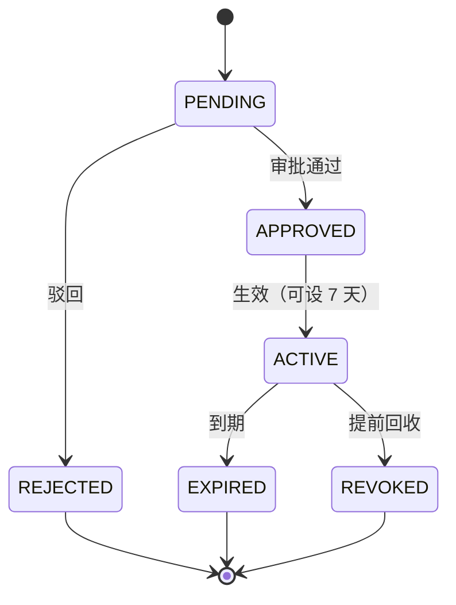

- 申请内容：数据集/字段、用途、时长、所需操作；
- 审批人：数据管理员；L4 需双人审批；
- 到期自动回收；所有查看/导出进入审计。

#### 4.8.7 密钥与租户隔离

- 数据源密码、模型 Key 使用 KMS/主密钥加密；不进入日志、Prompt、审计明文。
- 多租户：所有业务表带 `tenant_id`；查询网关强制注入；跨租户请求直接拒绝。
- 会话、缓存、导出文件按租户隔离；缓存 Key 包含租户与权限版本。
- 模型调用前做 PII 脱敏；可在配置中关闭“结果回传模型”。

#### 4.8.8 权限管理页

- 用户/角色：账号状态、角色、所属部门/区域、最近登录；支持禁用与重置密码。
- 资源授权：按数据源/数据集/表/字段/指标/智能体树形勾选；展示“用户授权 ∩ 智能体范围”的有效权限预览。
- 行/列策略：策略模板、适用范围、优先级、冲突检测；保存前展示改写后的 SQL 示例。
- 访问申请：待审批、已通过、已过期；支持批量审批、到期提醒、提前回收。
- 变更审计：谁在何时修改了哪条授权；高风险变更二次确认。


### 4.9 反馈、评估与运营（EVAL/OPS）

#### 4.9.1 反馈与坏例

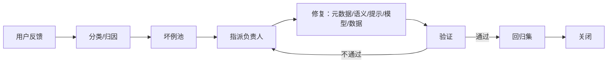

- 反馈原因：数据错、口径错、SQL 错、图表不合适、太慢、其他。
- 坏例字段：来源消息、问题、期望答案/SQL、根因分类、修复类型、负责人、状态、SLA。
- 修复类型对应动作：
  - 元数据：补注释/同义词/枚举；
  - 语义：修指标/维度/Join；
  - 提示：补规则/示例；
  - 模型：换模型/调参；
  - 数据：修 ETL/质量。

#### 4.9.2 评测集与回归

- 评测集：领域、问题、标准 SQL、预期结果（值/行集）、难度、维护人、版本。
- 指标：
  - 执行成功率 = 成功执行 / 总问题；
  - 结果匹配率 = 值与预期一致 / 总问题（数值容差可配）；
  - 语义匹配率 = 指标/维度/过滤一致；
  - 人工采纳率 = 点赞或未修改采纳 / 总回答；
  - 澄清率、平均轮次、P95 时延、单次成本。
- 回归触发：Schema 变更、指标版本、Prompt 变更、模型切换、权限策略变更。
- 发布门禁：评测通过率 ≥ 阈值（首期 70%，二期 85%），0 个 P0 安全问题；未通过阻断发布。

#### 4.9.3 运营看板

- 使用：DAU/WAU、提问量、会话数、活跃部门。
- 质量：执行成功率、采纳率、坏例趋势、Top 失败原因。
- 数据：数据源健康、同步失败、质量失败、新鲜度。
- 安全：高风险 SQL、越权尝试、导出量。
- 成本：Token、查询次数、单次成本、配额使用。

#### 4.9.4 评测与运营页

- 评测集：问题列表、标准 SQL/结果、难度、领域、维护人；支持导入导出、版本对比。
- 回归运行：选择评测集/模型/提示版本，展示通过率、失败明细、耗时与成本；支持按失败原因聚类。
- 坏例：看板按状态/根因/负责人分组；详情可直接跳转到对应会话、元数据或指标。
- 运营：使用趋势、Top 问题、失败原因、数据源健康、高风险 SQL、成本；支持导出周报。


### 4.10 定时任务（SCHED）

> 一期新增能力：把一次问数保存为定时任务，按 Cron 以任务所有者身份重新执行，保存结果并站内通知；多平台推送在二期/三期扩展。详细 DDL 与实现级设计见 [05 Phase 1 详细设计](05-detailed-design-phase1.md)。

#### 4.10.1 目标与边界

- **一期做**：从会话/自由问题创建任务、Cron 调度、手动试跑、暂停/恢复、结果快照、运行历史、站内通知、全量审计、权限重校验。
- **一期不做**：多接收人广播、邮件/Webhook/IM/第三方平台推送；这些在二期/三期通过 `channel` 与投递适配器扩展。
- **执行确定性**：任务保存“查询语义（结构化查询）或 SQL 快照”，运行时只做时间参数解析与重新编译，不在运行时让模型自由重写 SQL，避免口径漂移与不可控成本。
- **与 ETL 调度的关系**：共用调度基础设施，但使用独立任务表、队列与线程池；问数任务不阻塞 ETL，ETL 不占用问数配额。

#### 4.10.2 任务模型

| 对象 | 关键字段 | 说明 |
| --- | --- | --- |
| ScheduledTask | id、tenant_id、name、description、owner_id、agent_id、source_session_id、source_message_id、query_mode、question、query_spec、sql_snapshot、params_json、cron、timezone、start_at、end_at、status、misfire_policy、catch_up_minutes、timeout_seconds、max_retries、consecutive_failures、next_run_at、last_run_at、last_run_status、version | 任务定义与调度状态 |
| ScheduledTaskRun | id、task_id、scheduled_at、trigger_type、status、attempt、sql_text、query_spec、result_preview、result_ref、chart_json、row_count、data_freshness_at、duration_ms、error_code、error_message、trace_id、audit_id | 每次执行快照，追加写 |
| Notification | id、user_id、type、title、content、link、ref_type、ref_id、channel、status、read_at | 站内通知；渠道后续扩展 |

任务状态：

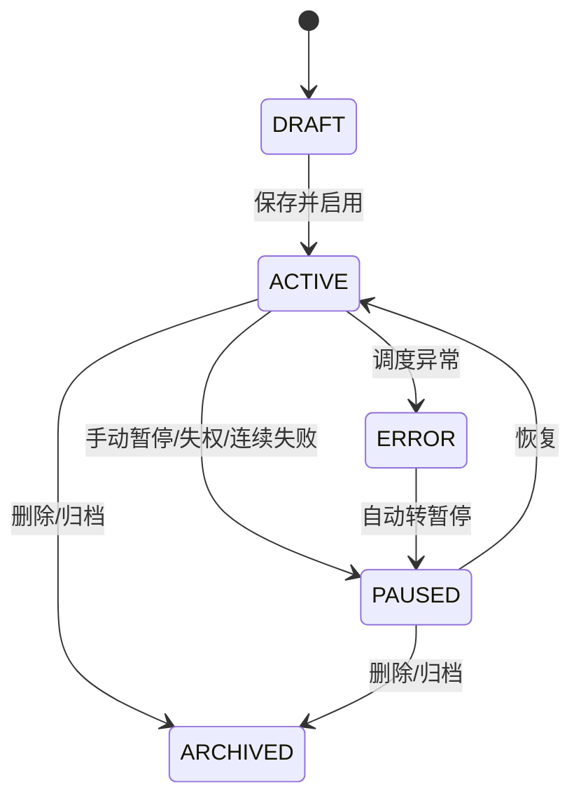

运行状态：`QUEUED → RUNNING → SUCCESS / FAILED / SKIPPED / CANCELED`。`SKIPPED` 用于错过补跑窗口、上一轮未结束或权限失效。

#### 4.10.3 调度引擎

- **调度方式**：数据库轮询 + 租约，不依赖单机内存 Cron。调度线程每 5 秒扫描 `status=ACTIVE AND next_run_at <= now()` 的任务。
- **抢占**：`SELECT ... WHERE ... FOR UPDATE SKIP LOCKED` 抢占，更新 `locked_by/locked_until`；单实例也按多实例安全设计。
- **计算下次时间**：按任务 `timezone` 用 `CronExpression.next` 计算；保存 UTC 时间，界面按任务时区展示。
- **幂等**：首次调度以 `task_id + scheduled_at + attempt` 唯一（attempt=1），重复调度插入冲突即忽略；重试显式 attempt+1。
- **错过补跑**：应用重启/停机后，`next_run_at` 已过且在 `catch_up_minutes`（默认 60）内补跑一次；更早的计划记为 `SKIPPED`，不无限补跑。
- **并发**：同一任务默认不允许并行，上一轮 `RUNNING` 时本轮 `SKIPPED`；问数任务线程池默认 2、队列 100。
- **手动执行**：`trigger_type=MANUAL`，不改变 `next_run_at`；用于创建后的“立即试跑”。
- **结束时间**：当前时间超过 `end_at` 后任务自动转 `ARCHIVED`，不再调度。

#### 4.10.4 执行流程

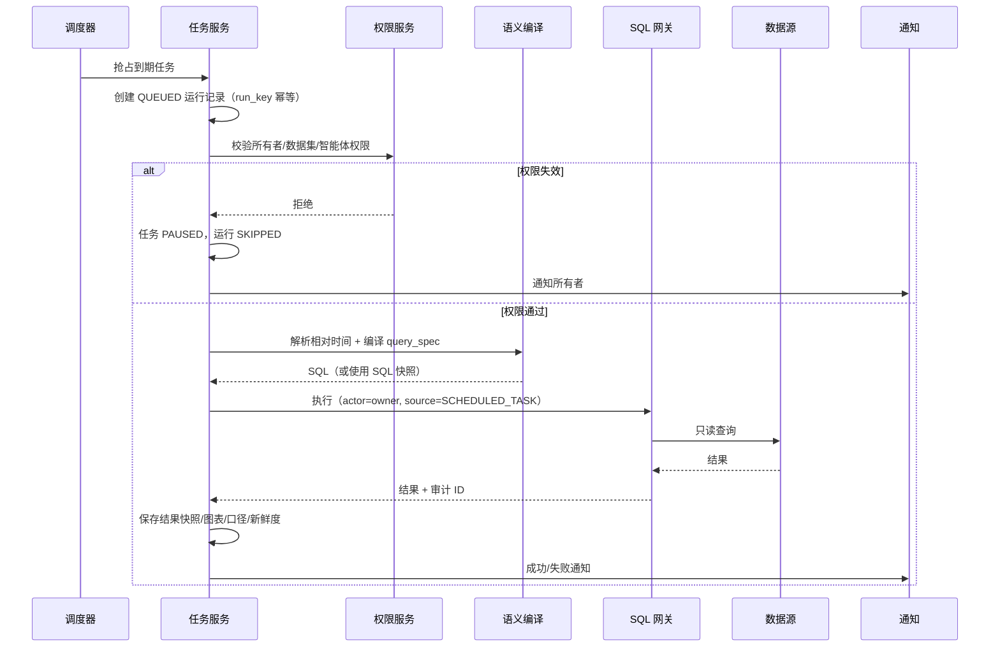

执行规则：

1. **相对时间**：`TODAY`、`YESTERDAY`、`LAST_7_DAYS`、`MTD`、`LAST_MONTH`、`YTD` 等在任务时区解析；执行前展示“本次时间范围”。
2. **语义任务**：保存 `query_spec`，运行时不调用大模型；语义编译器按当前指标版本生成 SQL。指标口径变更时，任务详情提示“口径已更新”，下次运行使用新版本并记录版本。
3. **探索任务**：保存 `sql_snapshot` 与参数白名单，运行前做同样的 SQL 网关校验；不允许运行时自由生成 SQL。
4. **结果快照**：默认保存前 1,000 行/1MB 到 `result_preview`；更大结果写对象存储并保存 `result_ref`；同时保存 SQL、图表配置、指标版本、数据新鲜度。
5. **审计**：`sql_audit_log` 记录 `scheduled_task_id`、`scheduled_task_run_id`、`trigger_source`（CHAT/SCHEDULED_TASK/API），执行人记为任务所有者。
6. **通知**：成功/失败都写 `notification`；连续失败额外告警管理员。

#### 4.10.5 权限规则

- 创建任务要求：可使用该智能体、可读任务涉及的数据集/指标、未超任务配额。
- 运行身份：任务所有者；不是“系统超级权限”。所有 SQL 仍走用户权限与租户隔离。
- 每次运行重新校验；所有者被停用、角色被回收、数据集授权过期时，任务转 `PAUSED`，不执行查询。
- 结果可见性：一期仅所有者可见；管理员可看任务元数据与运行状态，但查看结果仍需数据权限。
- 二期接收人：按接收人权限过滤结果；无权限的字段隐藏、无权限的数据集不投递，并记录投递审计。
- 任务转移：仅管理员可操作；转移后 `owner_id` 变更，下一次运行按新所有者权限执行，历史结果保留原所有者快照。

#### 4.10.6 失败与补偿

| 场景 | 处理 |
| --- | --- |
| 单次超时（默认 60s） | 取消查询，运行 `FAILED`，按退避重试 |
| SQL/语义编译失败 | 不重试（配置错误），运行 `FAILED`，通知所有者修正 |
| 数据源不可用 | 重试 3 次（1/5/15 分钟），仍失败则 `FAILED` |
| 连续 3 次失败 | 任务 `PAUSED`，通知所有者与管理员 |
| 上一轮未结束 | 本轮 `SKIPPED`，不并发 |
| 应用重启 | 恢复未完成任务；错过窗口按 `catch_up_minutes` 补跑 |
| 权限失效 | `PAUSED` + `SKIPPED`，不执行 |
| 结果过大 | 截断预览 + 对象存储，运行成功但标记 `truncated=true` |

#### 4.10.7 页面与交互

- **任务列表**：名称、所有者、智能体、频率、下次执行、最近状态、连续失败、操作（试跑/暂停/恢复/复制/删除）。
- **创建向导**：选择来源（会话/自由问题）→ 确认查询语义与时间口径 → 设置频率/时区/启停时间 → 预览未来 5 次 → 试跑 → 保存启用。
- **Cron 辅助**：预设“每天 09:00 / 每周一 09:00 / 每月 1 日 09:00 / 自定义”；自定义显示人类可读描述与未来 5 次时间。
- **详情页**：任务配置、查询语义、SQL、指标版本、运行历史、结果快照、通知记录、审计入口。
- **运行历史**：状态、计划时间、开始/结束、耗时、行数、错误码、重试次数、trace_id；支持查看结果与 SQL。
- **通知中心**：未读/已读、按任务筛选、跳转运行详情。
- **移动端**：列表与运行详情只读；创建/编辑桌面优先。

#### 4.10.8 接口

| 方法 | 路径 | 说明 |
| --- | --- | --- |
| POST | `/scheduled-tasks` | 创建任务（可带 `sourceSessionId`/`sourceMessageId`） |
| GET | `/scheduled-tasks` | 我的任务/管理员全部；按状态、所有者、智能体筛选 |
| GET | `/scheduled-tasks/{id}` | 任务详情 + 下次执行 + 最近运行 |
| PUT | `/scheduled-tasks/{id}` | 修改任务（版本+1，重新计算 next_run） |
| DELETE | `/scheduled-tasks/{id}` | 归档；停止调度 |
| POST | `/scheduled-tasks/{id}/run` | 立即试跑（不改变计划） |
| POST | `/scheduled-tasks/{id}/pause` | 暂停 |
| POST | `/scheduled-tasks/{id}/resume` | 恢复并重算下次时间 |
| GET | `/scheduled-tasks/{id}/runs` | 运行历史（分页） |
| GET | `/scheduled-task-runs/{runId}` | 运行详情（结果、SQL、审计） |
| GET | `/notifications` | 站内通知列表 |
| POST | `/notifications/{id}/read` | 标记已读 |

#### 4.10.9 验收要点

1. 从会话创建“每天 09:00”任务，未来 5 次时间正确；试跑不改变计划。
2. 到点自动执行，审计中可查到 `scheduled_task_id`、`scheduled_task_run_id`。
3. 同一计划时间重复调度只产生一条运行记录。
4. 所有者被停用/失权后，下一次运行不执行，任务暂停并通知。
5. 数据源故障触发重试；连续 3 次失败自动暂停。
6. 应用重启后，错过窗口内的任务补跑一次，更早的记 `SKIPPED`。
7. 结果快照包含 SQL、图表、口径、数据新鲜度；超过 1MB 走对象存储。
8. 站内通知 1 分钟内到达；标记已读不影响任务。
9. 删除任务后不再产生新运行；历史运行仍可审计。
10. 定时任务线程池占满时，在线问答不受影响。

### 4.11 前端信息架构

| 一级菜单 | 页面 | 主要用户 |
| --- | --- | --- |
| 概览 | 运营首页、快捷入口 | 全部 |
| 智能问答 | 会话页、历史、分享 | 业务/分析师 |
| 定时任务 | 任务列表、编辑器、运行历史、通知 | 分析师/管理员 |
| 数据接入 | 数据源、数据集、同步任务 | 数据管理员 |
| 数据准备 | ETL 任务、质量规则、运行历史 | 数据管理员 |
| 元数据 | 资产目录、标注工作台、术语表 | 数据管理员/分析师 |
| 语义指标 | 语义模型、指标、已验证查询 | 数据管理员 |
| 数据血缘 | 图谱、影响分析、覆盖率 | 数据管理员/安全 |
| 审计风控 | SQL 审计、操作审计、风险告警 | 安全/管理员 |
| 权限管理 | 用户、角色、授权、访问申请 | 管理员 |
| 评测运营 | 评测集、回归、坏例、质量看板 | 数据管理员/产品 |
| 系统设置 | 模型、配额、脱敏、保留期、公告 | 管理员 |

交互原则：管理页面桌面优先；问答页移动端可用；所有危险操作二次确认；空状态给出下一步；错误提示包含“发生了什么/为什么/怎么办”。

## 5. 核心数据模型

### 5.1 核心 ER 图

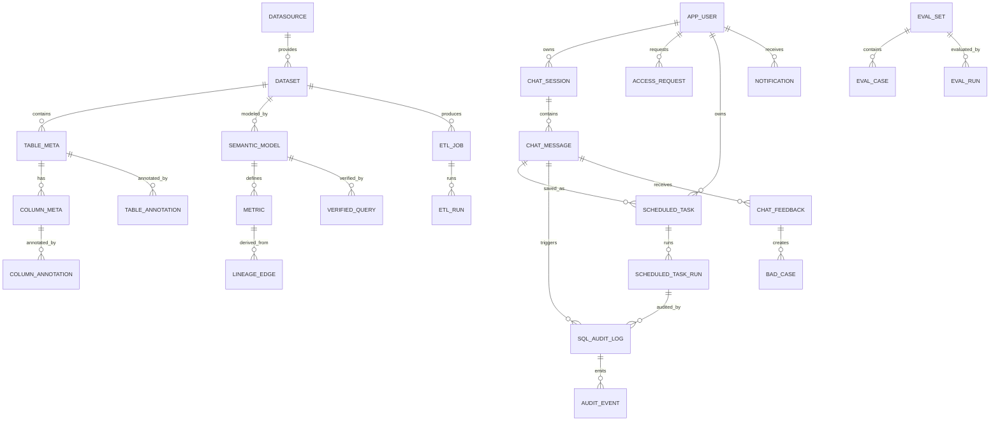

### 5.2 主要表清单

| 分组 | 表 | 关键字段 | 期次 |
| --- | --- | --- | --- |
| 身份权限 | `app_user` | id, tenant_id, username, password_hash, display_name, role, enabled | 1 |
| 身份权限 | `role` / `user_role` | code, name；user_id, role_id（自定义角色时启用） | 3 |
| 身份权限 | `permission_grant` | subject_type, subject_key, resource_type, resource_id, action, effect, expires_at | 1 |
| 身份权限 | `row_policy` | resource, column, operator, value_from, effect | 2 |
| 身份权限 | `access_request` | requester, resource, reason, status, approver, expires_at | 2 |
| 数据接入 | `datasource` | id, tenant_id, type, host, port, database, credential_cipher, status | 1 |
| 数据接入 | `dataset` | id, datasource_id, name, description, owner, status, freshness_at | 1 |
| 数据接入 | `table_meta` | id, dataset_id, schema_name, table_name, row_count, comment | 1 |
| 数据接入 | `column_meta` | id, table_id, column_name, data_type, nullable, comment, sample | 1 |
| 数据接入 | `sync_job` / `sync_run` | mode, schedule, watermark；status, rows, error | 1/2 |
| 数据准备 | `etl_job` / `etl_run` | config_json, schedule, status；started_at, rows, error | 2 |
| 数据准备 | `data_quality_rule` / `data_quality_result` | type, target, threshold；passed, detail | 2 |
| 元数据 | `table_annotation` / `column_annotation` | business_name, description, synonyms, sensitivity, status | 1 |
| 元数据 | `glossary_term` | term, definition, synonyms, owner | 2 |
| 元数据 | `annotation_task` | object_type, object_id, assignee, status, comment | 2 |
| 语义 | `semantic_model` | dataset_id, grain, default_time_field, version, status | 1 |
| 语义 | `dimension` / `measure` | name, expression, type, hierarchy | 1 |
| 语义 | `metric` | name, type, formula, unit, format, owner, version, status | 1 |
| 语义 | `metric_version` | metric_id, version, formula, status, published_at | 1 |
| 语义 | `verified_query` | question, params, sql, expected_columns, owner, status | 2 |
| 血缘 | `lineage_node` / `lineage_edge` | type, ref_id；from, to, kind, confidence | 2 |
| 会话 | `chat_session` | user_id, agent_id, title, status, context_summary | 1 |
| 会话 | `chat_message` | role, content, sql, result_json, chart_json, trace_id, tokens | 1 |
| 会话 | `chat_feedback` | message_id, rating, reason, corrected_sql, comment | 1 |
| 定时任务 | `scheduled_task` | owner_id, agent_id, query_spec, cron, timezone, status, next_run_at | 1 |
| 定时任务 | `scheduled_task_run` | task_id, scheduled_at, trigger_type, status, result_preview, audit_id | 1 |
| 通知 | `notification` | user_id, type, title, ref_type, ref_id, channel, status | 1 |
| 推送 | `scheduled_task_recipient` / `delivery_channel` / `delivery_record` | task_id, recipient, channel；config；status | 2 |
| 租户 | `tenant` | code, name, plan, status | 3 |
| 审计 | `sql_audit_log` | 见 4.7.1 | 1 |
| 审计 | `audit_event` | event_type, actor, object, before/after, ip | 2 |
| 评测 | `eval_set` / `eval_case` | name, domain；question, expected_sql, expected_result | 2 |
| 评测 | `eval_run` / `eval_result` | set_id, model, prompt_version；passed, diff | 2 |
| 评测 | `bad_case` | message_id, category, root_cause, fix_type, assignee, status | 2 |
| 智能体 | `data_agent`（现有） | name, description, data_source_type, status, owner | 1 |
| 智能体 | `agent_dataset` | agent_id, dataset_id, scope | 1 |
| 系统 | `model_provider` / `system_config` | type, endpoint, key_cipher；key, value | 1/2 |

> 现有 `data_agent` 表已存在，设计上做**增量扩展**：新增 `agent_dataset`、`agent_policy` 等关联表，不破坏现有字段。

## 6. 关键流程

### 6.1 问数主流程（含权限与审计）

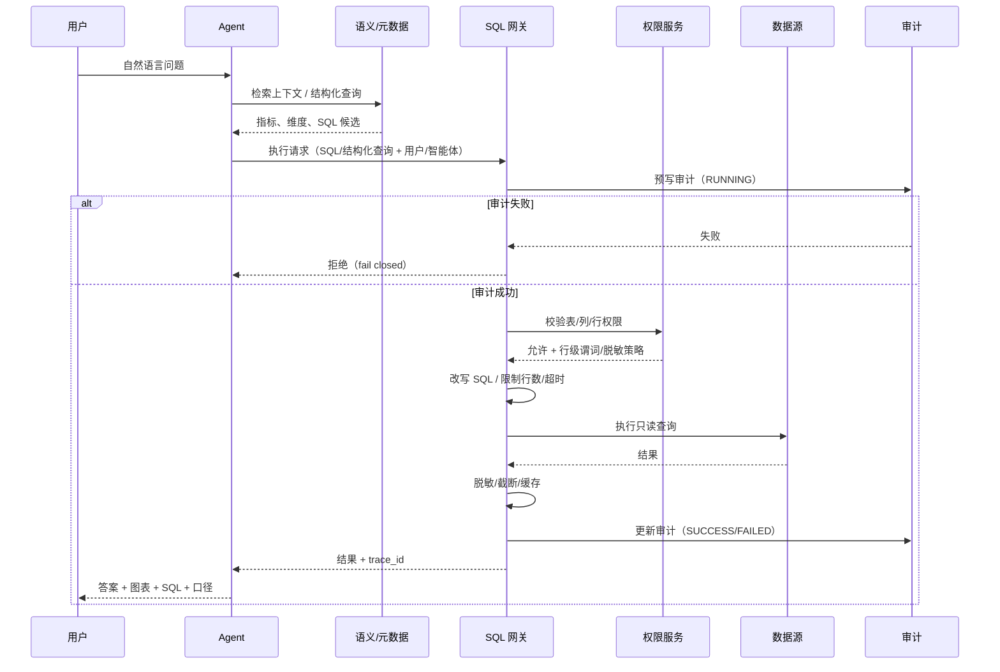

### 6.2 数据接入到发布

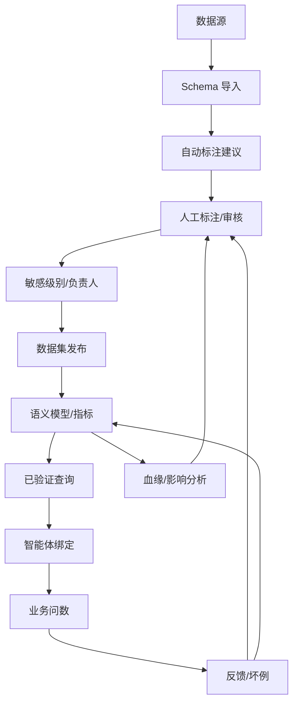

### 6.3 权限校验与 SQL 改写

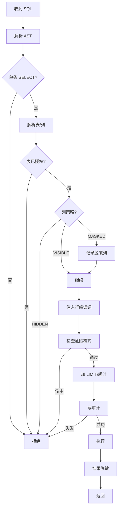

### 6.4 反馈闭环


### 6.5 定时任务执行

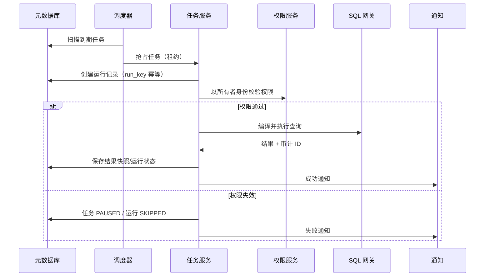

## 7. 接口设计

### 7.1 约定

- 基础路径 `/api`；除登录/注册外均需 `Authorization: Bearer <token>`。
- 统一响应：`{ "success": true, "message": "...", "data": ... }`。
- 分页：`page`、`size`、`sort`；默认 20，最大 100。
- 幂等：创建类接口支持 `Idempotency-Key`；查询类支持 `trace_id`。
- 错误码：`400` 参数/语义错误、`401` 未认证、`403` 无权限、`404` 不存在、`409` 冲突、`429` 限流、`500` 内部错误、`503` 模型/数据源不可用。
- 流式：问答使用 SSE；事件类型见 7.3。

### 7.2 主要接口

| 模块 | 方法 | 路径 | 说明 |
| --- | --- | --- | --- |
| 认证 | POST | `/auth/login` | 登录（现有） |
| 认证 | POST | `/auth/register` | 注册（现有） |
| 认证 | GET | `/auth/me` | 当前用户（现有） |
| 数据源 | GET/POST | `/datasources` | 列表/创建 |
| 数据源 | POST | `/datasources/{id}/test` | 测试连接 |
| 数据源 | POST | `/datasources/{id}/introspect` | 导入/刷新 Schema |
| 数据源 | POST | `/datasources/{id}/sync` | 触发同步 |
| 数据集 | GET/POST | `/datasets` | 列表/创建 |
| 数据集 | GET | `/datasets/{id}/tables` | 表清单 |
| 元数据 | GET | `/metadata/search` | 资产检索 |
| 元数据 | PATCH | `/tables/{id}/annotation` | 表标注 |
| 元数据 | PATCH | `/columns/{id}/annotation` | 字段标注 |
| 元数据 | POST | `/annotations/{id}/review` | 审核 |
| ETL | GET/POST | `/etl/jobs` | 任务列表/创建 |
| ETL | POST | `/etl/jobs/{id}/run` | 手动运行 |
| ETL | GET | `/etl/runs` | 运行历史 |
| 语义 | GET/POST | `/semantic/models` | 语义模型 |
| 语义 | GET/POST | `/metrics` | 指标 |
| 语义 | PUT | `/metrics/{id}` | 更新指标（版本+1） |
| 语义 | GET/POST | `/verified-queries` | 已验证查询 |
| 血缘 | GET | `/lineage/graph` | 图谱（节点/边） |
| 血缘 | POST | `/lineage/impact` | 影响分析 |
| 智能体 | GET/POST | `/agents` | 现有 |
| 会话 | POST | `/agents/{id}/sessions` | 新建会话 |
| 会话 | GET | `/sessions` | 我的会话 |
| 会话 | GET | `/sessions/{id}` | 会话详情 |
| 会话 | POST | `/sessions/{id}/messages` | 发送消息（SSE） |
| 会话 | POST | `/messages/{id}/feedback` | 反馈 |
| 会话 | POST | `/sessions/{id}/share` | 生成只读分享 |
| 定时任务 | GET/POST | `/scheduled-tasks` | 列表/创建 |
| 定时任务 | GET/PUT/DELETE | `/scheduled-tasks/{id}` | 详情/修改/归档 |
| 定时任务 | POST | `/scheduled-tasks/{id}/run` | 立即试跑 |
| 定时任务 | POST | `/scheduled-tasks/{id}/pause` | 暂停 |
| 定时任务 | POST | `/scheduled-tasks/{id}/resume` | 恢复 |
| 定时任务 | GET | `/scheduled-tasks/{id}/runs` | 运行历史 |
| 定时任务 | GET | `/scheduled-task-runs/{runId}` | 运行详情 |
| 通知 | GET | `/notifications` | 站内通知 |
| 通知 | POST | `/notifications/{id}/read` | 标记已读 |
| 审计 | GET | `/audit/sql` | SQL 审计列表 |
| 审计 | GET | `/audit/sql/{id}` | 审计详情 |
| 审计 | GET | `/audit/events` | 操作审计 |
| 权限 | GET/POST | `/permissions/grants` | 授权 |
| 权限 | POST | `/access-requests` | 申请 |
| 权限 | POST | `/access-requests/{id}/approve` | 审批 |
| 评测 | GET/POST | `/eval/sets` | 评测集 |
| 评测 | POST | `/eval/runs` | 执行回归 |
| 运营 | GET | `/ops/summary` | 运营看板 |
| 系统 | GET/PUT | `/system/config` | 系统配置 |

### 7.3 问答 SSE 事件

```text
event: message.start
data: {"messageId":"m1","traceId":"t1"}

event: tool.start
data: {"tool":"search_metadata","label":"检索相关数据资产"}

event: sql.generated
data: {"sql":"SELECT ...","mode":"SEMANTIC","confidence":"HIGH"}

event: result
data: {"columns":["category","sales_amount"],"rows":[...],"rowCount":12,"truncated":false}

event: chart
data: {"type":"bar","x":"category","y":"sales_amount"}

event: message.delta
data: {"text":"华东区上月销售额为..."}

event: message.end
data: {"messageId":"m1","auditId":"a1","latencyMs":4200}

event: error
data: {"code":"PERMISSION_DENIED","message":"无该数据集权限","requestId":"r1"}
```

### 7.4 请求/响应示例

创建数据源：

```json
{
  "name": "生产订单库",
  "type": "MYSQL",
  "host": "10.0.0.12",
  "port": 3306,
  "database": "sales",
  "username": "readonly",
  "password": "******",
  "ssl": true,
  "readOnlyConfirmed": true
}
```

问答请求：

```json
{
  "message": "上个月华东区销售额按品类拆开",
  "mode": "SEMANTIC",
  "sessionId": "s-1001"
}
```

审计记录（响应摘要）：

```json
{
  "auditId": "a-9001",
  "traceId": "t-7001",
  "user": "analyst",
  "datasource": "生产订单库",
  "sql": "SELECT category, SUM(amount) ...",
  "decision": "ALLOW",
  "riskLevel": "LOW",
  "durationMs": 820,
  "rowCount": 12,
  "status": "SUCCESS"
}
```

## 8. 状态机

| 对象 | 状态 | 迁移 |
| --- | --- | --- |
| 数据源 | DRAFT → TESTING → ACTIVE → SYNCING → ERROR → DISABLED | 见 4.1.1 |
| 同步/ETL 运行 | QUEUED → RUNNING → SUCCESS / FAILED / CANCELED | 失败可重试；超时取消 |
| 标注任务 | PENDING → IN_PROGRESS → REVIEW → PUBLISHED / REJECTED | 见 4.3.2 |
| 访问申请 | PENDING → APPROVED / REJECTED → ACTIVE → EXPIRED / REVOKED | 见 4.8.6 |
| 坏例 | NEW → TRIAGED → FIXING → VERIFYING → CLOSED / REOPENED | 验证失败回到 FIXING |
| 会话 | ACTIVE → ARCHIVED → DELETED | 删除软删除，保留审计 |
| 定时任务 | DRAFT → ACTIVE ⇄ PAUSED；ACTIVE → ERROR → PAUSED；→ ARCHIVED | 见 4.10.2 |
| 定时任务运行 | QUEUED → RUNNING → SUCCESS / FAILED / SKIPPED / CANCELED | 失败可重试；上一轮未结束则 SKIPPED |
| 通知 | UNREAD → READ | 标记已读不影响任务 |
| SQL 审计 | RUNNING → SUCCESS / FAILED / DENIED / TIMEOUT | 不可修改 SQL 内容 |
| 智能体 | DRAFT → RUNNING → PAUSED | 现有；发布前做权限/评测检查 |

## 9. 异常与降级

| 场景 | 策略 | 用户感知 |
| --- | --- | --- |
| 模型超时/限流 | 重试 1 次 + 切换备用模型；仍失败则返回错误 | “智能分析繁忙，请稍后重试” |
| 模型不可用 | 关闭新问答；保留元数据浏览、历史会话、已验证查询 | 明确提示能力降级 |
| 数据源不可用 | 熔断 30 秒；优先物化数据集/缓存；标记数据新鲜度 | 显示“数据源异常，结果为最近同步” |
| 查询超时 | 取消查询；建议缩小范围/加过滤 | 给出可操作建议 |
| 结果过大 | 截断 + 聚合建议 + 导出入口 | 明确“已截断” |
| 审计不可用 | 拒绝查询（fail closed） | “审计服务异常，查询已阻止” |
| 权限服务不可用 | 拒绝查询 | “权限校验失败，请稍后重试” |
| 缓存不一致 | 以数据版本/权限版本为 Key；变更即失效 | 无感 |
| 并发超限 | 队列 + 429 + `Retry-After` | 显示排队/稍后重试 |
| 调度线程池满 | 任务排队；超过队列上限则本轮 `SKIPPED` 并通知 | 任务延迟，在线问答不受影响 |
| 定时任务权限失效 | 任务 `PAUSED`，本轮 `SKIPPED`，不执行 SQL | 通知所有者重新授权 |
| 定时任务重复触发 | `run_key` 唯一冲突，忽略重复 | 无感；审计只有一条 |
| 文件解析失败 | 返回行号/列号/原因；保留原文件 | 可修正后重试 |

## 10. 非功能设计

### 10.1 性能

- 元数据：`tenant_id + dataset_id`、`table_name`、`column_name` 建索引；搜索走全文索引；P95 ≤ 500ms。
- 查询：连接池按数据源隔离；默认 10 连接/源；慢查询记录；结果缓存 5 分钟（按 SQL 哈希 + 权限版本 + 数据版本）。
- 会话：消息分页加载；历史摘要异步生成；SSE 首 Token ≤ 3s。
- 大结果：服务端分页/游标；导出异步任务，完成后通知。
- 并发：查询线程池、ETL 线程池、定时任务线程池隔离，避免互相拖垮。
- 调度：到期任务 5 秒内被发现；任务执行不占用在线问答线程池；单任务超时默认 60s。

### 10.2 安全

- TLS 1.2+；密码 BCrypt；JWT 短期 + 刷新策略；敏感操作二次确认。
- 数据源只读账号；连接参数防注入；SQL 参数化；禁止多语句。
- 输出编码防 XSS；CSV 导出防公式注入；文件上传类型/大小校验。
- 依赖漏洞扫描；镜像最小化；密钥不落盘明文。
- 审计日志脱敏；结果预览默认关闭或仅前 20 行。

### 10.3 可观测

- 每次问答生成 `trace_id`，贯穿意图、检索、生成、SQL、执行、答案。
- 指标：QPS、P50/P95/P99、错误率、Token、缓存命中、慢查询、审计写入失败、任务准时率/成功率、调度队列深度。
- 日志：结构化 JSON；不记录密码、完整敏感数据；SQL 记录到审计而非普通日志。
- 告警：数据源不可用、审计失败、错误率突增、成本超阈值。

### 10.4 成本

- 模型路由：简单问题用小模型，复杂问题用大模型；缓存相同问题。
- 上下文裁剪：只注入相关表/字段；限制历史与工具结果 Token。
- 查询限制：行数/超时/并发；大查询走异步。
- 配额：按用户/租户设置日/月 Token 与查询数；超限降级或拒绝。
- 定时任务：语义任务不调用模型，只重编译/执行查询；结果快照与通知设保留期；按用户限制任务数。

## 11. 与现有代码基线的映射

现有项目是 Spring Boot 3.5 + Java 17 + Spring Security/JWT + JPA/H2 + Vue 3/Element Plus + AgentScope Harness。设计**复用现有骨架，增量扩展**。

| 现有能力 | 现状 | 设计中的处理 |
| --- | --- | --- |
| 认证 | JWT、登录/注册/当前用户 | 保留；增加角色/权限模型与账号状态 |
| 角色 | `ADMIN` / `USER` | 扩展为 Admin/Data Admin/Analyst/Viewer/Auditor；保留兼容映射 |
| 智能体 | `DataAgent` CRUD、状态、数据源类型 | 保留；新增数据集绑定、权限范围、发布检查 |
| 会话 | Harness 内存会话、`userId + sessionId` | 保留运行时；会话/消息持久化到元数据库；支持恢复与分享 |
| 工具 | `list_data_agents`、`get_platform_summary` | 替换/扩展为元数据检索、语义查询、SQL 执行、血缘、图表工具 |
| 查询 | 无业务数据查询 | 新增 SQL 网关、连接池、权限改写、审计 |
| 元数据 | 无 | 新增数据源/数据集/表/字段/标注/语义/血缘模块 |
| 审计 | 无 | 新增 SQL/操作审计、风险规则 |
| 调度 | 无 | 新增定时任务调度器；与 ETL 共用基础设施但分队列/线程池 |
| 前端 | 登录、概览、智能体管理 | 保留；新增问答、数据接入、元数据、语义、血缘、审计、权限、评测页面 |
| 数据库 | H2 内存、`ddl-auto=update` | 开发保留 H2；生产切 MySQL/PostgreSQL；引入迁移脚本 |
| 测试 | 认证/智能体/Harness 测试 | 保留；新增网关、权限、审计、语义编译、会话集成测试 |

**兼容策略**：

- 现有 `/api/auth/*`、`/api/agents/*`、`/api/dashboard/*` 保持不变；
- 新表增量创建，不修改现有字段语义；
- 现有 `USER` 角色映射为 `VIEWER`（只读）或 `ANALYST`（可问数），由管理员配置；
- 现有 Harness 工具保留为只读平台工具，新增工具通过注册表按权限启用；
- 通过功能开关逐模块上线，避免一次性切换。

## 12. 设计取舍

| 取舍 | 选择 | 不选 | 原因 |
| --- | --- | --- | --- |
| 架构 | 模块化单体 | 微服务 | 团队小、部署简单、事务一致；未来可按查询/Agent 拆分 |
| 查询 | 语义编译优先 | 纯 NL2SQL | 口径可控、可解释、可回归；探索模式保留灵活性 |
| 存储 | 虚拟查询 + 按需物化 | 强制建仓 | 降低首期成本与实施周期 |
| 权限 | 网关改写 | 数据库 RLS | 跨源一致、策略可运营；复杂 SQL 需限制 |
| 审计 | 同步前置、失败拒绝 | 异步事后记录 | 避免“查了没记”；用本地缓冲保障可用性 |
| 搜索 | 关键词 + 同义词 | 首期上向量库 | 降低依赖；资产规模大后再引入 |
| 多租户 | 单租户 + 预留字段 | 首期 SaaS | 降低隔离复杂度；保留演进空间 |
| 模型 | 多模型网关 | 绑定单一厂商 | 成本/可用性/合规可切换 |
| Agent | 单 Agent + 工具 | 多 Agent 自治 | 可控、便宜、易调试；复杂任务再演进 |
| 定时任务执行 | 保存 query_spec/SQL 快照，运行时确定性重编译 | 每次让 Agent 重新生成 | 避免口径漂移、不可控成本、不可复现 |

## 13. 安全威胁模型（摘要）

| 威胁 | 场景 | 缓解 |
| --- | --- | --- |
| 提示注入 | 表注释/文档/查询结果含“忽略之前指令” | 数据与指令分离；工具白名单；输出校验；不执行数据中的指令 |
| SQL 注入 | 用户输入拼接 SQL | 参数化；AST 校验；只读；多语句拒绝 |
| 越权访问 | 用户/智能体访问未授权表 | 默认拒绝；网关校验；智能体范围交集；回归测试 |
| 数据外泄 | 导出/分享/模型回传 | 导出审批；分享按接收人权限；PII 脱敏；可关闭回传 |
| 凭据泄露 | 日志/错误/Prompt 泄露密码 | 加密；脱敏；密钥管理；日志审计 |
| 跨租户 | 构造 tenant_id | 网关强制注入；所有查询带租户；测试覆盖 |
| 审计篡改 | 删除/修改 SQL 记录 | 只插不改；哈希链；双人审批；归档 |
| 成本攻击 | 高频/大查询/高频定时任务 | 配额、限流、行数/超时、风险规则、任务并发上限 |
| 定时任务滥用 | 越权任务、所有者失权后仍执行 | 每次运行重校验权限；失权即暂停；任务审计 |
| 供应链 | 第三方依赖漏洞 | 依赖扫描、最小镜像、锁定版本 |

## 14. 交付边界

本文只定义需求与设计，**不包含代码改动**。落地时按 [04 分期实施方案](04-phased-delivery.md) 逐期实现；每期必须满足：

1. 功能闭环：本期模块能串成一条可演示、可验收的业务链路。
2. 安全底线：SQL 审计、权限校验、只读连接不可缺。
3. 可评测：有评测集/验收用例，能量化准确率与性能。
4. 可运维：有日志、监控、告警、回滚方案。
