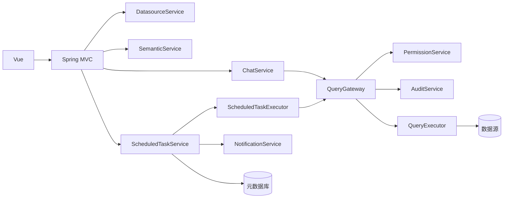
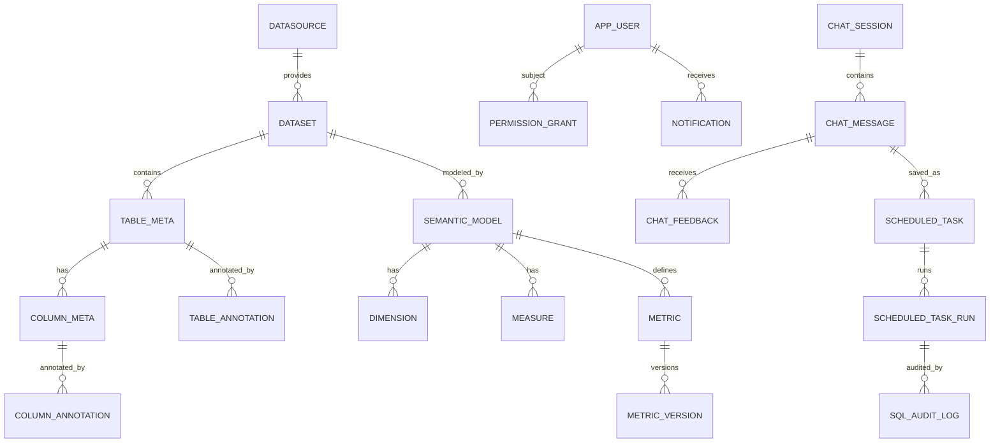
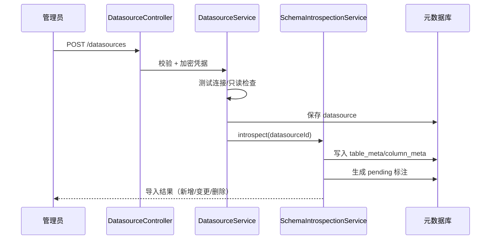

# 05 Phase 1 详细设计：可问数、可审计、可定时

> 版本：v1.1（2026-11-04）  
> 上游：[02 需求分析](02-requirements-analysis.md)、[03 功能设计](03-functional-design.md)、[04 分期实施方案](04-phased-delivery.md)  
> 定位：把 Phase 1 细化到**可以拆分开发任务、直接建表、直接写接口与测试**；本文不含代码改动。  
> 表结构约定、类型映射、迁移与索引规范见 [08 数据库设计](08-database-design.md)。

## 1. 范围与依赖

### 1.1 一期交付

| 能力 | 需求 ID | 交付边界 |
| --- | --- | --- |
| 数据接入 | DS-01～DS-04 | PostgreSQL/MySQL/SQL Server/CSV；连接测试、Schema 导入、手动同步 |
| 元数据与标注 | META-01、META-02、META-06 | 表/字段标注、敏感级别、检索 |
| 语义与指标 | SEM-01～SEM-04 | 语义模型、维度、度量、指标、语义编译 |
| 会话问数 | CHAT-01～CHAT-08、CHAT-10 | 会话、意图、查询、多轮、图表、解读、反馈 |
| SQL 审计 | AUD-01、AUD-02 | 全量记录、检索、详情 |
| 权限 | PERM-01～PERM-03、PERM-05、PERM-07 | 角色、资源授权、列级默认脱敏、智能体范围、SQL 网关 |
| 定时任务 | SCHED-01～SCHED-08 | Cron、执行、结果快照、站内通知、审计 |
| 反馈 | EVAL-01 | 反馈分类与记录 |

### 1.2 明确不做

- ETL 任务编排、质量规则、血缘（二期）。
- 行级策略模板、访问审批、评测/坏例闭环（二期）。
- 邮件/Webhook/IM/第三方推送（二期/三期）。
- 多租户、SSO、自定义角色（三期）。

### 1.3 依赖与假设

- 元数据库 PostgreSQL 15+（开发/测试/生产一致）；业务数据源支持 PostgreSQL、MySQL、SQL Server；使用 Flyway 管理迁移。
- 现有 `app_user`、`data_agent` 表保留；本期增量扩展。
- 数据源提供只读账号；若只有受限写账号，需显式开启并接受全量审计。
- 模型通过 `model_provider` 配置；定时任务执行**不依赖模型**（语义任务重编译，探索任务执行 SQL 快照）。

## 2. 代码结构

### 2.1 后端包结构

```text
com.huansi.dataagent
├── auth/                 # 现有：登录、注册、当前用户
├── user/                 # 现有：用户与角色
├── agent/                # 现有：智能体 CRUD
├── datasource/           # 数据源、连接测试、Schema 探查
├── dataset/              # 数据集、表/字段元数据
├── metadata/             # 标注、术语、检索
├── semantic/             # 语义模型、维度、度量、指标、编译器
├── chat/                 # 会话、消息、意图、答案编排
├── query/                # SQL 网关
│   ├── parser/           # AST 解析与校验
│   ├── policy/           # 权限改写、行列策略
│   ├── execute/          # 连接池、执行、超时、取消
│   └── result/           # 脱敏、截断、缓存、图表数据
├── audit/                # SQL/操作审计
├── permission/           # 角色、授权、有效权限计算
├── schedule/             # 定时任务、调度器、执行器
├── notification/         # 站内通知
├── persistence/          # MyBatis-Plus 配置、TypeHandler、MetaObjectHandler、分页
├── config/               # 安全、CORS、线程池、Flyway、模型
└── common/               # 统一响应、异常、工具
```

**依赖规则**：

- `chat`、`schedule` 只能通过 `query` 的 `QueryGateway` 取数，不得直接持有数据源连接。
- `query` 依赖 `permission`、`audit`、`datasource`，不依赖 `chat`/`schedule`。
- `metadata`、`semantic` 不依赖 `chat`，便于独立测试与复用。
- 模块间通过接口/领域事件解耦；禁止跨模块直接访问 Mapper/数据库。
- 数据访问统一用 MyBatis-Plus：简单 CRUD 用 `BaseMapper`/`IService`，复杂 SQL 放模块内 `mapper/*.xml`。
- 不使用 JPA/Hibernate；实体用 `@TableName`，主键 `IdType.AUTO`，逻辑删除按模块约定（`deleted_at`），乐观锁 `@Version`。

### 2.2 关键类

| 模块 | 类/接口 | 职责 |
| --- | --- | --- |
| datasource | `DatasourceController` / `DatasourceService` | 数据源 CRUD、测试连接、触发探查 |
| datasource | `SchemaIntrospectionService` | 读取 information_schema、生成元数据、diff |
| dataset | `DatasetService` / `SyncService` | 数据集、手动同步、运行记录 |
| metadata | `AnnotationService` / `MetadataSearchService` | 标注、检索、上下文构建 |
| semantic | `SemanticModelService` / `MetricService` | 语义模型、指标、版本 |
| semantic | `SemanticCompiler` | 结构化查询 → 方言 SQL |
| chat | `ChatController` / `ChatService` | SSE 问答、会话、消息 |
| chat | `IntentService` / `AnswerComposer` | 意图/澄清、答案组织 |
| query | `QueryGateway` | 查询统一入口 |
| query | `SqlParser` / `SqlValidator` | AST 解析、只读/对象/危险模式校验 |
| query | `PolicyRewriter` | 注入租户/行级条件、列策略、LIMIT/超时 |
| query | `QueryExecutor` | 连接池、执行、取消、超时 |
| query | `ResultMasker` | 列脱敏、截断、大小限制 |
| permission | `PermissionService` / `EffectivePermissionCalculator` | 有效权限计算 |
| audit | `AuditService` / `SqlAuditMapper` | 审计预写、更新、查询 |
| schedule | `ScheduledTaskController` / `ScheduledTaskService` | 任务 CRUD、试跑、暂停/恢复 |
| schedule | `ScheduledTaskDispatcher` | 扫描到期任务、抢占、创建运行 |
| schedule | `ScheduledTaskExecutor` | 权限重校验、编译/执行、快照、通知 |
| schedule | `CronService` | Cron 校验、下次执行时间、时区 |
| notification | `NotificationService` | 站内通知写/读 |

### 2.3 数据访问与迁移

- **MyBatis-Plus**：`BaseMapper<T>` + `ServiceImpl` 覆盖单表 CRUD；列表查询用 `LambdaQueryWrapper`；分页用 `PaginationInnerInterceptor(DbType.POSTGRE_SQL)`；乐观锁 `@Version`、`created_at/updated_at/created_by` 自动填充统一在 `persistence` 配置。
- **逻辑删除**：统一用 `deleted_at`；简单查询在 Wrapper 显式加 `deleted_at IS NULL`，或启用 MyBatis-Plus 时间戳 `@TableLogic`；同一模块二选一，避免全局拦截与手写条件重复。
- **复杂 SQL**：仅多表/CTE/窗口/递归血缘等场景使用 `mapper/*.xml`；XML 只写 SQL，不写业务逻辑；禁止字符串拼接，参数用 `#{}`。
- **类型处理**：`JSONB` 用 `JacksonTypeHandler`/自定义 `JsonbTypeHandler`；`Boolean`/`LocalDateTime` 由 MyBatis 内置/自定义 TypeHandler 映射。
- **迁移**：Flyway `V{n}__{desc}.sql`；生产 `clean-disabled=true`、`baseline-on-migrate=true`；启动不自动建表，测试用 Testcontainers PostgreSQL 执行同一套迁移。
- **禁止**：JPA/Hibernate、`ddl-auto`、运行期动态建表。

### 2.4 前端路由与页面

| 路由 | 页面 | 关键组件 |
| --- | --- | --- |
| `/chat` | 智能问答 | `SessionList`、`MessageStream`、`SqlPanel`、`ChartPanel`、`ContextPanel` |
| `/data/sources` | 数据源 | `DatasourceTable`、`DatasourceForm`、`ConnectionTest` |
| `/data/datasets/:id` | 数据集/元数据 | `TableTree`、`ColumnTable`、`AnnotationDrawer` |
| `/semantic` | 语义/指标 | `ModelEditor`、`MetricEditor`、`SqlPreview` |
| `/audit/sql` | SQL 审计 | `AuditFilters`、`AuditTable`、`AuditDetail` |
| `/tasks` | 定时任务 | `TaskTable`、`TaskWizard`、`RunHistory`、`CronPicker` |
| `/notifications` | 通知中心 | `NotificationList` |

## 3. 运行时与事务



- **写事务**：CRUD、标注、指标发布使用 `@Transactional`。
- **查询**：`QueryGateway` 不在数据库事务中执行；审计预写使用 `REQUIRES_NEW`，确保查询前落库。
- **调度**：抢占任务在短事务内完成；执行在事务外；运行状态更新独立事务。
- **线程池**：
  - `chatExecutor`：8–16，处理 SSE/答案编排；
  - `queryExecutor`：按数据源隔离，默认 10；
  - `schedExecutor`：2，队列 100；
  - `notificationExecutor`：2。
- **超时**：查询默认 30s；定时任务默认 60s；SSE 首 Token 3s 目标。

## 4. 领域模型与状态

### 4.1 Phase 1 核心 ER



### 4.2 状态机

- 数据源：`DRAFT → TESTING → ACTIVE ⇄ SYNCING → ERROR`；`ACTIVE → DISABLED`。
- 同步运行：`QUEUED → RUNNING → SUCCESS / FAILED / CANCELED`。
- 语义模型/指标：`DRAFT → REVIEW → PUBLISHED → DEPRECATED`。
- 会话：`ACTIVE → ARCHIVED → DELETED`。
- 定时任务：`DRAFT → ACTIVE ⇄ PAUSED`；`ACTIVE → ERROR → PAUSED`；`→ ARCHIVED`。
- 定时运行：`QUEUED → RUNNING → SUCCESS / FAILED / SKIPPED / CANCELED`。

## 5. 表结构（Phase 1 DDL）

> 约定：PostgreSQL 15+；`TIMESTAMP(3)` 存 UTC；`tenant_id` 默认 1；软删除用 `deleted_at`；枚举用 `VARCHAR` + 应用校验；JSON 用 `JSONB`。完整类型映射见 [08](08-database-design.md#2-类型映射)。

### 5.1 认证与权限

```sql
-- 现有表增量
ALTER TABLE app_user ADD COLUMN tenant_id BIGINT NOT NULL DEFAULT 1;
ALTER TABLE app_user ADD COLUMN updated_at TIMESTAMP(3) NOT NULL DEFAULT CURRENT_TIMESTAMP(3);
ALTER TABLE app_user ADD COLUMN last_login_at TIMESTAMP(3) NULL;
ALTER TABLE app_user ADD COLUMN deleted_at TIMESTAMP(3) NULL;
CREATE INDEX idx_user_tenant_role ON app_user (tenant_id, role, enabled);

CREATE TABLE permission_grant (
  id BIGINT GENERATED BY DEFAULT AS IDENTITY,
  tenant_id BIGINT NOT NULL DEFAULT 1,
  subject_type VARCHAR(16) NOT NULL,
  subject_key VARCHAR(64) NOT NULL,
  resource_type VARCHAR(24) NOT NULL,
  resource_id BIGINT NOT NULL,
  action VARCHAR(16) NOT NULL,
  effect VARCHAR(8) NOT NULL DEFAULT 'ALLOW',
  condition_json JSONB NULL,
  expires_at TIMESTAMP(3) NULL,
  created_by BIGINT NULL,
  created_at TIMESTAMP(3) NOT NULL DEFAULT CURRENT_TIMESTAMP(3),
  updated_at TIMESTAMP(3) NOT NULL DEFAULT CURRENT_TIMESTAMP(3),
  deleted_at TIMESTAMP(3) NULL,
  PRIMARY KEY (id),
  CONSTRAINT uk_grant UNIQUE (tenant_id, subject_type, subject_key,
                       resource_type, resource_id, action, effect)
);
CREATE INDEX idx_grant_subject ON permission_grant (tenant_id, subject_type, subject_key, resource_type);
CREATE INDEX idx_grant_resource ON permission_grant (tenant_id, resource_type, resource_id);
```

### 5.2 数据源与元数据

```sql
CREATE TABLE datasource (
  id BIGINT GENERATED BY DEFAULT AS IDENTITY,
  tenant_id BIGINT NOT NULL DEFAULT 1,
  name VARCHAR(120) NOT NULL,
  type VARCHAR(20) NOT NULL,
  host VARCHAR(255) NULL,
  port INT NULL,
  database_name VARCHAR(128) NULL,
  username VARCHAR(128) NULL,
  credential_cipher TEXT NULL,
  ssl_enabled BOOLEAN NOT NULL DEFAULT FALSE,
  connect_timeout_ms INT NOT NULL DEFAULT 5000,
  read_only_verified BOOLEAN NOT NULL DEFAULT FALSE,
  status VARCHAR(20) NOT NULL DEFAULT 'DRAFT',
  owner_id BIGINT NULL,
  last_test_at TIMESTAMP(3) NULL,
  last_error VARCHAR(1000) NULL,
  created_by BIGINT NULL,
  created_at TIMESTAMP(3) NOT NULL DEFAULT CURRENT_TIMESTAMP(3),
  updated_at TIMESTAMP(3) NOT NULL DEFAULT CURRENT_TIMESTAMP(3),
  deleted_at TIMESTAMP(3) NULL,
  PRIMARY KEY (id),
  CONSTRAINT uk_datasource_name UNIQUE (tenant_id, name)
);
CREATE INDEX idx_datasource_status ON datasource (tenant_id, status);

CREATE TABLE dataset (
  id BIGINT GENERATED BY DEFAULT AS IDENTITY,
  tenant_id BIGINT NOT NULL DEFAULT 1,
  datasource_id BIGINT NOT NULL,
  name VARCHAR(120) NOT NULL,
  code VARCHAR(64) NOT NULL,
  description VARCHAR(1000) NULL,
  owner_id BIGINT NULL,
  status VARCHAR(20) NOT NULL DEFAULT 'DRAFT',
  freshness_at TIMESTAMP(3) NULL,
  materialized BOOLEAN NOT NULL DEFAULT FALSE,
  storage_table VARCHAR(128) NULL,
  created_by BIGINT NULL,
  created_at TIMESTAMP(3) NOT NULL DEFAULT CURRENT_TIMESTAMP(3),
  updated_at TIMESTAMP(3) NOT NULL DEFAULT CURRENT_TIMESTAMP(3),
  deleted_at TIMESTAMP(3) NULL,
  PRIMARY KEY (id),
  CONSTRAINT uk_dataset_code UNIQUE (tenant_id, code),
  CONSTRAINT fk_dataset_ds FOREIGN KEY (datasource_id) REFERENCES datasource (id)
);
CREATE INDEX idx_dataset_ds ON dataset (datasource_id);
CREATE INDEX idx_dataset_status ON dataset (tenant_id, status);

CREATE TABLE table_meta (
  id BIGINT GENERATED BY DEFAULT AS IDENTITY,
  tenant_id BIGINT NOT NULL DEFAULT 1,
  dataset_id BIGINT NOT NULL,
  schema_name VARCHAR(128) NOT NULL DEFAULT '',
  table_name VARCHAR(128) NOT NULL,
  table_type VARCHAR(16) NOT NULL DEFAULT 'TABLE',
  row_count_estimate BIGINT NULL,
  comment VARCHAR(1000) NULL,
  source_updated_at TIMESTAMP(3) NULL,
  created_at TIMESTAMP(3) NOT NULL DEFAULT CURRENT_TIMESTAMP(3),
  updated_at TIMESTAMP(3) NOT NULL DEFAULT CURRENT_TIMESTAMP(3),
  PRIMARY KEY (id),
  CONSTRAINT uk_table UNIQUE (dataset_id, schema_name, table_name),
  CONSTRAINT fk_table_dataset FOREIGN KEY (dataset_id) REFERENCES dataset (id)
);
CREATE INDEX idx_table_dataset ON table_meta (dataset_id);

CREATE TABLE column_meta (
  id BIGINT GENERATED BY DEFAULT AS IDENTITY,
  tenant_id BIGINT NOT NULL DEFAULT 1,
  table_id BIGINT NOT NULL,
  column_name VARCHAR(128) NOT NULL,
  ordinal_position INT NOT NULL DEFAULT 0,
  data_type VARCHAR(64) NOT NULL,
  column_length INT NULL,
  numeric_precision INT NULL,
  numeric_scale INT NULL,
  nullable BOOLEAN NOT NULL DEFAULT TRUE,
  primary_key BOOLEAN NOT NULL DEFAULT FALSE,
  default_value VARCHAR(255) NULL,
  comment VARCHAR(1000) NULL,
  sample_values JSONB NULL,
  created_at TIMESTAMP(3) NOT NULL DEFAULT CURRENT_TIMESTAMP(3),
  updated_at TIMESTAMP(3) NOT NULL DEFAULT CURRENT_TIMESTAMP(3),
  PRIMARY KEY (id),
  CONSTRAINT uk_column UNIQUE (table_id, column_name),
  CONSTRAINT fk_column_table FOREIGN KEY (table_id) REFERENCES table_meta (id)
);
CREATE INDEX idx_column_table ON column_meta (table_id);

CREATE TABLE table_annotation (
  id BIGINT GENERATED BY DEFAULT AS IDENTITY,
  tenant_id BIGINT NOT NULL DEFAULT 1,
  table_id BIGINT NOT NULL,
  business_name VARCHAR(200) NULL,
  description VARCHAR(2000) NULL,
  domain VARCHAR(64) NULL,
  tags JSONB NULL,
  sensitivity VARCHAR(4) NOT NULL DEFAULT 'L1',
  owner_id BIGINT NULL,
  status VARCHAR(20) NOT NULL DEFAULT 'DRAFT',
  quality_score DECIMAL(5,2) NULL,
  version INT NOT NULL DEFAULT 1,
  published_at TIMESTAMP(3) NULL,
  created_by BIGINT NULL,
  created_at TIMESTAMP(3) NOT NULL DEFAULT CURRENT_TIMESTAMP(3),
  updated_at TIMESTAMP(3) NOT NULL DEFAULT CURRENT_TIMESTAMP(3),
  PRIMARY KEY (id),
  CONSTRAINT uk_table_annotation UNIQUE (table_id),
  CONSTRAINT fk_ta_table FOREIGN KEY (table_id) REFERENCES table_meta (id)
);

CREATE TABLE column_annotation (
  id BIGINT GENERATED BY DEFAULT AS IDENTITY,
  tenant_id BIGINT NOT NULL DEFAULT 1,
  column_id BIGINT NOT NULL,
  business_name VARCHAR(200) NULL,
  description VARCHAR(2000) NULL,
  synonyms JSONB NULL,
  enum_mapping JSONB NULL,
  unit VARCHAR(32) NULL,
  sensitivity VARCHAR(4) NOT NULL DEFAULT 'L1',
  owner_id BIGINT NULL,
  status VARCHAR(20) NOT NULL DEFAULT 'DRAFT',
  version INT NOT NULL DEFAULT 1,
  created_by BIGINT NULL,
  created_at TIMESTAMP(3) NOT NULL DEFAULT CURRENT_TIMESTAMP(3),
  updated_at TIMESTAMP(3) NOT NULL DEFAULT CURRENT_TIMESTAMP(3),
  PRIMARY KEY (id),
  CONSTRAINT uk_column_annotation UNIQUE (column_id),
  CONSTRAINT fk_ca_column FOREIGN KEY (column_id) REFERENCES column_meta (id)
);

CREATE TABLE sync_run (
  id BIGINT GENERATED BY DEFAULT AS IDENTITY,
  tenant_id BIGINT NOT NULL DEFAULT 1,
  dataset_id BIGINT NOT NULL,
  trigger_type VARCHAR(16) NOT NULL,
  mode VARCHAR(16) NOT NULL,
  status VARCHAR(16) NOT NULL,
  started_at TIMESTAMP(3) NULL,
  finished_at TIMESTAMP(3) NULL,
  rows_read BIGINT NULL,
  rows_written BIGINT NULL,
  error_code VARCHAR(64) NULL,
  error_message VARCHAR(2000) NULL,
  trace_id VARCHAR(64) NULL,
  created_by BIGINT NULL,
  created_at TIMESTAMP(3) NOT NULL DEFAULT CURRENT_TIMESTAMP(3),
  PRIMARY KEY (id),
  CONSTRAINT fk_sync_dataset FOREIGN KEY (dataset_id) REFERENCES dataset (id)
);
CREATE INDEX idx_sync_dataset ON sync_run (dataset_id, started_at);
CREATE INDEX idx_sync_status ON sync_run (tenant_id, status);
```

### 5.3 语义与指标

```sql
CREATE TABLE semantic_model (
  id BIGINT GENERATED BY DEFAULT AS IDENTITY,
  tenant_id BIGINT NOT NULL DEFAULT 1,
  dataset_id BIGINT NOT NULL,
  name VARCHAR(120) NOT NULL,
  code VARCHAR(64) NOT NULL,
  grain VARCHAR(255) NULL,
  default_time_field VARCHAR(128) NULL,
  status VARCHAR(20) NOT NULL DEFAULT 'DRAFT',
  version INT NOT NULL DEFAULT 1,
  config_json JSONB NULL,
  created_by BIGINT NULL,
  created_at TIMESTAMP(3) NOT NULL DEFAULT CURRENT_TIMESTAMP(3),
  updated_at TIMESTAMP(3) NOT NULL DEFAULT CURRENT_TIMESTAMP(3),
  deleted_at TIMESTAMP(3) NULL,
  PRIMARY KEY (id),
  CONSTRAINT uk_model_code UNIQUE (tenant_id, code),
  CONSTRAINT fk_model_dataset FOREIGN KEY (dataset_id) REFERENCES dataset (id)
);
CREATE INDEX idx_model_dataset ON semantic_model (dataset_id, status);

CREATE TABLE dimension (
  id BIGINT GENERATED BY DEFAULT AS IDENTITY,
  tenant_id BIGINT NOT NULL DEFAULT 1,
  model_id BIGINT NOT NULL,
  name VARCHAR(120) NOT NULL,
  code VARCHAR(64) NOT NULL,
  expression VARCHAR(1000) NOT NULL,
  data_type VARCHAR(32) NOT NULL DEFAULT 'STRING',
  hierarchy VARCHAR(255) NULL,
  synonyms JSONB NULL,
  status VARCHAR(20) NOT NULL DEFAULT 'ACTIVE',
  created_at TIMESTAMP(3) NOT NULL DEFAULT CURRENT_TIMESTAMP(3),
  updated_at TIMESTAMP(3) NOT NULL DEFAULT CURRENT_TIMESTAMP(3),
  PRIMARY KEY (id),
  CONSTRAINT uk_dimension_code UNIQUE (model_id, code),
  CONSTRAINT fk_dim_model FOREIGN KEY (model_id) REFERENCES semantic_model (id)
);

CREATE TABLE measure (
  id BIGINT GENERATED BY DEFAULT AS IDENTITY,
  tenant_id BIGINT NOT NULL DEFAULT 1,
  model_id BIGINT NOT NULL,
  name VARCHAR(120) NOT NULL,
  code VARCHAR(64) NOT NULL,
  aggregation VARCHAR(16) NOT NULL,
  expression VARCHAR(1000) NOT NULL,
  format VARCHAR(32) NULL,
  status VARCHAR(20) NOT NULL DEFAULT 'ACTIVE',
  created_at TIMESTAMP(3) NOT NULL DEFAULT CURRENT_TIMESTAMP(3),
  updated_at TIMESTAMP(3) NOT NULL DEFAULT CURRENT_TIMESTAMP(3),
  PRIMARY KEY (id),
  CONSTRAINT uk_measure_code UNIQUE (model_id, code),
  CONSTRAINT fk_measure_model FOREIGN KEY (model_id) REFERENCES semantic_model (id)
);

CREATE TABLE metric (
  id BIGINT GENERATED BY DEFAULT AS IDENTITY,
  tenant_id BIGINT NOT NULL DEFAULT 1,
  model_id BIGINT NOT NULL,
  name VARCHAR(120) NOT NULL,
  code VARCHAR(64) NOT NULL,
  type VARCHAR(16) NOT NULL,
  formula TEXT NOT NULL,
  numerator_metric_id BIGINT NULL,
  denominator_metric_id BIGINT NULL,
  unit VARCHAR(32) NULL,
  format VARCHAR(32) NULL,
  allowed_dimensions JSONB NULL,
  time_field VARCHAR(128) NULL,
  owner_id BIGINT NULL,
  version INT NOT NULL DEFAULT 1,
  status VARCHAR(20) NOT NULL DEFAULT 'DRAFT',
  certification VARCHAR(16) NOT NULL DEFAULT 'UNCERTIFIED',
  description VARCHAR(2000) NULL,
  created_by BIGINT NULL,
  created_at TIMESTAMP(3) NOT NULL DEFAULT CURRENT_TIMESTAMP(3),
  updated_at TIMESTAMP(3) NOT NULL DEFAULT CURRENT_TIMESTAMP(3),
  deleted_at TIMESTAMP(3) NULL,
  PRIMARY KEY (id),
  CONSTRAINT uk_metric_code UNIQUE (tenant_id, code),
  CONSTRAINT fk_metric_model FOREIGN KEY (model_id) REFERENCES semantic_model (id)
);
CREATE INDEX idx_metric_model ON metric (model_id, status);

CREATE TABLE metric_version (
  id BIGINT GENERATED BY DEFAULT AS IDENTITY,
  tenant_id BIGINT NOT NULL DEFAULT 1,
  metric_id BIGINT NOT NULL,
  version INT NOT NULL,
  formula TEXT NOT NULL,
  numerator_metric_id BIGINT NULL,
  denominator_metric_id BIGINT NULL,
  allowed_dimensions JSONB NULL,
  time_field VARCHAR(128) NULL,
  status VARCHAR(20) NOT NULL,
  published_at TIMESTAMP(3) NULL,
  created_by BIGINT NULL,
  created_at TIMESTAMP(3) NOT NULL DEFAULT CURRENT_TIMESTAMP(3),
  PRIMARY KEY (id),
  CONSTRAINT uk_metric_version UNIQUE (metric_id, version),
  CONSTRAINT fk_mv_metric FOREIGN KEY (metric_id) REFERENCES metric (id)
);
```

### 5.4 会话、反馈与定时任务

```sql
CREATE TABLE chat_session (
  id BIGINT GENERATED BY DEFAULT AS IDENTITY,
  tenant_id BIGINT NOT NULL DEFAULT 1,
  user_id BIGINT NOT NULL,
  agent_id BIGINT NOT NULL,
  title VARCHAR(200) NOT NULL,
  status VARCHAR(20) NOT NULL DEFAULT 'ACTIVE',
  context_summary TEXT NULL,
  context_json JSONB NULL,
  data_version VARCHAR(64) NULL,
  share_token VARCHAR(64) NULL,
  share_expires_at TIMESTAMP(3) NULL,
  last_message_at TIMESTAMP(3) NULL,
  created_at TIMESTAMP(3) NOT NULL DEFAULT CURRENT_TIMESTAMP(3),
  updated_at TIMESTAMP(3) NOT NULL DEFAULT CURRENT_TIMESTAMP(3),
  deleted_at TIMESTAMP(3) NULL,
  PRIMARY KEY (id),
  CONSTRAINT uk_session_share UNIQUE (share_token)
);
CREATE INDEX idx_session_user ON chat_session (user_id, updated_at);
CREATE INDEX idx_session_agent ON chat_session (agent_id);

CREATE TABLE chat_message (
  id BIGINT GENERATED BY DEFAULT AS IDENTITY,
  tenant_id BIGINT NOT NULL DEFAULT 1,
  session_id BIGINT NOT NULL,
  seq INT NOT NULL,
  role VARCHAR(16) NOT NULL,
  content TEXT NULL,
  sql_text TEXT NULL,
  sql_hash CHAR(64) NULL,
  query_spec JSONB NULL,
  result_json JSONB NULL,
  chart_json JSONB NULL,
  citations JSONB NULL,
  trace_id VARCHAR(64) NULL,
  model VARCHAR(128) NULL,
  prompt_tokens INT NULL,
  completion_tokens INT NULL,
  latency_ms INT NULL,
  status VARCHAR(16) NOT NULL DEFAULT 'SUCCESS',
  created_at TIMESTAMP(3) NOT NULL DEFAULT CURRENT_TIMESTAMP(3),
  PRIMARY KEY (id),
  CONSTRAINT uk_message_seq UNIQUE (session_id, seq),
  CONSTRAINT fk_msg_session FOREIGN KEY (session_id) REFERENCES chat_session (id)
);
CREATE INDEX idx_message_trace ON chat_message (trace_id);

CREATE TABLE chat_feedback (
  id BIGINT GENERATED BY DEFAULT AS IDENTITY,
  tenant_id BIGINT NOT NULL DEFAULT 1,
  message_id BIGINT NOT NULL,
  user_id BIGINT NOT NULL,
  rating BOOLEAN NOT NULL,
  reason VARCHAR(32) NULL,
  corrected_sql TEXT NULL,
  expected_result JSONB NULL,
  comment VARCHAR(1000) NULL,
  status VARCHAR(16) NOT NULL DEFAULT 'OPEN',
  created_at TIMESTAMP(3) NOT NULL DEFAULT CURRENT_TIMESTAMP(3),
  PRIMARY KEY (id),
  CONSTRAINT fk_fb_message FOREIGN KEY (message_id) REFERENCES chat_message (id)
);
CREATE INDEX idx_feedback_message ON chat_feedback (message_id);
CREATE INDEX idx_feedback_user ON chat_feedback (user_id, created_at);

CREATE TABLE agent_dataset (
  id BIGINT GENERATED BY DEFAULT AS IDENTITY,
  tenant_id BIGINT NOT NULL DEFAULT 1,
  agent_id BIGINT NOT NULL,
  dataset_id BIGINT NOT NULL,
  scope_json JSONB NULL,
  created_at TIMESTAMP(3) NOT NULL DEFAULT CURRENT_TIMESTAMP(3),
  PRIMARY KEY (id),
  CONSTRAINT uk_agent_dataset UNIQUE (agent_id, dataset_id),
  CONSTRAINT fk_ad_dataset FOREIGN KEY (dataset_id) REFERENCES dataset (id)
);
CREATE INDEX idx_ad_dataset ON agent_dataset (dataset_id);

CREATE TABLE scheduled_task (
  id BIGINT GENERATED BY DEFAULT AS IDENTITY,
  tenant_id BIGINT NOT NULL DEFAULT 1,
  name VARCHAR(120) NOT NULL,
  description VARCHAR(500) NULL,
  owner_id BIGINT NOT NULL,
  agent_id BIGINT NOT NULL,
  source_session_id BIGINT NULL,
  source_message_id BIGINT NULL,
  query_mode VARCHAR(16) NOT NULL,
  question TEXT NOT NULL,
  query_spec JSONB NULL,
  sql_snapshot TEXT NULL,
  params_json JSONB NULL,
  cron_expression VARCHAR(64) NOT NULL,
  timezone VARCHAR(40) NOT NULL DEFAULT 'Asia/Shanghai',
  start_at TIMESTAMP(3) NULL,
  end_at TIMESTAMP(3) NULL,
  status VARCHAR(16) NOT NULL DEFAULT 'DRAFT',
  misfire_policy VARCHAR(16) NOT NULL DEFAULT 'CATCH_UP',
  catch_up_minutes INT NOT NULL DEFAULT 60,
  timeout_seconds INT NOT NULL DEFAULT 60,
  max_retries INT NOT NULL DEFAULT 3,
  retry_backoff_seconds VARCHAR(64) NOT NULL DEFAULT '60,300,900',
  notify_on_success BOOLEAN NOT NULL DEFAULT TRUE,
  notify_on_failure BOOLEAN NOT NULL DEFAULT TRUE,
  next_run_at TIMESTAMP(3) NULL,
  last_run_at TIMESTAMP(3) NULL,
  last_run_status VARCHAR(16) NULL,
  consecutive_failures INT NOT NULL DEFAULT 0,
  locked_by VARCHAR(64) NULL,
  locked_until TIMESTAMP(3) NULL,
  version INT NOT NULL DEFAULT 0,
  created_by BIGINT NULL,
  created_at TIMESTAMP(3) NOT NULL DEFAULT CURRENT_TIMESTAMP(3),
  updated_at TIMESTAMP(3) NOT NULL DEFAULT CURRENT_TIMESTAMP(3),
  deleted_at TIMESTAMP(3) NULL,
  PRIMARY KEY (id),
  CONSTRAINT uk_task_name UNIQUE (tenant_id, name)
);
CREATE INDEX idx_task_due ON scheduled_task (status, next_run_at);
CREATE INDEX idx_task_owner ON scheduled_task (owner_id, status);
CREATE INDEX idx_task_agent ON scheduled_task (agent_id);

CREATE TABLE scheduled_task_run (
  id BIGINT GENERATED BY DEFAULT AS IDENTITY,
  tenant_id BIGINT NOT NULL DEFAULT 1,
  task_id BIGINT NOT NULL,
  scheduled_at TIMESTAMP(3) NOT NULL,
  trigger_type VARCHAR(16) NOT NULL,
  status VARCHAR(16) NOT NULL,
  attempt INT NOT NULL DEFAULT 1,
  sql_text TEXT NULL,
  query_spec JSONB NULL,
  metric_version VARCHAR(64) NULL,
  result_preview JSONB NULL,
  result_ref VARCHAR(500) NULL,
  chart_json JSONB NULL,
  row_count BIGINT NULL,
  data_freshness_at TIMESTAMP(3) NULL,
  duration_ms BIGINT NULL,
  error_code VARCHAR(64) NULL,
  error_message VARCHAR(2000) NULL,
  trace_id VARCHAR(64) NULL,
  audit_id BIGINT NULL,
  created_at TIMESTAMP(3) NOT NULL DEFAULT CURRENT_TIMESTAMP(3),
  started_at TIMESTAMP(3) NULL,
  finished_at TIMESTAMP(3) NULL,
  PRIMARY KEY (id),
  CONSTRAINT uk_task_run UNIQUE (task_id, scheduled_at, attempt),
  CONSTRAINT fk_run_task FOREIGN KEY (task_id) REFERENCES scheduled_task (id)
);
CREATE INDEX idx_schedrun_task ON scheduled_task_run (task_id, scheduled_at);
CREATE INDEX idx_schedrun_status ON scheduled_task_run (status, created_at);
CREATE INDEX idx_schedrun_trace ON scheduled_task_run (trace_id);

CREATE TABLE notification (
  id BIGINT GENERATED BY DEFAULT AS IDENTITY,
  tenant_id BIGINT NOT NULL DEFAULT 1,
  user_id BIGINT NOT NULL,
  type VARCHAR(32) NOT NULL,
  title VARCHAR(200) NOT NULL,
  content VARCHAR(2000) NULL,
  link VARCHAR(500) NULL,
  ref_type VARCHAR(32) NULL,
  ref_id BIGINT NULL,
  channel VARCHAR(16) NOT NULL DEFAULT 'IN_APP',
  status VARCHAR(16) NOT NULL DEFAULT 'UNREAD',
  created_at TIMESTAMP(3) NOT NULL DEFAULT CURRENT_TIMESTAMP(3),
  read_at TIMESTAMP(3) NULL,
  PRIMARY KEY (id)
);
CREATE INDEX idx_notify_user ON notification (user_id, status, created_at);
CREATE INDEX idx_notify_ref ON notification (ref_type, ref_id);
```

### 5.5 审计与配置

```sql
CREATE TABLE sql_audit_log (
  id BIGINT GENERATED BY DEFAULT AS IDENTITY,
  tenant_id BIGINT NOT NULL DEFAULT 1,
  trace_id VARCHAR(64) NOT NULL,
  user_id BIGINT NOT NULL,
  session_id BIGINT NULL,
  message_id BIGINT NULL,
  agent_id BIGINT NULL,
  trigger_source VARCHAR(24) NOT NULL DEFAULT 'CHAT',
  scheduled_task_id BIGINT NULL,
  scheduled_task_run_id BIGINT NULL,
  datasource_id BIGINT NULL,
  dataset_id BIGINT NULL,
  sql_text TEXT NOT NULL,
  sql_hash CHAR(64) NOT NULL,
  normalized_sql TEXT NULL,
  params_json JSONB NULL,
  decision VARCHAR(16) NOT NULL,
  risk_level VARCHAR(8) NOT NULL DEFAULT 'LOW',
  risk_rules JSONB NULL,
  row_limit INT NULL,
  timeout_ms INT NULL,
  started_at TIMESTAMP(3) NOT NULL,
  finished_at TIMESTAMP(3) NULL,
  duration_ms BIGINT NULL,
  row_count BIGINT NULL,
  result_size_bytes BIGINT NULL,
  status VARCHAR(16) NOT NULL,
  error_code VARCHAR(64) NULL,
  result_preview JSONB NULL,
  policy_snapshot JSONB NULL,
  client_ip VARCHAR(64) NULL,
  user_agent VARCHAR(255) NULL,
  model VARCHAR(128) NULL,
  prompt_tokens INT NULL,
  completion_tokens INT NULL,
  cost DECIMAL(12,6) NULL,
  created_at TIMESTAMP(3) NOT NULL DEFAULT CURRENT_TIMESTAMP(3),
  PRIMARY KEY (id)
);
CREATE INDEX idx_audit_tenant_time ON sql_audit_log (tenant_id, created_at);
CREATE INDEX idx_audit_user_time ON sql_audit_log (user_id, created_at);
CREATE INDEX idx_audit_trace ON sql_audit_log (trace_id);
CREATE INDEX idx_audit_task ON sql_audit_log (scheduled_task_id, created_at);
CREATE INDEX idx_audit_task_run ON sql_audit_log (scheduled_task_run_id);
CREATE INDEX idx_audit_status ON sql_audit_log (status, created_at);

CREATE TABLE model_provider (
  id BIGINT GENERATED BY DEFAULT AS IDENTITY,
  tenant_id BIGINT NOT NULL DEFAULT 1,
  name VARCHAR(64) NOT NULL,
  type VARCHAR(32) NOT NULL,
  endpoint VARCHAR(500) NULL,
  api_key_cipher TEXT NULL,
  model_name VARCHAR(128) NOT NULL,
  status VARCHAR(16) NOT NULL DEFAULT 'ACTIVE',
  is_default BOOLEAN NOT NULL DEFAULT FALSE,
  config_json JSONB NULL,
  created_at TIMESTAMP(3) NOT NULL DEFAULT CURRENT_TIMESTAMP(3),
  updated_at TIMESTAMP(3) NOT NULL DEFAULT CURRENT_TIMESTAMP(3),
  PRIMARY KEY (id),
  CONSTRAINT uk_provider_name UNIQUE (tenant_id, name)
);

CREATE TABLE system_config (
  id BIGINT GENERATED BY DEFAULT AS IDENTITY,
  tenant_id BIGINT NOT NULL DEFAULT 1,
  config_key VARCHAR(128) NOT NULL,
  config_value JSONB NOT NULL,
  description VARCHAR(500) NULL,
  updated_by BIGINT NULL,
  updated_at TIMESTAMP(3) NOT NULL DEFAULT CURRENT_TIMESTAMP(3),
  PRIMARY KEY (id),
  CONSTRAINT uk_config_key UNIQUE (tenant_id, config_key)
);
```

### 5.6 迁移文件

| 文件 | 内容 |
| --- | --- |
| `V1__baseline.sql` | 现有 `app_user`、`data_agent` 基线（由当前实体生成） |
| `V2__phase1_auth.sql` | `app_user` 增量、`permission_grant` |
| `V3__phase1_data.sql` | `datasource` → `sync_run` |
| `V4__phase1_semantic.sql` | `semantic_model` → `metric_version` |
| `V5__phase1_chat.sql` | `chat_session`、`chat_message`、`chat_feedback`、`agent_dataset` |
| `V6__phase1_schedule.sql` | `scheduled_task`、`scheduled_task_run`、`notification` |
| `V7__phase1_audit_config.sql` | `sql_audit_log`、`model_provider`、`system_config` |


## 6. 核心流程

### 6.1 数据源接入



事务边界：数据源保存与探查分开；探查失败不回滚数据源，记录 `last_error`；元数据写入按表分批提交。

### 6.2 问数主流程

1. `POST /sessions/{id}/messages` 建立 SSE。
2. 加载会话、上下文、权限；意图识别；必要时澄清。
3. 语义模式：LLM 输出结构化查询 → `SemanticCompiler` → SQL；探索模式：LLM 生成 SQL。
4. `QueryGateway.execute()`：
   - `AuditService.start()`（`REQUIRES_NEW`）→ 失败拒绝；
   - 解析/校验/权限/租户条件/LIMIT/超时；
   - `QueryExecutor` 执行；
   - `ResultMasker` 脱敏/截断；
   - 更新审计。
5. `AnswerComposer` 生成结论/图表/口径；保存 `chat_message`。
6. SSE 推送 `message.end`。

### 6.3 定时任务执行

详见第 8 节；关键约束：**运行时不调用大模型**，只重编译 `query_spec` 或执行 `sql_snapshot`。

## 7. API 契约

### 7.1 通用

- 前缀 `/api`；JWT Bearer；统一 `{success,message,data}`；分页 `page/size`。
- 错误码：`400` 参数、`401` 未认证、`403` 无权限、`404` 不存在、`409` 冲突、`429` 限流、`503` 模型/数据源不可用。
- 所有写接口要求 `Idempotency-Key`（创建类）或 `version`（更新类，乐观锁）。

### 7.2 接口清单

| 方法 | 路径 | 权限 | 说明 |
| --- | --- | --- | --- |
| POST | `/datasources` | Data Admin | 创建数据源 |
| POST | `/datasources/{id}/test` | Data Admin | 测试连接 |
| POST | `/datasources/{id}/introspect` | Data Admin | 导入/刷新 Schema |
| GET | `/datasources` | Data Admin | 列表 |
| GET/POST | `/datasets` | Data Admin | 数据集 |
| GET | `/datasets/{id}/tables` | 登录 | 表清单 |
| PATCH | `/tables/{id}/annotation` | Data Admin | 表标注 |
| PATCH | `/columns/{id}/annotation` | Data Admin | 字段标注 |
| GET | `/metadata/search` | 登录 | 资产检索 |
| GET/POST | `/semantic/models` | Data Admin | 语义模型 |
| GET/POST | `/metrics` | Data Admin | 指标 |
| PUT | `/metrics/{id}` | Data Admin | 更新指标（版本+1） |
| POST | `/agents/{id}/sessions` | 登录 | 新建会话 |
| GET | `/sessions/{id}` | 会话所有者 | 会话详情 |
| POST | `/sessions/{id}/messages` | 登录 | SSE 问答 |
| POST | `/messages/{id}/feedback` | 消息可见者 | 反馈 |
| GET | `/audit/sql` | Admin/Auditor | SQL 审计 |
| GET | `/audit/sql/{id}` | Admin/Auditor | 审计详情 |
| GET/POST | `/scheduled-tasks` | Analyst/Admin | 定时任务 |
| PUT/DELETE | `/scheduled-tasks/{id}` | 所有者/Admin | 修改/归档 |
| POST | `/scheduled-tasks/{id}/run` | 所有者/Admin | 试跑 |
| POST | `/scheduled-tasks/{id}/pause` | 所有者/Admin | 暂停 |
| POST | `/scheduled-tasks/{id}/resume` | 所有者/Admin | 恢复 |
| GET | `/scheduled-tasks/{id}/runs` | 所有者/Admin | 运行历史 |
| GET | `/scheduled-task-runs/{runId}` | 所有者/Admin | 运行详情 |
| GET | `/notifications` | 登录 | 通知 |
| POST | `/notifications/{id}/read` | 本人 | 标记已读 |

### 7.3 关键请求/响应

创建定时任务：

```json
{
  "name": "每日区域销售额",
  "description": "每天 9 点跑昨日各区域销售额",
  "sourceSessionId": 1001,
  "sourceMessageId": 2001,
  "queryMode": "SEMANTIC",
  "querySpec": {
    "dataset": "sales_model",
    "metrics": ["sales_amount"],
    "dimensions": ["region"],
    "time": {"field": "order_date", "range": "YESTERDAY", "timezone": "Asia/Shanghai"}
  },
  "cron": "0 0 9 * * *",
  "timezone": "Asia/Shanghai",
  "notifyOnSuccess": true,
  "notifyOnFailure": true
}
```

创建响应：

```json
{
  "success": true,
  "message": "创建成功",
  "data": {
    "id": 3001,
    "status": "ACTIVE",
    "nextRunAt": "2026-11-05T01:00:00Z",
    "nextRuns": [
      "2026-11-05T01:00:00Z",
      "2026-11-06T01:00:00Z",
      "2026-11-07T01:00:00Z"
    ]
  }
}
```

运行详情：

```json
{
  "id": 4001,
  "taskId": 3001,
  "scheduledAt": "2026-11-05T01:00:00Z",
  "status": "SUCCESS",
  "rowCount": 7,
  "durationMs": 820,
  "dataFreshnessAt": "2026-11-05T00:30:00Z",
  "sql": "SELECT region, SUM(amount) ...",
  "resultPreview": {"columns": ["region", "sales_amount"], "rows": [...]},
  "chart": {"type": "bar", "x": "region", "y": "sales_amount"},
  "auditId": 9001
}
```

## 8. 定时任务实现细节

### 8.1 调度算法

```text
loop every 5s:
  now = utcNow()
  candidates = select id from scheduled_task
      where status='ACTIVE' and next_run_at <= now
        and (locked_until is null or locked_until < now)
      order by next_run_at limit 20
      for update skip locked
  for each candidate:
      lock task (locked_by=instance, locked_until=now+60s)
      scheduledAt = task.next_run_at
      insert scheduled_task_run(task_id, scheduled_at, trigger_type='CRON',
                                status='QUEUED', attempt=1)
        on duplicate key -> skip
      nextRunAt = cron.next(scheduledAt, task.timezone)
      update task set next_run_at=nextRunAt, locked_by=null, locked_until=null
  enqueue run ids to schedExecutor
```

- **时钟**：使用 `Clock` Bean，测试可注入固定时钟。
- **Cron**：Spring `CronExpression` 6 段（秒 分 时 日 月 周）；UI 提供 5 段预设并转换。
- **时区**：`ZoneId.of(task.timezone)`；保存 UTC；展示按任务时区。
- **错过补跑**：启动时/扫描时，若 `next_run_at < now - catch_up_minutes`，记录 `SKIPPED` 并直接算下一次；窗口内则补跑一次。
- **重试**：同一 `scheduled_at`，`attempt+1`；`run_key` 唯一防止重复。
- **上一轮未结束**：`scheduled_task_run` 存在同任务 `RUNNING` 时，本轮 `SKIPPED`。

### 8.2 执行器

```text
execute(runId):
  run = load; if run.status != QUEUED return
  task = load
  if task.status != ACTIVE: run SKIPPED
  if !permissionService.canRunAs(task.ownerId, task): task PAUSED; run SKIPPED; notify
  plan = task.queryMode == SEMANTIC
         ? semanticCompiler.compile(resolveRelativeTime(task.querySpec, task.timezone))
         : sqlSnapshotExecutor.prepare(task.sqlSnapshot, task.params, task.timezone)
  auditId = queryGateway.execute(plan, actor=owner, source=SCHEDULED_TASK,
                                 taskId, runId, rowLimit=1000, timeout=task.timeoutSeconds)
  snapshot = resultSnapshot(result)
  update run SUCCESS; update task lastRunAt/lastRunStatus/consecutiveFailures=0
  notify success
catch:
  update run FAILED; task consecutiveFailures+1
  if consecutiveFailures >= 3: task PAUSED; notify admin
  else schedule retry per backoff
```

### 8.3 结果快照

- `result_preview`：列 + 前 1,000 行；超过 1MB 截断。
- `result_ref`：大结果 CSV 对象存储路径；保留 90 天（可配）。
- `chart_json`：图表配置；不保存图片。
- `data_freshness_at`：数据集最近同步时间。
- `sql_text`：实际执行 SQL；指标版本写入 `metric_version`。

### 8.4 通知

- 成功：`type=TASK_SUCCESS`，标题“定时任务执行成功”，链接运行详情。
- 失败：`type=TASK_FAILURE`，包含错误码与重试次数。
- 连续失败：额外通知管理员。
- 一期只写 `IN_APP`；`channel` 字段预留。

### 8.5 配置项

| 配置 | 默认 | 说明 |
| --- | --- | --- |
| `app.schedule.enabled` | true | 调度开关 |
| `app.schedule.scan-interval` | 5000ms | 扫描间隔 |
| `app.schedule.batch-size` | 20 | 每次抢占数 |
| `app.schedule.lock-seconds` | 60 | 租约时长 |
| `app.schedule.threads` | 2 | 执行线程 |
| `app.schedule.queue-size` | 100 | 队列上限 |
| `app.schedule.default-timeout` | 60s | 单任务超时 |
| `app.schedule.max-per-user` | 20 | 用户任务上限 |
| `app.schedule.default-catch-up-minutes` | 60 | 补跑窗口 |

## 9. 前端实现要点

- SSE 使用 `fetch` + `ReadableStream`（需要 Authorization 头，不能用原生 EventSource）；断线重连保留 `messageId` 幂等。
- 消息渲染：Markdown + SQL 高亮；图表用 ECharts；表格虚拟滚动。
- 任务向导：Cron 预设 + 未来 5 次预览；时区下拉；试跑结果不影响正式计划。
- 评估：所有危险操作二次确认；空状态给示例问题；错误提示包含“原因/下一步”。

## 10. 测试设计

### 10.1 单元测试

- `CronService`：合法/非法 Cron、时区、跨日、闰年、下一次时间。
- `SqlValidator`：多语句、DDL/DML、系统表、无 Join 多表、超限。
- `PolicyRewriter`：租户条件、列隐藏/脱敏、LIMIT。
- `EffectivePermissionCalculator`：角色/授权/智能体交集/过期。
- `ScheduledTaskService`：创建校验、名称冲突、配额、状态迁移。

### 10.2 集成测试

- 数据源连接 → 探查 → 标注 → 指标 → 问数 → 审计（Testcontainers PostgreSQL + Mock 数据源）。
- 定时任务：固定 `Clock` 到点 → 执行 → 结果快照 → 通知；重复调度不重复执行。
- 权限：撤销数据集授权后任务暂停；越权 SQL 拒绝。
- 审计失败：模拟审计写入异常，查询被拒绝。

### 10.3 安全与性能

- 越权表/列、SQL 注入、跨租户、敏感字段脱敏、导出。
- 50 并发问答；100 个任务同一分钟到期；调度队列满时在线问答不受影响。
- 审计 100 万行查询分页 P95 < 1s。

## 11. 实施顺序（建议 6 个迭代）

| 迭代 | 内容 | 出口 |
| --- | --- | --- |
| I1 | Flyway 基线、认证/角色、权限表、数据源/数据集 | 可登录、可接数据源 |
| I2 | Schema 导入、标注、检索 | 元数据可用 |
| I3 | SQL 网关、审计、权限改写 | 可安全执行 SQL |
| I4 | 语义模型、指标、问答、图表 | 可问数 |
| I5 | 定时任务、通知、运行历史 | 可定时执行 |
| I6 | 前端联调、评测、压测、试点 | 验收 |

**DoD**：接口文档、迁移脚本、单测/集成测试、审计用例、权限用例、演示脚本齐全；无 P0 缺陷。

## 12. 验收

沿用 [04 Phase 1 验收](04-phased-delivery.md#44-验收标准)，并补充：

1. 定时任务到点误差 ≤ 1 分钟；重复执行 0。
2. 任务所有者失权后下一次执行 `SKIPPED` 且任务 `PAUSED`。
3. 任务运行 SQL 在审计中可按 `scheduled_task_run_id` 查到。
4. 应用重启后窗口内任务补跑一次。
5. 迁移脚本在空库和已有库上均可执行。
