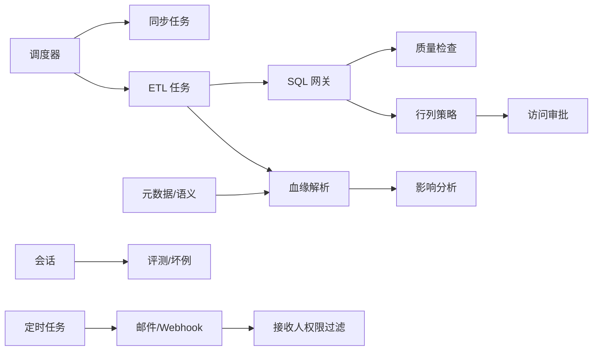
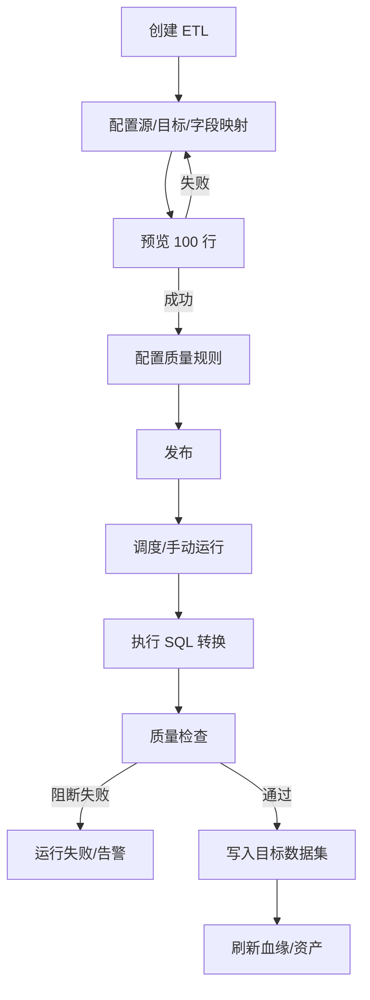
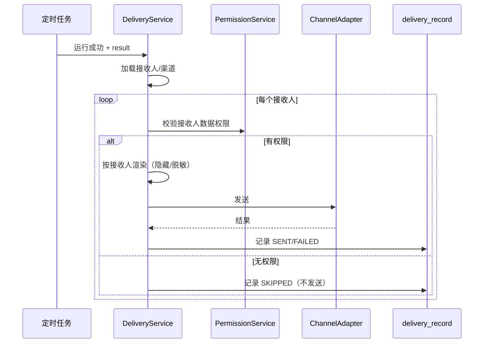

# 06 Phase 2 详细设计：数据闭环、治理与推送

> 版本：v1.1（2026-11-04）  
> 上游：[02 需求分析](02-requirements-analysis.md)、[03 功能设计](03-functional-design.md)、[04 分期实施方案](04-phased-delivery.md)  
> 前置：[05 Phase 1 详细设计](05-detailed-design-phase1.md)  
> 说明：本文是 Phase 2 的增量详细设计，表结构为在 Phase 1 基础上的新增表/字段；不含代码改动。

## 1. 范围与依赖

### 1.1 二期交付

| 能力 | 需求 ID | 增量 |
| --- | --- | --- |
| 同步增强 | DS-05 | 定时/增量同步、字段映射、重试 |
| 轻量 ETL | ETL-01～ETL-04 | SQL 转换、物化、线性 DAG、调度、运行历史 |
| 数据质量 | ETL-05、ETL-06 | 规则、结果、认证门槛、问答提示 |
| 元数据增强 | META-03～META-05 | 术语表、标注工作流、资产认证 |
| 血缘 | LIN-01～LIN-04 | 表/字段血缘、图谱、影响分析 |
| 语义增强 | SEM-05、SEM-06 | 已验证查询、指标权限 |
| 会话增强 | CHAT-09 | 导出/分享 |
| 审计增强 | AUD-03～AUD-05 | 风险规则、操作审计、留存/导出 |
| 权限增强 | PERM-04、PERM-06 | 行级策略、访问审批 |
| 反馈评测 | EVAL-02～EVAL-05 | 坏例、评测集、回归、质量看板 |
| 推送 | SCHED-06（二期） | 邮件/Webhook、接收人、按接收人权限过滤结果 |
| 运营 | OPS-01～OPS-04 | 看板、告警、模型/成本、系统配置 |

### 1.2 依赖

- Phase 1 的 `permission_grant`、`scheduled_task`、`scheduled_task_run`、`sql_audit_log`、`chat_message` 已上线。
- Phase 2 的 ETL/血缘/评测都依赖 Phase 1 的元数据、语义、审计。
- 行级权限依赖 `app_user` 的组织属性（`region/dept_id`）；若 Phase 1 未建，二期通过 `app_user_attribute` 或扩展字段补齐。

### 1.3 明确不做

- 多源连接器、IM/第三方平台推送、SSO、多租户（三期）。
- 复杂 DAG、实时 CDC、跨集群计算。

## 2. 架构增量



- **调度器复用**：Phase 1 的数据库租约/线程池扩展为 `jobType` 队列；ETL 与问数任务分表、分线程池。
- **ETL 写入通道**：与只读查询网关隔离；仅 Data Admin 可发布；写入使用受控连接。
- **血缘**：SQL AST + 字段映射 + 人工声明；不依赖外部数据治理平台。
- **策略**：行/列策略在 Phase 1 `permission_grant` 之上扩展 `row_policy`；网关改写顺序不变。
- **推送**：任务运行成功后按接收人逐个做权限过滤，再渲染邮件/Webhook；失败重试与投递审计。

## 3. 代码结构增量

```text
com.huansi.dataagent
├── sync/                 # 同步任务、水位、重试
├── etl/                  # ETL 定义、编排、运行、质量
│   ├── model/
│   ├── engine/
│   └── quality/
├── lineage/              # AST 解析、节点/边、影响分析
├── evaluation/           # 评测集、回归、坏例
├── delivery/             # 渠道、接收人、渲染、投递
└── permission/           # 扩展 row_policy、access_request
```

关键类：

| 类 | 职责 |
| --- | --- |
| `SyncJobService` / `WatermarkService` | 增量水位、字段映射、重试 |
| `EtlJobService` / `EtlEngine` | ETL 定义、DAG 校验、运行 |
| `QualityRuleService` / `QualityChecker` | 规则执行、结果、认证门槛 |
| `LineageParser` / `LineageService` | SQL AST 解析、图查询、影响 BFS |
| `RowPolicyService` / `PolicyCompiler` | 策略模板、谓词编译、冲突检测 |
| `AccessRequestService` | 申请、审批、到期回收 |
| `EvalService` / `BadCaseService` | 评测、回归、坏例状态机 |
| `DeliveryService` / `ChannelAdapter` | 邮件/Webhook 适配、接收人过滤、重试 |

## 4. 领域模型

```mermaid
erDiagram
  DATASET ||--o{ SYNC_JOB : syncs
  DATASET ||--o{ ETL_JOB : target
  ETL_JOB ||--o{ ETL_RUN : runs
  ETL_RUN ||--o{ DATA_QUALITY_RESULT : checks
  DATA_QUALITY_RULE ||--o{ DATA_QUALITY_RESULT : evaluates
  DATASET ||--o{ LINEAGE_NODE : maps
  LINEAGE_NODE ||--o{ LINEAGE_EDGE : from
  LINEAGE_NODE ||--o{ LINEAGE_EDGE : to
  DATASET ||--o{ VERIFIED_QUERY : verified_by
  DATASET ||--o{ ROW_POLICY : protected_by
  APP_USER ||--o{ ACCESS_REQUEST : requests
  EVAL_SET ||--o{ EVAL_CASE : contains
  EVAL_SET ||--o{ EVAL_RUN : evaluated_by
  EVAL_RUN ||--o{ EVAL_RESULT : produces
  CHAT_FEEDBACK ||--o{ BAD_CASE : creates
  SCHEDULED_TASK ||--o{ SCHEDULED_TASK_RECIPIENT : notifies
  DELIVERY_CHANNEL ||--o{ DELIVERY_RECORD : sends
```

状态：

- ETL 定义：`DRAFT → PUBLISHED → PAUSED → ARCHIVED`。
- ETL 运行：`QUEUED → RUNNING → SUCCESS / FAILED / CANCELED`。
- 质量结果：`PASS / WARN / FAIL`。
- 访问申请：`PENDING → APPROVED / REJECTED → ACTIVE → EXPIRED / REVOKED`。
- 坏例：`NEW → TRIAGED → FIXING → VERIFYING → CLOSED / REOPENED`。
- 投递：`PENDING → SENT / FAILED / SKIPPED`。

## 5. 表结构（Phase 2 增量 DDL）

> 在 Phase 1 基础上前置；PostgreSQL 15+。新增表按依赖顺序创建；索引使用独立 `CREATE INDEX`。

### 5.1 同步与 ETL

```sql
CREATE TABLE sync_job (
  id BIGINT GENERATED BY DEFAULT AS IDENTITY,
  tenant_id BIGINT NOT NULL DEFAULT 1,
  dataset_id BIGINT NOT NULL,
  mode VARCHAR(16) NOT NULL,
  cron_expression VARCHAR(64) NULL,
  timezone VARCHAR(40) NOT NULL DEFAULT 'Asia/Shanghai',
  watermark_column VARCHAR(128) NULL,
  watermark_value VARCHAR(255) NULL,
  status VARCHAR(16) NOT NULL DEFAULT 'DRAFT',
  last_run_at TIMESTAMP(3) NULL,
  next_run_at TIMESTAMP(3) NULL,
  created_by BIGINT NULL,
  created_at TIMESTAMP(3) NOT NULL DEFAULT CURRENT_TIMESTAMP(3),
  updated_at TIMESTAMP(3) NOT NULL DEFAULT CURRENT_TIMESTAMP(3),
  deleted_at TIMESTAMP(3) NULL,
  PRIMARY KEY (id),
  CONSTRAINT uk_sync_dataset UNIQUE (dataset_id),
  CONSTRAINT fk_sync_job_dataset FOREIGN KEY (dataset_id) REFERENCES dataset (id)
);
CREATE INDEX idx_sync_due ON sync_job (status, next_run_at);

ALTER TABLE sync_run ADD COLUMN job_id BIGINT NULL;
CREATE INDEX idx_sync_run_job ON sync_run (job_id);

CREATE TABLE etl_job (
  id BIGINT GENERATED BY DEFAULT AS IDENTITY,
  tenant_id BIGINT NOT NULL DEFAULT 1,
  name VARCHAR(120) NOT NULL,
  description VARCHAR(1000) NULL,
  source_dataset_id BIGINT NOT NULL,
  target_dataset_id BIGINT NOT NULL,
  config_json JSONB NOT NULL,
  cron_expression VARCHAR(64) NULL,
  timezone VARCHAR(40) NOT NULL DEFAULT 'Asia/Shanghai',
  status VARCHAR(16) NOT NULL DEFAULT 'DRAFT',
  version INT NOT NULL DEFAULT 1,
  owner_id BIGINT NULL,
  last_run_at TIMESTAMP(3) NULL,
  next_run_at TIMESTAMP(3) NULL,
  created_by BIGINT NULL,
  created_at TIMESTAMP(3) NOT NULL DEFAULT CURRENT_TIMESTAMP(3),
  updated_at TIMESTAMP(3) NOT NULL DEFAULT CURRENT_TIMESTAMP(3),
  deleted_at TIMESTAMP(3) NULL,
  PRIMARY KEY (id),
  CONSTRAINT uk_etl_name UNIQUE (tenant_id, name),
  CONSTRAINT fk_etl_source FOREIGN KEY (source_dataset_id) REFERENCES dataset (id),
  CONSTRAINT fk_etl_target FOREIGN KEY (target_dataset_id) REFERENCES dataset (id)
);
CREATE INDEX idx_etl_due ON etl_job (status, next_run_at);
CREATE INDEX idx_etl_target ON etl_job (target_dataset_id);

CREATE TABLE etl_run (
  id BIGINT GENERATED BY DEFAULT AS IDENTITY,
  tenant_id BIGINT NOT NULL DEFAULT 1,
  job_id BIGINT NOT NULL,
  trigger_type VARCHAR(16) NOT NULL,
  status VARCHAR(16) NOT NULL,
  started_at TIMESTAMP(3) NULL,
  finished_at TIMESTAMP(3) NULL,
  rows_read BIGINT NULL,
  rows_written BIGINT NULL,
  error_code VARCHAR(64) NULL,
  error_message VARCHAR(2000) NULL,
  log_ref VARCHAR(500) NULL,
  trace_id VARCHAR(64) NULL,
  created_at TIMESTAMP(3) NOT NULL DEFAULT CURRENT_TIMESTAMP(3),
  PRIMARY KEY (id),
  CONSTRAINT fk_etl_run_job FOREIGN KEY (job_id) REFERENCES etl_job (id)
);
CREATE INDEX idx_etlrun_job ON etl_run (job_id, started_at);
CREATE INDEX idx_etlrun_status ON etl_run (tenant_id, status, created_at);

CREATE TABLE data_quality_rule (
  id BIGINT GENERATED BY DEFAULT AS IDENTITY,
  tenant_id BIGINT NOT NULL DEFAULT 1,
  dataset_id BIGINT NOT NULL,
  table_id BIGINT NULL,
  column_id BIGINT NULL,
  rule_type VARCHAR(32) NOT NULL,
  rule_config JSONB NOT NULL,
  severity VARCHAR(16) NOT NULL,
  status VARCHAR(16) NOT NULL DEFAULT 'ACTIVE',
  created_by BIGINT NULL,
  created_at TIMESTAMP(3) NOT NULL DEFAULT CURRENT_TIMESTAMP(3),
  updated_at TIMESTAMP(3) NOT NULL DEFAULT CURRENT_TIMESTAMP(3),
  PRIMARY KEY (id),
  CONSTRAINT fk_rule_dataset FOREIGN KEY (dataset_id) REFERENCES dataset (id)
);
CREATE INDEX idx_rule_dataset ON data_quality_rule (dataset_id, status);

CREATE TABLE data_quality_result (
  id BIGINT GENERATED BY DEFAULT AS IDENTITY,
  tenant_id BIGINT NOT NULL DEFAULT 1,
  rule_id BIGINT NOT NULL,
  etl_run_id BIGINT NULL,
  status VARCHAR(16) NOT NULL,
  metric_value DECIMAL(20,6) NULL,
  detail JSONB NULL,
  checked_at TIMESTAMP(3) NOT NULL DEFAULT CURRENT_TIMESTAMP(3),
  PRIMARY KEY (id),
  CONSTRAINT fk_dq_rule FOREIGN KEY (rule_id) REFERENCES data_quality_rule (id)
);
CREATE INDEX idx_dq_rule ON data_quality_result (rule_id, checked_at);
CREATE INDEX idx_dq_run ON data_quality_result (etl_run_id);
```

### 5.2 元数据与血缘

```sql
CREATE TABLE glossary_term (
  id BIGINT GENERATED BY DEFAULT AS IDENTITY,
  tenant_id BIGINT NOT NULL DEFAULT 1,
  term VARCHAR(128) NOT NULL,
  definition TEXT NOT NULL,
  synonyms JSONB NULL,
  owner_id BIGINT NULL,
  status VARCHAR(16) NOT NULL DEFAULT 'DRAFT',
  created_at TIMESTAMP(3) NOT NULL DEFAULT CURRENT_TIMESTAMP(3),
  updated_at TIMESTAMP(3) NOT NULL DEFAULT CURRENT_TIMESTAMP(3),
  PRIMARY KEY (id),
  CONSTRAINT uk_term UNIQUE (tenant_id, term)
);

CREATE TABLE annotation_task (
  id BIGINT GENERATED BY DEFAULT AS IDENTITY,
  tenant_id BIGINT NOT NULL DEFAULT 1,
  object_type VARCHAR(16) NOT NULL,
  object_id BIGINT NOT NULL,
  assignee_id BIGINT NULL,
  status VARCHAR(16) NOT NULL DEFAULT 'PENDING',
  due_at TIMESTAMP(3) NULL,
  comment VARCHAR(1000) NULL,
  created_by BIGINT NULL,
  created_at TIMESTAMP(3) NOT NULL DEFAULT CURRENT_TIMESTAMP(3),
  updated_at TIMESTAMP(3) NOT NULL DEFAULT CURRENT_TIMESTAMP(3),
  PRIMARY KEY (id)
);
CREATE INDEX idx_task_assignee ON annotation_task (assignee_id, status);
CREATE INDEX idx_task_object ON annotation_task (object_type, object_id);

CREATE TABLE lineage_node (
  id BIGINT GENERATED BY DEFAULT AS IDENTITY,
  tenant_id BIGINT NOT NULL DEFAULT 1,
  node_type VARCHAR(24) NOT NULL,
  ref_id BIGINT NOT NULL,
  name VARCHAR(255) NOT NULL,
  metadata JSONB NULL,
  created_at TIMESTAMP(3) NOT NULL DEFAULT CURRENT_TIMESTAMP(3),
  updated_at TIMESTAMP(3) NOT NULL DEFAULT CURRENT_TIMESTAMP(3),
  PRIMARY KEY (id),
  CONSTRAINT uk_lineage_node UNIQUE (tenant_id, node_type, ref_id)
);
CREATE INDEX idx_lineage_name ON lineage_node (tenant_id, name);

CREATE TABLE lineage_edge (
  id BIGINT GENERATED BY DEFAULT AS IDENTITY,
  tenant_id BIGINT NOT NULL DEFAULT 1,
  from_node_id BIGINT NOT NULL,
  to_node_id BIGINT NOT NULL,
  edge_type VARCHAR(16) NOT NULL,
  confidence VARCHAR(16) NOT NULL DEFAULT 'PARSED',
  source VARCHAR(32) NULL,
  created_at TIMESTAMP(3) NOT NULL DEFAULT CURRENT_TIMESTAMP(3),
  PRIMARY KEY (id),
  CONSTRAINT uk_lineage_edge UNIQUE (from_node_id, to_node_id, edge_type),
  CONSTRAINT fk_le_from FOREIGN KEY (from_node_id) REFERENCES lineage_node (id),
  CONSTRAINT fk_le_to FOREIGN KEY (to_node_id) REFERENCES lineage_node (id)
);
CREATE INDEX idx_lineage_to ON lineage_edge (to_node_id);

CREATE TABLE schema_change_event (
  id BIGINT GENERATED BY DEFAULT AS IDENTITY,
  tenant_id BIGINT NOT NULL DEFAULT 1,
  datasource_id BIGINT NOT NULL,
  dataset_id BIGINT NULL,
  table_id BIGINT NULL,
  change_type VARCHAR(32) NOT NULL,
  before_json JSONB NULL,
  after_json JSONB NULL,
  status VARCHAR(16) NOT NULL DEFAULT 'OPEN',
  detected_at TIMESTAMP(3) NOT NULL DEFAULT CURRENT_TIMESTAMP(3),
  created_at TIMESTAMP(3) NOT NULL DEFAULT CURRENT_TIMESTAMP(3),
  PRIMARY KEY (id)
);
CREATE INDEX idx_schema_ds ON schema_change_event (datasource_id, detected_at);
CREATE INDEX idx_schema_status ON schema_change_event (tenant_id, status);
```

### 5.3 语义增强与治理

```sql
CREATE TABLE verified_query (
  id BIGINT GENERATED BY DEFAULT AS IDENTITY,
  tenant_id BIGINT NOT NULL DEFAULT 1,
  dataset_id BIGINT NOT NULL,
  semantic_model_id BIGINT NULL,
  question VARCHAR(1000) NOT NULL,
  normalized_question VARCHAR(1000) NULL,
  params JSONB NULL,
  sql_text TEXT NOT NULL,
  expected_columns JSONB NULL,
  owner_id BIGINT NULL,
  status VARCHAR(16) NOT NULL DEFAULT 'ACTIVE',
  usage_count INT NOT NULL DEFAULT 0,
  last_verified_at TIMESTAMP(3) NULL,
  created_at TIMESTAMP(3) NOT NULL DEFAULT CURRENT_TIMESTAMP(3),
  updated_at TIMESTAMP(3) NOT NULL DEFAULT CURRENT_TIMESTAMP(3),
  PRIMARY KEY (id),
  CONSTRAINT fk_vq_dataset FOREIGN KEY (dataset_id) REFERENCES dataset (id)
);
CREATE INDEX idx_vq_dataset ON verified_query (dataset_id, status);
CREATE INDEX idx_vq_model ON verified_query (semantic_model_id);

CREATE TABLE row_policy (
  id BIGINT GENERATED BY DEFAULT AS IDENTITY,
  tenant_id BIGINT NOT NULL DEFAULT 1,
  resource_type VARCHAR(16) NOT NULL,
  resource_id BIGINT NOT NULL,
  column_name VARCHAR(128) NOT NULL,
  operator VARCHAR(16) NOT NULL,
  value_from VARCHAR(128) NULL,
  value_json JSONB NULL,
  effect VARCHAR(8) NOT NULL DEFAULT 'ALLOW',
  priority INT NOT NULL DEFAULT 100,
  status VARCHAR(16) NOT NULL DEFAULT 'ACTIVE',
  created_by BIGINT NULL,
  created_at TIMESTAMP(3) NOT NULL DEFAULT CURRENT_TIMESTAMP(3),
  updated_at TIMESTAMP(3) NOT NULL DEFAULT CURRENT_TIMESTAMP(3),
  PRIMARY KEY (id)
);
CREATE INDEX idx_policy_resource ON row_policy (tenant_id, resource_type, resource_id, status);

CREATE TABLE access_request (
  id BIGINT GENERATED BY DEFAULT AS IDENTITY,
  tenant_id BIGINT NOT NULL DEFAULT 1,
  requester_id BIGINT NOT NULL,
  resource_type VARCHAR(24) NOT NULL,
  resource_id BIGINT NOT NULL,
  action VARCHAR(16) NOT NULL,
  reason VARCHAR(1000) NULL,
  status VARCHAR(16) NOT NULL DEFAULT 'PENDING',
  approver_id BIGINT NULL,
  approved_at TIMESTAMP(3) NULL,
  expires_at TIMESTAMP(3) NULL,
  created_at TIMESTAMP(3) NOT NULL DEFAULT CURRENT_TIMESTAMP(3),
  updated_at TIMESTAMP(3) NOT NULL DEFAULT CURRENT_TIMESTAMP(3),
  PRIMARY KEY (id)
);
CREATE INDEX idx_request_user ON access_request (requester_id, status);
CREATE INDEX idx_request_status ON access_request (tenant_id, status, created_at);

CREATE TABLE audit_event (
  id BIGINT GENERATED BY DEFAULT AS IDENTITY,
  tenant_id BIGINT NOT NULL DEFAULT 1,
  event_type VARCHAR(32) NOT NULL,
  actor_id BIGINT NULL,
  actor_type VARCHAR(16) NOT NULL DEFAULT 'USER',
  object_type VARCHAR(24) NULL,
  object_id BIGINT NULL,
  action VARCHAR(32) NOT NULL,
  before_json JSONB NULL,
  after_json JSONB NULL,
  ip VARCHAR(64) NULL,
  user_agent VARCHAR(255) NULL,
  trace_id VARCHAR(64) NULL,
  created_at TIMESTAMP(3) NOT NULL DEFAULT CURRENT_TIMESTAMP(3),
  PRIMARY KEY (id)
);
CREATE INDEX idx_event_time ON audit_event (tenant_id, created_at);
CREATE INDEX idx_event_object ON audit_event (object_type, object_id);
CREATE INDEX idx_event_actor ON audit_event (actor_id, created_at);
```

### 5.4 评测、导出与推送

```sql
CREATE TABLE eval_set (
  id BIGINT GENERATED BY DEFAULT AS IDENTITY,
  tenant_id BIGINT NOT NULL DEFAULT 1,
  name VARCHAR(120) NOT NULL,
  domain VARCHAR(64) NULL,
  description VARCHAR(1000) NULL,
  version INT NOT NULL DEFAULT 1,
  status VARCHAR(16) NOT NULL DEFAULT 'ACTIVE',
  owner_id BIGINT NULL,
  created_at TIMESTAMP(3) NOT NULL DEFAULT CURRENT_TIMESTAMP(3),
  updated_at TIMESTAMP(3) NOT NULL DEFAULT CURRENT_TIMESTAMP(3),
  PRIMARY KEY (id),
  CONSTRAINT uk_eval_name UNIQUE (tenant_id, name)
);

CREATE TABLE eval_case (
  id BIGINT GENERATED BY DEFAULT AS IDENTITY,
  tenant_id BIGINT NOT NULL DEFAULT 1,
  set_id BIGINT NOT NULL,
  question VARCHAR(1000) NOT NULL,
  expected_sql TEXT NULL,
  expected_result JSONB NULL,
  difficulty VARCHAR(16) NULL,
  tags JSONB NULL,
  created_at TIMESTAMP(3) NOT NULL DEFAULT CURRENT_TIMESTAMP(3),
  updated_at TIMESTAMP(3) NOT NULL DEFAULT CURRENT_TIMESTAMP(3),
  PRIMARY KEY (id),
  CONSTRAINT fk_case_set FOREIGN KEY (set_id) REFERENCES eval_set (id)
);
CREATE INDEX idx_case_set ON eval_case (set_id);

CREATE TABLE eval_run (
  id BIGINT GENERATED BY DEFAULT AS IDENTITY,
  tenant_id BIGINT NOT NULL DEFAULT 1,
  set_id BIGINT NOT NULL,
  model VARCHAR(128) NULL,
  prompt_version VARCHAR(64) NULL,
  status VARCHAR(16) NOT NULL,
  started_at TIMESTAMP(3) NULL,
  finished_at TIMESTAMP(3) NULL,
  pass_count INT NOT NULL DEFAULT 0,
  total_count INT NOT NULL DEFAULT 0,
  created_by BIGINT NULL,
  created_at TIMESTAMP(3) NOT NULL DEFAULT CURRENT_TIMESTAMP(3),
  PRIMARY KEY (id),
  CONSTRAINT fk_evalrun_set FOREIGN KEY (set_id) REFERENCES eval_set (id)
);
CREATE INDEX idx_evalrun_set ON eval_run (set_id, started_at);

CREATE TABLE eval_result (
  id BIGINT GENERATED BY DEFAULT AS IDENTITY,
  tenant_id BIGINT NOT NULL DEFAULT 1,
  run_id BIGINT NOT NULL,
  case_id BIGINT NOT NULL,
  status VARCHAR(16) NOT NULL,
  actual_sql TEXT NULL,
  actual_result JSONB NULL,
  diff JSONB NULL,
  latency_ms INT NULL,
  created_at TIMESTAMP(3) NOT NULL DEFAULT CURRENT_TIMESTAMP(3),
  PRIMARY KEY (id),
  CONSTRAINT fk_evalresult_run FOREIGN KEY (run_id) REFERENCES eval_run (id),
  CONSTRAINT fk_evalresult_case FOREIGN KEY (case_id) REFERENCES eval_case (id)
);
CREATE INDEX idx_evalresult_run ON eval_result (run_id);

CREATE TABLE bad_case (
  id BIGINT GENERATED BY DEFAULT AS IDENTITY,
  tenant_id BIGINT NOT NULL DEFAULT 1,
  feedback_id BIGINT NULL,
  message_id BIGINT NULL,
  category VARCHAR(32) NOT NULL,
  root_cause VARCHAR(64) NULL,
  fix_type VARCHAR(32) NULL,
  assignee_id BIGINT NULL,
  status VARCHAR(16) NOT NULL DEFAULT 'NEW',
  due_at TIMESTAMP(3) NULL,
  resolution VARCHAR(2000) NULL,
  created_at TIMESTAMP(3) NOT NULL DEFAULT CURRENT_TIMESTAMP(3),
  updated_at TIMESTAMP(3) NOT NULL DEFAULT CURRENT_TIMESTAMP(3),
  PRIMARY KEY (id)
);
CREATE INDEX idx_badcase_status ON bad_case (tenant_id, status, created_at);
CREATE INDEX idx_badcase_assignee ON bad_case (assignee_id, status);

CREATE TABLE export_job (
  id BIGINT GENERATED BY DEFAULT AS IDENTITY,
  tenant_id BIGINT NOT NULL DEFAULT 1,
  user_id BIGINT NOT NULL,
  resource_type VARCHAR(24) NOT NULL,
  resource_id BIGINT NOT NULL,
  format VARCHAR(16) NOT NULL,
  status VARCHAR(16) NOT NULL DEFAULT 'QUEUED',
  file_ref VARCHAR(500) NULL,
  row_count BIGINT NULL,
  error_message VARCHAR(1000) NULL,
  expires_at TIMESTAMP(3) NULL,
  created_at TIMESTAMP(3) NOT NULL DEFAULT CURRENT_TIMESTAMP(3),
  finished_at TIMESTAMP(3) NULL,
  PRIMARY KEY (id)
);
CREATE INDEX idx_export_user ON export_job (user_id, created_at);
CREATE INDEX idx_export_status ON export_job (status, created_at);

CREATE TABLE scheduled_task_recipient (
  id BIGINT GENERATED BY DEFAULT AS IDENTITY,
  tenant_id BIGINT NOT NULL DEFAULT 1,
  task_id BIGINT NOT NULL,
  recipient_type VARCHAR(16) NOT NULL,
  recipient_key VARCHAR(64) NOT NULL,
  channel VARCHAR(16) NOT NULL DEFAULT 'IN_APP',
  created_at TIMESTAMP(3) NOT NULL DEFAULT CURRENT_TIMESTAMP(3),
  PRIMARY KEY (id),
  CONSTRAINT uk_task_recipient UNIQUE (task_id, recipient_type, recipient_key, channel),
  CONSTRAINT fk_recipient_task FOREIGN KEY (task_id) REFERENCES scheduled_task (id)
);
CREATE INDEX idx_recipient_key ON scheduled_task_recipient (recipient_type, recipient_key);

CREATE TABLE delivery_channel (
  id BIGINT GENERATED BY DEFAULT AS IDENTITY,
  tenant_id BIGINT NOT NULL DEFAULT 1,
  name VARCHAR(64) NOT NULL,
  type VARCHAR(16) NOT NULL,
  config_cipher TEXT NOT NULL,
  status VARCHAR(16) NOT NULL DEFAULT 'ACTIVE',
  created_by BIGINT NULL,
  created_at TIMESTAMP(3) NOT NULL DEFAULT CURRENT_TIMESTAMP(3),
  updated_at TIMESTAMP(3) NOT NULL DEFAULT CURRENT_TIMESTAMP(3),
  PRIMARY KEY (id),
  CONSTRAINT uk_channel_name UNIQUE (tenant_id, name)
);

CREATE TABLE delivery_record (
  id BIGINT GENERATED BY DEFAULT AS IDENTITY,
  tenant_id BIGINT NOT NULL DEFAULT 1,
  task_run_id BIGINT NOT NULL,
  channel_id BIGINT NOT NULL,
  recipient_key VARCHAR(64) NOT NULL,
  status VARCHAR(16) NOT NULL DEFAULT 'PENDING',
  attempts INT NOT NULL DEFAULT 0,
  response_code VARCHAR(32) NULL,
  response_body VARCHAR(1000) NULL,
  sent_at TIMESTAMP(3) NULL,
  created_at TIMESTAMP(3) NOT NULL DEFAULT CURRENT_TIMESTAMP(3),
  PRIMARY KEY (id),
  CONSTRAINT uk_delivery UNIQUE (task_run_id, channel_id, recipient_key),
  CONSTRAINT fk_dr_run FOREIGN KEY (task_run_id) REFERENCES scheduled_task_run (id),
  CONSTRAINT fk_dr_channel FOREIGN KEY (channel_id) REFERENCES delivery_channel (id)
);
CREATE INDEX idx_delivery_status ON delivery_record (status, created_at);
```

## 6. 关键流程

### 6.1 ETL 生命周期



- 预览在只读沙箱执行 `LIMIT 100`，不写目标。
- 发布前必须预览成功；发布后版本化。
- 质量阻断失败时目标数据集标记“不可信”，问答提示。
- 运行记录 `etl_run`；失败重试由调度器处理。

### 6.2 血缘与影响

1. ETL 发布/同步时解析 SQL AST 与字段映射，写 `lineage_node/edge`。
2. 查询日志补充 `INFERRED` 关系，人工确认后升级为 `PARSED/DECLARED`。
3. Schema 变更写 `schema_change_event`；影响分析从节点向下 BFS（深度 5）。
4. 影响清单展示资产、负责人、影响等级；支持导出/通知。
5. 修复后触发回归评测。

### 6.3 行/列权限与审批

- 行策略：`row_policy` 编译为 SQL 谓词；多条 ALLOW 取 OR，再与租户条件 AND；DENY 优先。
- 列策略：沿用 Phase 1 `permission_grant` + 敏感级别；Phase 2 增加按角色/字段配置。
- 访问申请：`access_request` 审批通过后写 `permission_grant`，带 `expires_at`；到期定时回收。
- 每次查询仍走 Phase 1 的统一网关，不因审批绕过审计。

### 6.4 评测与坏例

1. 反馈/错误进入 `bad_case`，按根因/修复类型指派。
2. 修复后加入 `eval_set/case`，运行 `eval_run`。
3. 回归通过率低于阈值阻断发布；结果写 `eval_result`。
4. 周会看坏例趋势、Top 失败原因、修复 SLA。

### 6.5 推送



- 邮件/Webhook 配置加密；发送失败重试 3 次（1/5/15 分钟）。
- 接收人无权限时**不发送数据**，只记录原因；避免“推送即越权”。
- 渠道配置变更/停用需审计；发送频率限制。

## 7. API 增量

| 方法 | 路径 | 说明 |
| --- | --- | --- |
| GET/POST | `/sync-jobs` | 同步任务 |
| POST | `/sync-jobs/{id}/run` | 手动同步 |
| GET/POST | `/etl/jobs` | ETL 任务 |
| POST | `/etl/jobs/{id}/preview` | 预览 |
| POST | `/etl/jobs/{id}/run` | 运行 |
| GET | `/etl/runs` | 运行历史 |
| GET/POST | `/quality/rules` | 质量规则 |
| GET | `/quality/results` | 质量结果 |
| GET | `/lineage/graph` | 图谱 |
| POST | `/lineage/impact` | 影响分析 |
| GET/POST | `/verified-queries` | 已验证查询 |
| GET/POST | `/permission/row-policies` | 行策略 |
| GET/POST | `/access-requests` | 访问申请 |
| POST | `/access-requests/{id}/approve` | 审批 |
| GET/POST | `/eval/sets` | 评测集 |
| POST | `/eval/runs` | 运行回归 |
| GET | `/eval/runs/{id}` | 回归结果 |
| GET/POST | `/bad-cases` | 坏例 |
| POST | `/bad-cases/{id}/transition` | 状态流转 |
| GET/POST | `/delivery/channels` | 推送渠道 |
| POST | `/delivery/channels/{id}/test` | 测试渠道 |
| GET | `/delivery/records` | 投递记录 |
| GET/POST | `/scheduled-tasks/{id}/recipients` | 任务接收人 |

## 8. 迁移与回填

| 迁移 | 内容 |
| --- | --- |
| `V8__phase2_data.sql` | `sync_job`、`etl_job/run`、质量表、Schema 变更 |
| `V9__phase2_meta.sql` | `glossary_term`、`annotation_task`、`lineage_*`、`verified_query` |
| `V10__phase2_govern.sql` | `row_policy`、`access_request`、`audit_event` |
| `V11__phase2_eval.sql` | `eval_*`、`bad_case`、`export_job` |
| `V12__phase2_delivery.sql` | 接收人、`delivery_channel/record` |

**回填**：

1. 从 Phase 1 `chat_message` 中提取高频问题/SQL，生成候选 `verified_query`（人工确认后启用）。
2. 从 Phase 1 `sql_audit_log` 提取表关系，生成 `INFERRED` 血缘，人工确认。
3. 对现有 `permission_grant` 做一次“无行策略=拒绝”的演练；为试点租户配置默认行策略。
4. 将历史反馈导入 `bad_case`，按原因分类。

## 9. 测试与验收

- ETL：预览/发布/运行/失败重试/质量阻断/回滚。
- 血缘：表级、字段级、影响 BFS、覆盖率。
- 权限：行策略 OR/AND/DENY、列脱敏、审批到期回收、跨租户。
- 评测：坏例状态机、回归通过率、发布门禁。
- 推送：接收人权限过滤、邮件/Webhook 重试、投递记录、退订/停用。
- 迁移：空库、Phase 1 库升级、回滚。

## 10. 实施顺序

| 迭代 | 内容 |
| --- | --- |
| I1 | 同步任务、ETL 引擎、质量规则 |
| I2 | 血缘解析/图谱/影响 |
| I3 | 行策略、访问审批、操作审计 |
| I4 | 评测集、坏例、回归门禁 |
| I5 | 接收人、邮件/Webhook、投递记录 |
| I6 | 迁移回填、压测、试点扩展 |
