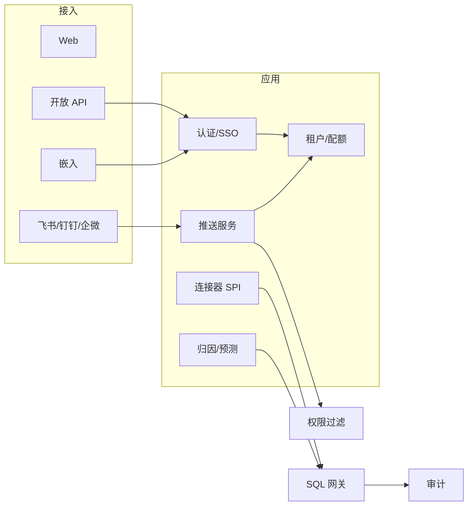
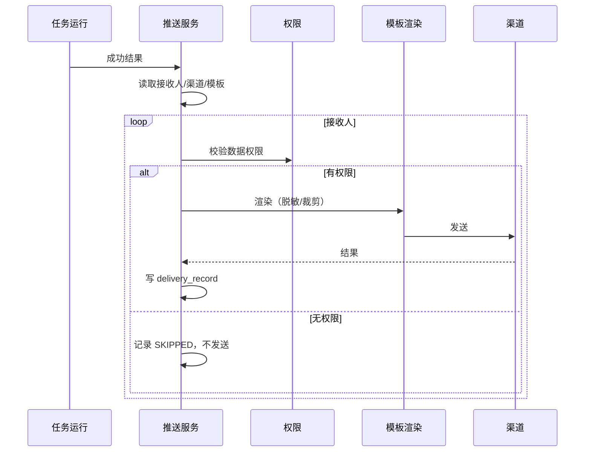

# 07 Phase 3 详细设计：多源、多平台推送与规模化

> 版本：v1.0（2026-11-04）  
> 上游：[02 需求分析](02-requirements-analysis.md)、[03 功能设计](03-functional-design.md)、[04 分期实施方案](04-phased-delivery.md)  
> 前置：[05 Phase 1](05-detailed-design-phase1.md)、[06 Phase 2](06-detailed-design-phase2.md)  
> 说明：本文是 Phase 3 的增量详细设计；不含代码改动。

## 1. 范围与依赖

### 1.1 三期交付

| 能力 | 需求/目标 | 增量 |
| --- | --- | --- |
| 多源连接 | 01 3.1、DS-01 扩展 | SQL Server/Oracle/ClickHouse/Doris/API |
| 多平台推送 | SCHED-06（三期） | 飞书/钉钉/企业微信/第三方 Webhook、模板、限流 |
| 定时报告 | 01 3.6 | 将任务结果组织为日报/周报并推送 |
| SSO/自定义角色 | OPS/企业管理 | OIDC/SAML/LDAP、角色映射 |
| 多租户 | 03 2.2 | 租户、隔离、配额、计费 |
| 开放能力 | 01 3.6 | API Client、嵌入 Token |
| 高级分析 | 01 3.4 | 归因、预测（可选） |
| 成本治理 | OPS-03 | 用量、配额、预算告警 |

### 1.2 依赖

- Phase 1/2 的租户字段、权限、审计、任务、投递记录已存在。
- 多租户默认“共享库 + `tenant_id` 行级隔离”；大客户可选独立 schema/DB。
- SSO 不替代本地账号；本地管理员保留应急入口。

## 2. 架构增量



- **连接器 SPI**：每种数据源实现 `test/introspect/query`，统一方言与类型映射；连接器不直接暴露给模型。
- **推送服务**：复用 Phase 2 `delivery_channel/record`；新增 IM/第三方适配器；按接收人权限裁剪内容。
- **租户**：JWT 带 `tenant_id`；网关强制注入；平台管理员可跨租户运维，但操作审计。
- **开放 API**：Client Credentials/Token；scope 限制；速率限制；审计。

## 3. 多源连接器

### 3.1 SPI

```text
interface DataSourceConnector {
  String type();                       // MYSQL/POSTGRESQL/SQLSERVER/ORACLE/CLICKHOUSE/DORIS/API
  ConnectionTestResult test(config);
  List<TableSchema> introspect(config);
  QueryResult query(config, CompiledQuery query, QueryOptions options);
  String dialect();                    // SQL 方言
  TypeMapper typeMapper();
}
```

- 连接器注册表按 `type` 路由；禁止模型直接调用连接器。
- 方言差异：分页、标识符引用、日期函数、LIMIT/TOP/ROWNUM、JSON 函数；由 `Dialect` 统一。
- API 数据源：配置 `config_json`（baseUrl、auth、endpoint、分页、字段映射）；只读、超时、重试；结果转表。
- 连接池按数据源隔离；最大连接数、空闲回收、健康检查。

### 3.2 类型映射

| 通用类型 | MySQL | PostgreSQL | SQL Server | Oracle | ClickHouse |
| --- | --- | --- | --- | --- | --- |
| STRING | VARCHAR/TEXT | VARCHAR/TEXT | NVARCHAR | VARCHAR2 | String |
| INTEGER | INT/BIGINT | INT/BIGINT | INT/BIGINT | NUMBER | Int32/Int64 |
| DECIMAL | DECIMAL | NUMERIC | DECIMAL | NUMBER | Decimal |
| DATE | DATE | DATE | DATE | DATE | Date |
| TIMESTAMP | DATETIME | TIMESTAMP | DATETIME2 | TIMESTAMP | DateTime |
| BOOLEAN | TINYINT | BOOLEAN | BIT | NUMBER(1) | UInt8 |
| JSON | JSON | JSONB | NVARCHAR | CLOB | String |

### 3.3 接入流程

1. 选择类型 → 填配置 → 测试连接（只读校验）。
2. 探查 Schema → 预览样例（脱敏）→ 选择表。
3. 生成数据集/元数据 → 标注 → 语义建模。
4. 连接器版本与配置变更进入审计；失败熔断并告警。

## 4. 多平台推送

### 4.1 渠道适配器

```text
interface ChannelAdapter {
  String type();                       // EMAIL/WEBHOOK/FEISHU/WECOM/DINGTALK
  void validate(ChannelConfig config);
  DeliveryResult send(DeliveryMessage message, ChannelConfig config);
}
```

| 渠道 | 配置 | 消息形态 | 限流 |
| --- | --- | --- | --- |
| 邮件 | SMTP host/port/user/password、发件人 | HTML + 附件/链接 | 按租户/渠道 |
| Webhook | URL、签名密钥、Header | JSON | 20/min |
| 飞书 | Webhook/应用凭证、签名 | 卡片/文本 | 20/min |
| 钉钉 | Webhook、加签 | Markdown/卡片 | 20/min |
| 企业微信 | Webhook/应用 | Markdown/图文 | 20/min |

- 配置使用 AES-256-GCM 加密；接口不回显密钥。
- 发送前做模板渲染与长度限制；大结果只发摘要 + 链接。
- 失败重试 3 次（1/5/15 分钟）；仍失败写 `FAILED` + 告警；幂等键 `task_run_id + channel_id + recipient`。
- 支持静默时段、退订、@ 指定人；敏感数据默认不推送。

### 4.2 推送流程



### 4.3 模板

- 变量：任务名、运行时间、数据时间、指标口径、Top N 结果、图表链接、运行详情链接。
- 模板版本化；预览；禁用不安全 HTML；Markdown 转义。
- 图表用签名 URL（短期有效），不直接嵌入大图。

## 5. SSO、多租户与开放能力

### 5.1 租户模型

- `tenant` 表；所有业务表已有 `tenant_id`。
- 隔离级别：
  - L1 共享库 + 行级（默认，成本低）；
  - L2 独立 schema；
  - L3 独立数据库（大客户）。
- JWT 包含 `tenant_id`、`user_id`、`roles`；网关注入租户条件；跨租户请求 403。
- 平台管理员跨租户运维需显式授权与审计。

### 5.2 SSO

- 协议：OIDC（首选）、SAML 2.0、LDAP。
- 流程：域名发现 → 跳转 IdP → 回调 → 校验 → JIT 创建/绑定用户 → 角色映射。
- 角色映射：IdP group → 平台角色；映射表配置化。
- 本地管理员保留“破窗”入口；SSO 故障可回退。

### 5.3 API 与嵌入

- API Client：`client_id/secret`，scope（chat/read/audit），速率限制，IP 白名单（可选）。
- Token：短期 access token + 刷新；密钥只存哈希。
- 嵌入：签名 token + 允许域名 + 只读会话；禁止导出/管理操作。
- 所有 API 调用进入审计，带 `client_id`。

## 6. 成本与配额

- `usage_record` 记录模型 Token、查询次数、存储、推送条数；按租户/用户/日聚合。
- `tenant_quota` 配额：日/月 Token、并发查询、任务数、推送条数。
- 预算告警：80%/100%；超限降级（小模型/排队）或拒绝。
- 成本报表：按部门/用户/智能体；支持导出。
- 优化：缓存、上下文裁剪、小模型路由、结果复用、异步大查询。

## 7. 高级分析（可选）

- 归因：按维度计算贡献度（同比/环比/占比），输出 Top 贡献与拖累。
- 预测：简单时间序列（移动平均/指数平滑）；明确置信区间与局限。
- `analysis_job` 异步执行；结果存 JSON；不阻塞问答。
- 首版只做“解释性归因”，不做黑盒预测；模型输出必须可复核。

## 8. 表结构（Phase 3 增量 DDL）

### 8.1 租户、SSO、角色

```sql
CREATE TABLE tenant (
  id BIGINT NOT NULL AUTO_INCREMENT,
  code VARCHAR(64) NOT NULL,
  name VARCHAR(120) NOT NULL,
  plan VARCHAR(32) NOT NULL DEFAULT 'STANDARD',
  status VARCHAR(16) NOT NULL DEFAULT 'ACTIVE',
  created_at DATETIME(3) NOT NULL DEFAULT CURRENT_TIMESTAMP(3),
  updated_at DATETIME(3) NOT NULL DEFAULT CURRENT_TIMESTAMP(3)
      ON UPDATE CURRENT_TIMESTAMP(3),
  PRIMARY KEY (id),
  UNIQUE KEY uk_tenant_code (code)
) ENGINE=InnoDB DEFAULT CHARSET=utf8mb4 COLLATE=utf8mb4_0900_ai_ci
  COMMENT='租户';

CREATE TABLE role (
  id BIGINT NOT NULL AUTO_INCREMENT,
  tenant_id BIGINT NOT NULL DEFAULT 1,
  code VARCHAR(32) NOT NULL,
  name VARCHAR(64) NOT NULL,
  description VARCHAR(500) NULL,
  built_in TINYINT NOT NULL DEFAULT 0,
  created_at DATETIME(3) NOT NULL DEFAULT CURRENT_TIMESTAMP(3),
  updated_at DATETIME(3) NOT NULL DEFAULT CURRENT_TIMESTAMP(3)
      ON UPDATE CURRENT_TIMESTAMP(3),
  PRIMARY KEY (id),
  UNIQUE KEY uk_role_code (tenant_id, code)
) ENGINE=InnoDB DEFAULT CHARSET=utf8mb4 COLLATE=utf8mb4_0900_ai_ci
  COMMENT='角色（自定义/SSO 映射）';

CREATE TABLE user_role (
  user_id BIGINT NOT NULL,
  role_id BIGINT NOT NULL,
  created_at DATETIME(3) NOT NULL DEFAULT CURRENT_TIMESTAMP(3),
  PRIMARY KEY (user_id, role_id),
  KEY idx_user_role_role (role_id),
  CONSTRAINT fk_ur_role FOREIGN KEY (role_id) REFERENCES role (id)
) ENGINE=InnoDB DEFAULT CHARSET=utf8mb4 COLLATE=utf8mb4_0900_ai_ci
  COMMENT='用户角色';

CREATE TABLE identity_provider (
  id BIGINT NOT NULL AUTO_INCREMENT,
  tenant_id BIGINT NOT NULL DEFAULT 1,
  type VARCHAR(16) NOT NULL COMMENT 'OIDC/SAML/LDAP',
  name VARCHAR(64) NOT NULL,
  config_cipher TEXT NOT NULL,
  status VARCHAR(16) NOT NULL DEFAULT 'ACTIVE',
  created_at DATETIME(3) NOT NULL DEFAULT CURRENT_TIMESTAMP(3),
  updated_at DATETIME(3) NOT NULL DEFAULT CURRENT_TIMESTAMP(3)
      ON UPDATE CURRENT_TIMESTAMP(3),
  PRIMARY KEY (id),
  UNIQUE KEY uk_idp_name (tenant_id, name)
) ENGINE=InnoDB DEFAULT CHARSET=utf8mb4 COLLATE=utf8mb4_0900_ai_ci
  COMMENT='身份提供方';

ALTER TABLE app_user ADD COLUMN identity_provider_id BIGINT NULL AFTER deleted_at;
ALTER TABLE app_user ADD COLUMN external_subject VARCHAR(255) NULL AFTER identity_provider_id;
ALTER TABLE app_user ADD CONSTRAINT uk_user_external UNIQUE (identity_provider_id, external_subject);

-- 多租户下用户名/邮箱改为租户内唯一（上线前按实际索引名调整）
ALTER TABLE app_user DROP INDEX uk_user_username;
ALTER TABLE app_user ADD CONSTRAINT uk_user_tenant_name UNIQUE (tenant_id, username);
ALTER TABLE app_user DROP INDEX uk_user_email;
ALTER TABLE app_user ADD CONSTRAINT uk_user_tenant_email UNIQUE (tenant_id, email);
```

### 8.2 开放 API、嵌入、配额

```sql
CREATE TABLE api_client (
  id BIGINT NOT NULL AUTO_INCREMENT,
  tenant_id BIGINT NOT NULL DEFAULT 1,
  name VARCHAR(64) NOT NULL,
  client_id VARCHAR(64) NOT NULL,
  secret_hash VARCHAR(128) NOT NULL,
  scopes JSON NULL,
  status VARCHAR(16) NOT NULL DEFAULT 'ACTIVE',
  created_by BIGINT NULL,
  created_at DATETIME(3) NOT NULL DEFAULT CURRENT_TIMESTAMP(3),
  updated_at DATETIME(3) NOT NULL DEFAULT CURRENT_TIMESTAMP(3)
      ON UPDATE CURRENT_TIMESTAMP(3),
  PRIMARY KEY (id),
  UNIQUE KEY uk_client_id (client_id),
  UNIQUE KEY uk_client_name (tenant_id, name)
) ENGINE=InnoDB DEFAULT CHARSET=utf8mb4 COLLATE=utf8mb4_0900_ai_ci
  COMMENT='API 客户端';

CREATE TABLE api_token (
  id BIGINT NOT NULL AUTO_INCREMENT,
  tenant_id BIGINT NOT NULL DEFAULT 1,
  api_client_id BIGINT NOT NULL,
  token_hash VARCHAR(128) NOT NULL,
  expires_at DATETIME(3) NOT NULL,
  last_used_at DATETIME(3) NULL,
  status VARCHAR(16) NOT NULL DEFAULT 'ACTIVE',
  created_at DATETIME(3) NOT NULL DEFAULT CURRENT_TIMESTAMP(3),
  PRIMARY KEY (id),
  UNIQUE KEY uk_api_token (token_hash),
  KEY idx_token_client (api_client_id, status),
  CONSTRAINT fk_token_client FOREIGN KEY (api_client_id) REFERENCES api_client (id)
) ENGINE=InnoDB DEFAULT CHARSET=utf8mb4 COLLATE=utf8mb4_0900_ai_ci
  COMMENT='API 令牌';

CREATE TABLE embed_token (
  id BIGINT NOT NULL AUTO_INCREMENT,
  tenant_id BIGINT NOT NULL DEFAULT 1,
  name VARCHAR(64) NOT NULL,
  token_hash VARCHAR(128) NOT NULL,
  allowed_origins JSON NULL,
  expires_at DATETIME(3) NOT NULL,
  status VARCHAR(16) NOT NULL DEFAULT 'ACTIVE',
  created_by BIGINT NULL,
  created_at DATETIME(3) NOT NULL DEFAULT CURRENT_TIMESTAMP(3),
  PRIMARY KEY (id),
  UNIQUE KEY uk_embed_token (token_hash)
) ENGINE=InnoDB DEFAULT CHARSET=utf8mb4 COLLATE=utf8mb4_0900_ai_ci
  COMMENT='嵌入 Token';

CREATE TABLE tenant_quota (
  id BIGINT NOT NULL AUTO_INCREMENT,
  tenant_id BIGINT NOT NULL,
  quota_key VARCHAR(64) NOT NULL COMMENT 'TOKEN_MONTH/QUERY_DAY/TASK_COUNT/PUSH_MONTH',
  limit_value BIGINT NOT NULL,
  used_value BIGINT NOT NULL DEFAULT 0,
  period_start DATETIME(3) NOT NULL,
  period_end DATETIME(3) NOT NULL,
  updated_at DATETIME(3) NOT NULL DEFAULT CURRENT_TIMESTAMP(3)
      ON UPDATE CURRENT_TIMESTAMP(3),
  PRIMARY KEY (id),
  UNIQUE KEY uk_quota (tenant_id, quota_key, period_start)
) ENGINE=InnoDB DEFAULT CHARSET=utf8mb4 COLLATE=utf8mb4_0900_ai_ci
  COMMENT='租户配额';

CREATE TABLE usage_record (
  id BIGINT NOT NULL AUTO_INCREMENT,
  tenant_id BIGINT NOT NULL,
  user_id BIGINT NULL,
  usage_type VARCHAR(32) NOT NULL COMMENT 'MODEL_TOKEN/QUERY/STORAGE/PUSH',
  quantity DECIMAL(20,6) NOT NULL,
  unit VARCHAR(16) NOT NULL,
  cost DECIMAL(12,6) NULL,
  ref_type VARCHAR(24) NULL,
  ref_id BIGINT NULL,
  occurred_at DATETIME(3) NOT NULL,
  created_at DATETIME(3) NOT NULL DEFAULT CURRENT_TIMESTAMP(3),
  PRIMARY KEY (id),
  KEY idx_usage_tenant_time (tenant_id, occurred_at),
  KEY idx_usage_user_time (user_id, occurred_at)
) ENGINE=InnoDB DEFAULT CHARSET=utf8mb4 COLLATE=utf8mb4_0900_ai_ci
  COMMENT='用量记录';

CREATE TABLE analysis_job (
  id BIGINT NOT NULL AUTO_INCREMENT,
  tenant_id BIGINT NOT NULL DEFAULT 1,
  type VARCHAR(24) NOT NULL COMMENT 'ATTRIBUTION/FORECAST',
  dataset_id BIGINT NULL,
  question VARCHAR(1000) NULL,
  params JSON NULL,
  status VARCHAR(16) NOT NULL DEFAULT 'QUEUED',
  result_json JSON NULL,
  error_message VARCHAR(1000) NULL,
  created_by BIGINT NULL,
  created_at DATETIME(3) NOT NULL DEFAULT CURRENT_TIMESTAMP(3),
  started_at DATETIME(3) NULL,
  finished_at DATETIME(3) NULL,
  PRIMARY KEY (id),
  KEY idx_analysis_status (tenant_id, status, created_at)
) ENGINE=InnoDB DEFAULT CHARSET=utf8mb4 COLLATE=utf8mb4_0900_ai_ci
  COMMENT='归因/预测任务';

ALTER TABLE datasource
  ADD COLUMN config_json JSON NULL AFTER credential_cipher;
```

## 9. API 增量

| 方法 | 路径 | 说明 |
| --- | --- | --- |
| POST | `/connectors/test` | 连接器测试 |
| GET | `/connectors` | 可用连接器/版本 |
| GET/POST | `/tenants` | 租户（平台管理员） |
| GET/PUT | `/tenants/{id}/quotas` | 配额 |
| GET | `/tenants/{id}/usage` | 用量/成本 |
| GET/POST | `/identity-providers` | SSO 配置 |
| GET | `/auth/sso/{tenant}/authorize` | SSO 跳转 |
| POST | `/auth/sso/callback` | SSO 回调 |
| GET/POST | `/api-clients` | API 客户端 |
| POST | `/api-clients/{id}/tokens` | 签发 Token |
| GET/POST | `/embed-tokens` | 嵌入 Token |
| GET/POST | `/delivery/channels` | 渠道（扩展 IM） |
| POST | `/delivery/channels/{id}/test` | 测试发送 |
| GET | `/delivery/records` | 投递记录 |
| POST | `/analysis/jobs` | 归因/预测 |
| GET | `/analysis/jobs/{id}` | 结果 |

## 10. 安全与合规

- 租户隔离测试：API、SQL、缓存、对象存储、推送、审计全链路。
- SSO：签名/证书校验、时钟偏移、重放保护；JIT 用户默认最小角色。
- API：secret 哈希、短期 token、scope、速率限制、IP 白名单、审计。
- 推送：不发送未脱敏数据；接收人权限过滤；退订；内容签名。
- 数据边界：支持独立 schema/DB、指定区域、私有模型；不将客户数据用于训练。
- 审计：跨租户运维、SSO 登录、API 调用、配额变更、渠道变更均留痕。

## 11. 迁移与上线

| 迁移 | 内容 |
| --- | --- |
| `V13__phase3_tenant.sql` | `tenant`、`role/user_role`、`identity_provider`、`app_user` 扩展 |
| `V14__phase3_open.sql` | `api_client/token`、`embed_token`、`tenant_quota`、`usage_record` |
| `V15__phase3_analysis.sql` | `analysis_job`、`datasource.config_json` |

**上线顺序**：

1. 建租户 1 基线，回填所有表 `tenant_id=1`（Phase 1 已默认）。
2. 建角色表，回填固定角色；保留 `app_user.role` 兼容。
3. SSO 先在测试租户启用，灰度 10% 用户。
4. API/嵌入先只读 scope，逐步开放。
5. 推送先内部渠道测试，再开客户渠道。

## 12. 测试与验收

- 连接器契约测试：每种源至少 1 个真实实例；类型映射/分页/超时。
- 推送：模板渲染、权限过滤、限流、重试、幂等、退订。
- 多租户：跨租户 0 越权；独立 schema/DB 切换。
- SSO：OIDC/SAML/LDAP 各 1 条链路；故障回退本地管理员。
- 成本：用量准确、配额生效、告警。
- 性能：100+ 用户、5+ 数据源、50 并发；推送 1,000 条/小时。

## 13. 实施顺序

| 迭代 | 内容 |
| --- | --- |
| I1 | 连接器 SPI + 2 个新数据源 |
| I2 | IM/第三方推送 + 模板 + 限流 |
| I3 | 租户/角色/配额/用量 |
| I4 | SSO + API Client + 嵌入 |
| I5 | 归因/预测（可选）+ 压测/灰度 |
